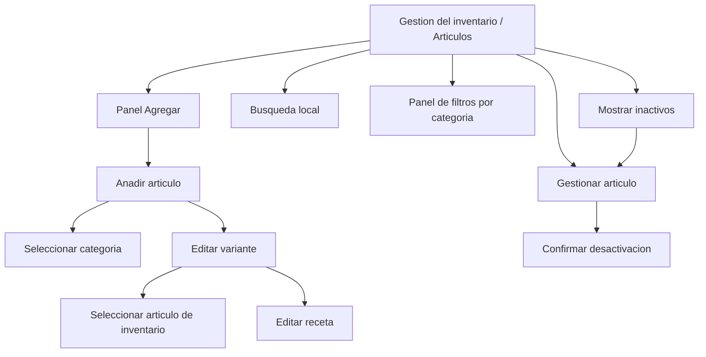
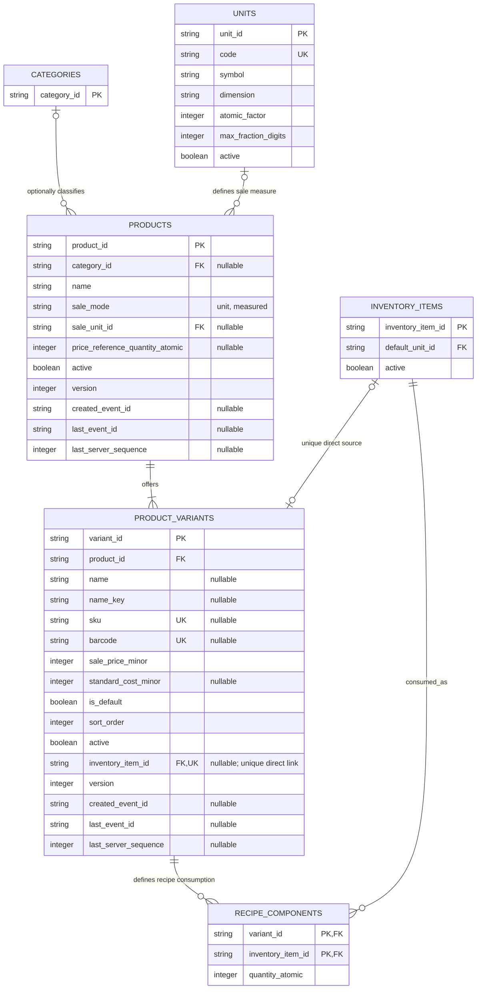
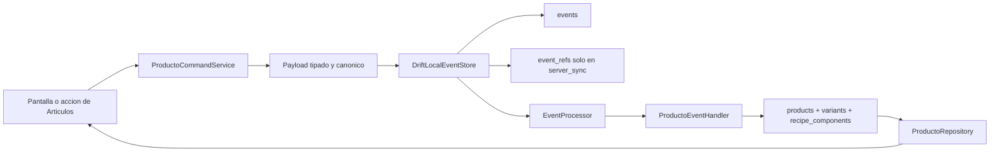
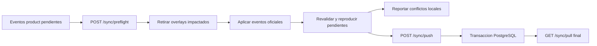

# Modulo Articulos

> [!IMPORTANT]
> El alcance vigente incorpora seguimiento directo según ADR-0014. Las recetas
> y el descuento automático por venta permanecen fuera de esta característica.
> El ER canónico es
> [[05 - Datos/Catalogo e inventario|Catálogo e inventario]].

Esta nota define el contrato funcional, visual y tecnico confirmado para
implementar Articulos en Flutter/Drift y NestJS/PostgreSQL. El alta sencilla,
sus proyecciones iniciales y el evento `producto_creado` ya tienen una
implementacion parcial con seguimiento directo opcional en la variante; el
listado, busqueda, filtros y el resto del contrato continuan siendo
prescriptivos hasta verificarse en codigo.

Las reglas transversales de eventos, modos, preflight, pull, push y conflictos
siguen viviendo en sus ADR y notas propias. Aqui se documenta como las aplica
este modulo.

## Clasificacion de decisiones

| Clasificacion | Significado en esta nota |
|---|---|
| Confirmado en codigo | Comportamiento que ya existe en Flutter o NestJS |
| Confirmado por material visual | Elemento visible en los adjuntos; no implica que deba copiarse |
| Confirmado por negocio | Decision confirmada por el usuario durante el analisis |
| Propuesta tecnica | Contrato recomendado para poder implementar y probar el modulo |
| Pendiente | Decision que pertenece a otro modulo o que todavia requiere cierre |
| Fuera de alcance | Capacidad que no debe implementarse como parte de esta especificacion |

## Fuentes de verdad revisadas

| Componente | Fuente |
|---|---|
| App movil, UI y SQLite | `/Users/benjamin/Projects/POS/pos_flutter` |
| API, PostgreSQL y conflictos | `/Users/benjamin/Library/CloudStorage/GoogleDrive-benjamin94833@gmail.com/My Drive/Projects/POS/pos-nest` |
| Referencia estructural | [[03 - Dominio/Modulos/Categorias|Modulo Categorias]] |
| Modelo relacionado | [[05 - Datos/Catalogo e inventario|Catalogo e inventario]] |
| Unidades y cantidades | [[03 - Dominio/Modulos/Unidades y cantidades|Unidades y cantidades]] |
| Patron de implementacion | [[04 - Sincronizacion/Patron para nuevas funcionalidades offline first|Patron para nuevas funcionalidades offline first]] |
| Modos | [[01 - Contexto/Modos de operacion|Modos de operacion]] |
| Inventario por movimientos | [[02 - Decisiones/ADR-0004 Inventario por movimientos|ADR-0004]] |
| Cantidades atomicas | [[02 - Decisiones/ADR-0012 Cantidades atomicas y unidades por dimension|ADR-0012]] |
| Costo estandar por variante | [[02 - Decisiones/ADR-0013 Costo estandar opcional por variante|ADR-0013]] |
| Seguimiento directo de existencias | [[02 - Decisiones/ADR-0014 Seguimiento directo de existencias por variante|ADR-0014]] |

Linea base revisada:

- Flutter: rama `main`, commit `dda8c91`, sin cambios locales al revisar el
  2026-08-06. Incluye alta sencilla, proyecciones Drift y aplicacion local de
  `producto_creado`; la pestana Articulos permanece vacia.
- NestJS: rama `main`, commit base `4c63b95`, con cambios locales preexistentes
  de sincronizacion, categorias y alta sencilla de producto. Esos cambios no
  deben descartarse ni atribuirse a una implementacion nueva del listado.
- Evidencia visual previa: un video de 51.54 segundos y cinco imagenes
  verticales recibidas el 2026-08-02.
- Evidencia visual de listado y filtros: video
  `/Users/benjamin/Downloads/Archivos-del-celular/Screenrecorder-2026-08-06-12-56-50-273.mp4`,
  de 15.55 segundos, 720 x 1640, revisado el 2026-08-06.
- Evidencia visual de seguimiento de existencias: video
  `/Users/benjamin/Downloads/Archivos-del-celular/Screenrecorder-2026-08-26-18-23-09-478.mp4`,
  revisado el 2026-08-26. Confirma captura de existencia inicial y opciones de
  stock.

## Estado funcional actual

| Capacidad | Flutter | NestJS | Estado de esta especificacion |
|---|---:|---:|---|
| Mostrar la pestana Articulos | Cascaron vacio | No aplica | Confirmado en codigo |
| Mostrar `Anadir articulo` | Implementado para alta sencilla | No aplica | Confirmado en codigo |
| Buscar articulos | Icono sin callback | No aplica | Confirmado en codigo |
| Consultar productos y variantes | Consultas por ID; sin listado reactivo | Proyecciones de alta en cambios locales | Listado especificado, pendiente de implementar |
| Crear y editar | Alta sencilla implementada; edicion no | Alta sencilla en cambios locales; edicion no | Implementacion parcial |
| Desactivar y reactivar | No | No | Especificado, pendiente de implementar |
| Reordenar variantes | No | No | Especificado, pendiente de implementar |
| SKU y codigo de barras | No | No | Especificado, pendiente de implementar |
| Venta unitaria o medida | No | No | Especificada como configuracion comun del producto |
| Costo estandar opcional | No | No | Confirmado por negocio; especificado, pendiente de implementar |
| Seguimiento directo de variante | Implementado en alta avanzada y proyección local | Implementado en payload, validación y proyección | Un recurso opcional y único por variante |
| Receta vigente por variante | No | No | Fuera del alcance vigente |
| Sync y conflictos | `producto_creado` integrado | Alta aplicada transaccionalmente | Edición pendiente |

## Proposito y alcance

Un articulo es la definicion comercial de algo vendible. El producto conserva
el nombre, la categoria opcional y la configuracion comun de venta; cada
variante representa una presentacion vendible con precio de venta, costo
estandar opcional, identificadores, orden y un vínculo opcional a un recurso de
inventario directo.

El modulo incluye:

- Consulta reactiva del catalogo local.
- Busqueda por nombre de producto, nombre de variante, SKU o codigo de barras.
- Alta atomica de producto y variante inicial.
- Edicion de nombre y categoria opcional.
- Alta y edicion de variantes.
- Seleccion de una variante predeterminada.
- Reordenamiento de variantes dentro de su producto.
- Desactivacion y reactivacion de productos y variantes.
- SKU y un codigo de barras opcionales por variante.
- Precio de venta obligatorio y costo estandar opcional, ambos enteros en
  unidad monetaria menor y pertenecientes a la variante.
- Modo de venta `unit` o `measured`, unidad y cantidad de referencia comunes a
  todas las variantes del producto.
- Seguimiento directo opcional por variante, con recurso, balance y movimiento
  inicial creados atómicamente.
- Registro local optimista mediante comandos y eventos.
- Sincronizacion, preflight, conflictos y restauracion en `server_sync`.
- Funcionamiento completamente local en `standalone`.

No incluye:

- Borrado fisico ordinario de productos o variantes. La excepcion futura para
  `Eliminar todos` desde una categoria se rige por
  [[03 - Dominio/Modulos/Eliminacion de categorias|Eliminacion de categorias]]
  y permanece bloqueada hasta especificar Ventas.
- Subcategorias o categorias padre.
- Orden manual de productos.
- Imagenes de articulo.
- Descripcion comercial.
- Contabilidad de costos, utilidad neta y reportes completos de rentabilidad;
  el modulo solo conserva el costo estandar de referencia.
- Impuestos, MRP/precio comparativo, vencimiento o lotes desde Articulos.
- Modificadores, etiquetas, espacios o favoritos.
- Edicion masiva.
- Tutoriales copiados de la aplicacion externa.
- Producción, alertas, reposición y políticas de bloqueo por stock.
- Recetas y consumo automático de ingredientes.
- Conteos, ajustes, entradas y mermas posteriores; pertenecen a Inventario.
- Definir que accion de Ventas o Comandas confirma operativamente una linea.
- Produccion de productos terminados desde ingredientes.
- Endpoints CRUD especiales; se usa el protocolo generico de sync.

## Terminologia del dominio

| Termino | Definicion |
|---|---|
| Articulo | Nombre de UI para el conjunto producto + variantes |
| Producto | Entidad comercial con nombre, categoria opcional, configuracion comun de venta y ciclo de vida |
| Variante | Presentacion vendible con precio de venta, costo estandar opcional, SKU/codigo y habilitacion/configuracion de consumo propios |
| Variante sencilla | Unica variante activa sin nombre visible |
| Variante predeterminada | Variante usada para resumir precio y seleccion inicial |
| Articulo de inventario | Recurso fisico cuyo saldo se calcula por movimientos |
| Modo de venta | Estrategia comun `unit` o `measured` usada por todas las variantes del producto |
| Unidad de venta | Unidad activa usada para capturar y presentar una venta medida |
| Cantidad de referencia | Cantidad atomica a la que corresponde el precio de cada variante medida |
| Precio de venta | Importe obligatorio de la variante usado para calcular lo cobrado al cliente |
| Costo estandar | Importe opcional vigente usado como referencia comercial; no sustituye el costo real de inventario |
| Estrategia de consumo | Estado derivado por variante: sin seguimiento, directo o receta; no se persiste como enum ni bandera |
| Existencia directa | Venta que descuenta un solo `inventory_item` vinculado directamente como maximo a una variante |
| Existencia comun | Escenario derivado, no un modo: varias configuraciones consumen el mismo `inventory_item` mediante recetas |
| Receta | Definicion actual de uno o mas recursos consumidos por una variante; puede contener un solo componente |
| Componente | Par `inventory_item_id` + `quantity_atomic` dentro de una receta |
| Dimension | Familia compatible de unidades: conteo, masa o volumen |
| Factor atomico | Numero entero de atomos que representa una unidad completa |
| Cantidad atomica | Entero normalizado al atomo de la dimension; no depende de `double` |
| Linea confirmada | Linea que Ventas/Comandas considera comprometida y que genera consumo |

`Product` y `ProductVariant` son nombres de dominio y persistencia; la UI usa
`Articulo` y `Variante`.

## Actores y permisos

La decision de negocio exige administracion por roles con permiso de catalogo.
Se confirman los permisos del primer alcance:

| Permiso | Capacidades |
|---|---|
| `catalog.articles.read` | Listar, buscar y consultar |
| `catalog.articles.manage` | Crear, editar, ordenar, configurar inventario, desactivar y reactivar |
| `inventory.items.read` | Seleccionar recursos para existencia directa o receta |

Reglas:

- Un usuario sin `catalog.articles.read` no puede abrir la administracion.
- Un usuario con lectura pero sin gestion ve formularios y controles mutables
  deshabilitados u ocultos.
- En offline se evalua el ultimo snapshot local de permisos.
- En `server_sync`, el servidor revalida el permiso al aceptar el evento.
- Una revocacion remota desconocida localmente puede producir `conflict` o
  `rejected` conforme a la politica transversal de seguridad.
- En `standalone`, el propietario o rol local configurado debe poseer ambos
  permisos de catalogo.

Cambiar estos identificadores exige una migracion coordinada del catalogo
general de autorizacion, clientes, servidor y pruebas.

## Inventario de evidencia visual

### Video `document_5150243585559365687.mp4`

| Tiempo | Hallazgo | Clasificacion |
|---|---|---|
| `00:00-00:01.5` | Lista y panel con `Anadir articulo`, categoria, modificador, ingrediente y edicion masiva | Confirmado visualmente |
| `00:02-00:05.5` | Alta sencilla con nombre, categoria, modo de venta, precio e imagen | Confirmado visualmente |
| `00:05.5-00:06` | Cambio a vista avanzada con tarjeta y alta de variante | Confirmado visualmente |
| `00:09.5-00:11.5` | Captura de nombre | Confirmado visualmente |
| `00:12-00:14` | Selector modal de categoria | Confirmado visualmente |
| `00:17-00:20.5` | Selector unidad/fraccion | Confirmado visualmente; fraccion queda fuera del alcance |
| `00:22.5-00:25` | Captura de precio | Confirmado visualmente |
| `00:31-00:38` | Editor de variante con precio, existencias y opciones avanzadas | Confirmado visualmente |
| `00:39.5-00:41` | Codigo de barras y vencimiento | Confirmado visualmente; vencimiento queda fuera |
| `00:42-00:50` | Impuesto, notas, modificadores, receta, espacios, etiquetas y MRP | Confirmado visualmente; solo receta entra al alcance |

El video no muestra guardado, errores, confirmacion de borrado, reordenamiento,
sync ni resultado de escaneo. Esos comportamientos no se atribuyen a la
referencia externa.

### Video `Screenrecorder-2026-08-06-12-56-50-273.mp4`

| Tiempo aproximado | Hallazgo | Clasificacion |
|---|---|---|
| `00:00-00:01.5` | Lista vertical de tarjetas con indicador circular, nombre, precio y opciones de variante; busqueda, filtros rapidos, filtro avanzado y dos acciones flotantes | Confirmado visualmente |
| `00:01.5-00:03` | Apertura de un panel superpuesto con cerrar, reiniciar y aplicar | Confirmado visualmente |
| `00:03-00:09` | Secciones de categorias, etiquetas y espacios; las categorias admiten seleccion multiple | Confirmado visualmente |
| `00:09-00:11.5` | Dos categorias permanecen seleccionadas antes de aplicar | Confirmado visualmente |
| `00:11.5-00:15.55` | El panel cierra y la lista visible cambia despues de aplicar | Confirmado visualmente |

El video confirma composicion y secuencia, pero no demuestra la semantica
exacta de busqueda, el calculo de inventario bajo, vencimiento, la accion de
los chips de variante ni el funcionamiento del escaner. Para este POS se
adoptan solo lista, busqueda local, filtro por categorias y una accion de alta.
Inventario bajo, vencimiento, etiquetas, espacios, imagenes y escaneo se
excluyen de este corte porque no cuentan con dominio o caso de uso implementado.

### Imagenes

| Archivo | Evidencia relevante |
|---|---|
| `photo_5125516540173290735_y.jpg` | Lista con productos, precio, variantes, busqueda, filtros y acciones flotantes |
| `photo_5125516540173290736_y.jpg` | Gestion de producto y tarjetas de variantes con posibles flechas de orden |
| `photo_5125516540173290737_y.jpg` | Editor avanzado y opcion de receta |
| `photo_5125516540173290738_y.jpg` | Modo sencillo con nombre, categoria y precio |
| `photo_5125516540173290739_y.jpg` | Continuacion del editor; parte de la imagen pertenece a una herramienta externa |

Las flechas se adoptan como control de orden por decision de negocio, no porque
el material demuestre su comportamiento. Marcas, iconografia y textos deben
adaptarse a Material y al lenguaje visual vigente del POS.

## Inventario de pantallas

| Pantalla o componente | Responsabilidad | Estado |
|---|---|---|
| Pestana Articulos | Lista, busqueda y acceso a gestion | Cascaron en codigo; contrato visual confirmado |
| Tarjeta de articulo | Resumir producto, categoria, precio y variantes activas | Contrato confirmado para implementar |
| Panel de filtros | Seleccion multiple de categorias y `Sin categoria` | Contrato confirmado para implementar |
| Busqueda de articulos | Filtrado local reactivo desde la barra superior | Contrato confirmado para implementar |
| Panel Agregar | Enlazar `Anadir articulo` con el formulario | Implementado para alta sencilla |
| Formulario de articulo | Nombre, categoria y variante sencilla inicial | Implementado parcialmente |
| Editor de variante | Precio de venta, costo estandar opcional, SKU, codigo, habilitacion y configuracion de inventario | Propuesta |
| Selector de categoria | Categoria opcional y `Sin categoria` | Propuesta; reutiliza Categorias |
| Selector de articulo de inventario | Elegir recurso activo compatible | Dependencia de Inventario |
| Editor de receta | Reemplazar componentes y cantidades | Propuesta |
| Confirmacion de desactivacion | Explicar efecto y confirmar | Propuesta |
| Vista de inactivos | Consultar y reactivar | Propuesta necesaria por ciclo de vida |

## Navegacion propuesta



Volver o cerrar un formulario con cambios sin guardar debe pedir confirmacion.
Guardar actualiza SQLite antes de cerrar y no espera respuesta del servidor.

## Estados visuales

| Estado | Comportamiento esperado |
|---|---|
| Carga inicial | Indicador centrado hasta la primera emision del repositorio |
| Vacio activo | Mensaje `No hay articulos.` y accion `Anadir articulo` si tiene permiso |
| Busqueda sin resultados | `No se encontraron articulos.` sin sustituir el catalogo |
| Error de lectura | `No se pudieron cargar los articulos.` y accion de reintento |
| Guardando localmente | Boton Guardar deshabilitado e indicador; se evita doble envio |
| Error al guardar | Formulario permanece abierto y muestra `No se pudo guardar el articulo.` |
| Sin permiso de gestion | Consulta disponible; controles mutables ausentes o deshabilitados |
| Producto inactivo | Etiqueta `Inactivo`; no aparece en la vista activa ni en nuevas ventas |
| Variante inactiva | Etiqueta `Inactiva`; no aparece en seleccion de nuevas ventas |
| Conflicto | La proyeccion optimista no aceptada se restaura; se muestra un aviso simplificado |
| Offline | No bloquea operaciones; no se presenta el cambio como aceptado por servidor |

No se requieren estados de carga remota dentro del formulario: la UI observa
SQLite y los selectores usan datos locales.

## Casos de uso

| ID | Caso | Actor | Resultado |
|---|---|---|---|
| `ART-UC-01` | Listar y buscar articulos | Usuario con lectura | Consulta reactiva desde SQLite |
| `ART-UC-02` | Crear articulo sencillo | Usuario con administracion | `producto_creado` con una variante sin nombre |
| `ART-UC-03` | Crear articulo con variantes | Usuario con administracion | `producto_creado` con variantes nombradas y ordenadas |
| `ART-UC-04` | Editar articulo y variantes | Usuario con administracion | Un `producto_actualizado` atomico o ningun evento si no hay cambios |
| `ART-UC-05` | Agregar una variante | Usuario con administracion | Variante activa agregada al final mediante `producto_actualizado` |
| `ART-UC-06` | Reordenar variantes | Usuario con administracion | `variante_movida` intercambia dos posiciones adyacentes |
| `ART-UC-07` | Desactivar o reactivar producto | Usuario con administracion | Evento de ciclo sin borrado fisico |
| `ART-UC-08` | Desactivar o reactivar variante | Usuario con administracion | Evento de ciclo que conserva orden e identificadores |
| `ART-UC-09` | Habilitar consumo directo | Usuario con administracion y lectura de inventario | La variante obtiene el unico vinculo directo del recurso y configura una cantidad atomica |
| `ART-UC-10` | Habilitar consumo por receta | Usuario con administracion y lectura de inventario | La variante usa una receta actual no vacia, incluso de un solo componente compartido |
| `ART-UC-11` | Consultar y corregir inactivos | Usuario con administracion | Edicion permitida antes de reactivar |
| `ART-UC-12` | Resolver conflicto | Usuario con administracion | Conserva servidor o genera un comando nuevo |

### `ART-UC-01`: listar y buscar

Precondicion: el usuario tiene `catalog.articles.read`.

Flujo:

1. La pestana se suscribe al repositorio de la instalacion local.
2. La vista activa muestra solo productos activos y sus variantes activas.
3. Los productos se ordenan por nombre y UUID como desempate.
4. Las variantes se ordenan por `sort_order`; filtrar inactivas no crea una
   segunda secuencia.
5. La busqueda compara nombre de producto, nombre de variante, SKU canonico y
   codigo de barras.
6. El filtro de categorias admite varios IDs y `Sin categoria`; varios valores
   se combinan con OR y el resultado se combina con la busqueda mediante AND.
7. La vista administrativa puede incluir productos y variantes inactivos.
8. Una alta local confirmada aparece por la nueva emision del repositorio sin
   refresco manual ni espera del servidor.

No se consulta el servidor para dibujar la lista. Los estados vacio, error y
sin resultados son diferentes y conservan las acciones permitidas por el rol.

### `ART-UC-02` y `ART-UC-03`: crear

Flujo sencillo:

1. El usuario captura nombre, categoria opcional y precio de venta; puede
   capturar ademas el costo estandar de referencia.
2. El formulario crea una variante sin nombre, activa, predeterminada y con
   `sort_order = 0`.
3. El producto usa `sale_mode = unit` por defecto; unidad y cantidad de
   referencia inician nulas.
4. Si el usuario elige venta medida, selecciona una unidad activa y captura la
   cantidad de referencia en esa unidad. El command service la convierte a un
   entero atomico positivo comun a todas las variantes.
5. La variante inicia sin vínculo directo ni componentes.
6. Si el usuario configura inventario, elige para esa variante existencia
   directa o consumo por receta y captura la configuracion requerida.
7. Guardar valida y genera un solo `producto_creado`.
8. Evento y proyecciones se aplican atomicamente en SQLite.
9. La pantalla cierra despues del commit local; no espera al servidor.

Flujo con variantes:

1. Al agregar una segunda variante, todas las variantes deben tener nombre.
2. Cada variante captura precio de venta, costo estandar opcional,
   identificadores opcionales y decide de forma independiente si no da
   seguimiento, usa existencia directa o receta.
3. Exactamente una se marca predeterminada.
4. El orden inicial debe ser consecutivo desde cero.
5. Guardar genera un solo evento con el agregado completo.

Alternativas:

- `category_id = null` guarda `Sin categoria` sin crear una categoria ficticia.
- Un SKU, codigo o nombre de variante repetido impide el commit local.
- Seleccionar receta sin componentes impide guardar; configurar vínculo directo
  y componentes a la vez también.
- Cerrar con cambios sin guardar pide confirmacion y no crea evento.

### `ART-UC-04` y `ART-UC-05`: editar

1. El formulario carga producto, todas sus variantes y configuraciones
   actuales, incluidas las inactivas cuando se administra el catalogo.
2. El usuario puede cambiar datos del producto, agregar variantes, editar
   variantes existentes y cambiar la predeterminada.
3. La configuracion de venta cambia como un bloque y solo cuando no existen
   lineas abiertas o provisionales de ninguna variante del producto.
4. La estrategia de inventario puede cambiar por variante dentro de una sola
   configuracion atomica; nunca existe un estado intermedio directo + receta.
5. Habilitar, deshabilitar o editar consumo inserta, reemplaza o retira los
   componentes dentro del mismo commit.
6. El command service calcula diferencias y captura bases de cada entidad
   afectada.
7. Sin diferencias normalizadas, Guardar cierra o informa que no hay cambios y
   no crea evento.
8. Con diferencias, un solo `producto_actualizado` acepta o revierte todo el
   change-set.

Producto y variantes inactivos pueden editarse con
`catalog.articles.manage`; editarlos no los reactiva automaticamente.

### `ART-UC-06`: reordenar

1. La vista administrativa carga la secuencia completa, incluidas inactivas.
2. Arriba esta deshabilitado para `sort_order = 0`; abajo para la ultima
   posicion.
3. Una accion valida captura bases y posiciones de la variante movida y la
   desplazada.
4. `variante_movida` intercambia exactamente esas dos posiciones.
5. Un limite no crea evento; una base obsoleta entra en conflicto.

No existe reordenamiento manual de productos ni una secuencia separada para
variantes activas.

### `ART-UC-07`, `ART-UC-08` y `ART-UC-11`: ciclo de vida

- La accion visible se llama `Desactivar`, no `Borrar`.
- Desactivar un producto conserva variantes, recetas, claves y orden.
- Reactivar un producto exige al menos una variante activa y exactamente una
  predeterminada activa.
- Desactivar la variante predeterminada de un producto activo exige elegir
  otra activa en la misma transaccion.
- La ultima variante activa de un producto activo no puede desactivarse.
- Una variante inactiva conserva y reserva SKU y codigo.
- Desactivar o reactivar una variante conserva `sort_order`.
- La vista de inactivos permite corregir antes de reactivar.

La confirmacion debe indicar que el registro dejara de estar disponible para
nuevas operaciones, sin afirmar efectos retroactivos sobre ventas abiertas.

### `ART-UC-09` y `ART-UC-10`: configuracion de inventario

Sin vínculo directo ni componentes, el editor representa “sin seguimiento”.

Para una variante con configuracion directa:

1. Selecciona un `inventory_item` activo disponible localmente que no tenga
   vinculo directo con otra variante. El recurso puede participar en recetas.
2. No permite receta simultánea. El consumo directo futuro corresponde a una
   unidad vendida en `unit` o a la referencia del producto en `measured`; no se
   persiste una cantidad directa adicional.

Para una variante con configuracion por receta:

1. Agrega uno o mas `inventory_items` activos disponibles localmente.
2. Captura una cantidad decimal positiva por recurso en su unidad
   predeterminada o en otra unidad activa de la misma dimension.
3. Convierte cada entrada a cantidad atomica antes de crear el evento.
4. Consolida o rechaza recursos repetidos.
5. Guarda la receta completa; no parches independientes por componente.
6. Permite una receta de un solo componente y permite elegir un recurso que ya
   tenga una variante directa; esa reutilizacion no ocupa otro vinculo directo.

La existencia comun no aparece como una opcion distinta. Para que varias
variantes repercutan el mismo saldo, cada una referencia el recurso compartido
mediante uno de sus componentes, aunque sea el unico. Otra variante puede
vender directamente ese recurso y ambos usos afectan el mismo saldo fisico.

En productos `unit`, esas cantidades representan consumo por una unidad
vendida. En productos `measured`, representan consumo por
`price_reference_quantity_atomic`; una venta parcial aplica la proporcion y
redondea una sola vez al atomo de cada recurso.

Articulos configura el consumo, pero no crea saldos ni movimientos. Ventas e
Inventario son responsables de capturar la definicion usada y descontarla al
confirmar operativamente una linea.

Ventas siempre conserva un `sale_item` relacionado con la variante, incluso si
esta no habilita inventario. Ese registro permite contar unidades vendidas o
servicios prestados; no se crean `inventory_movements` de cantidad cero ni sin
`inventory_item` para representar actividad comercial.

### `ART-UC-12`: resolver conflicto

1. La app retira la proyeccion optimista no aceptada sin borrar el evento.
2. El usuario ve un mensaje funcional y puede abrir el detalle si tiene
   `catalog.articles.manage`.
3. La vista compara estado oficial y propuesta local.
4. `Conservar servidor` no crea mutacion de catalogo.
5. `Editar` o `Volver a aplicar` construye un comando nuevo sobre las bases
   oficiales; nunca edita el evento conflictivo.

## Comportamiento visual y de formularios

### Lista de articulos: contrato cerrado para implementacion

Este corte adopta del video la jerarquia de lista, el resumen por tarjeta, la
busqueda, la seleccion multiple de categorias y la aplicacion explicita de
filtros. La composicion se adapta al dominio existente y no replica funciones
sin respaldo.

#### Adopcion y descarte de elementos de la referencia

| Elemento de la referencia | Decision para este POS | Motivo |
|---|---|---|
| Lista vertical de tarjetas | Adoptar | Permite escaneo visual rapido del catalogo |
| Nombre y precio principal | Adoptar | Existen en producto y variante predeterminada |
| Opciones de variante | Adoptar cuando existan variantes nombradas | La fase actual solo crea una variante sencilla sin nombre |
| Indicador circular con imagen | Adaptar a icono y color de categoria | Articulos no maneja imagenes |
| Busqueda superior | Adoptar | Opera sobre SQLite local |
| Chip `Todos` | Adoptar | Restablece solo filtros de categoria |
| `Inventario bajo` | Posponer | Requiere saldo y politica de inventario confirmados |
| `Expirado` | Excluir de Articulos | Pertenece a lotes y vencimiento |
| Panel de categorias | Adoptar | Producto ya tiene categoria opcional |
| Etiquetas y espacios | Excluir | No pertenecen al dominio confirmado |
| Boton de escaneo flotante | Excluir de este corte | No existe caso de uso ni resultado de escaneo definido |
| Boton flotante de alta | Conservar | Ya abre el panel de acciones existente |

No deben mostrarse controles deshabilitados o simulados para las capacidades
pospuestas. Su incorporacion futura requiere dominio, datos, comportamiento,
errores y pruebas propios.

#### Fuente de datos y modelo de lectura

La pantalla observa una consulta reactiva de Drift. No llama al servidor, no
lee `events` para componer tarjetas y no espera el estado de entrega de un
evento. Pull, replay o un comando local actualizan las proyecciones y provocan
una nueva emision del mismo repositorio.

El modelo de presentacion recomendado es independiente de las filas Drift:

```text
ArticuloListado
  productId
  nombre
  activo
  categoriaId?
  categoriaNombre?
  categoriaColorKey?
  variantePredeterminadaId
  precioPredeterminadoMenor
  variantesActivas: List<VarianteListado>

VarianteListado
  variantId
  nombre?
  precioVentaMenor
  predeterminada
  orden
```

Reglas de lectura:

- La vista inicial incluye `products.active = true` y
  `product_variants.active = true`.
- El producto debe tener una variante activa predeterminada; una proyeccion
  invalida produce error de lectura y no una tarjeta con precio inventado.
- Productos se ordenan por nombre y `product_id` como desempate estable.
- Variantes se ordenan por `sort_order`, nombre e ID.
- Categoria se resuelve con join opcional; `category_id = null` se presenta
  como `Sin categoria` solo donde aporte contexto.
- La consulta o agregacion debe evitar N+1: no se ejecuta una consulta de
  variantes o categorias por cada tarjeta.
- El listado no carga recetas, componentes, saldos, movimientos ni lotes.
- La primera implementacion consume el esquema sencillo actual. No agrega
  nombre de variante, SKU, codigo de barras o migraciones avanzadas solo para
  dibujar la lista.

#### Composicion de la tarjeta

Cada tarjeta activa contiene, en este orden visual:

1. Indicador circular con el color de la categoria y un icono Material de
   articulo. Sin categoria usa el color neutral. El color nunca es la unica
   forma de comunicar informacion.
2. Nombre del producto como texto principal.
3. Nombre de categoria como texto secundario cuando no sea nula.
4. Precio formateado de la variante activa predeterminada.
5. Variantes activas nombradas, cuando existan, mediante chips informativos en
   `sort_order`. Cada chip muestra nombre y precio.

Una variante sencilla con `name = null` no genera un chip redundante. Si hay
varias variantes activas, el precio principal sigue siendo el de la
predeterminada. Los chips no cambian el precio principal ni seleccionan una
variante en este corte.

El objetivo final es que tocar la tarjeta abra `Gestionar articulo`. Mientras
el comando y la pantalla de edicion no existan, la primera entrega del listado
debe presentar la tarjeta sin una accion vacia o engañosa. La navegacion se
habilita junto con la edicion real, no mediante un callback sin efecto.

#### Busqueda local

- El icono de busqueda de la barra superior abre un campo con foco.
- La lista se filtra mientras el usuario escribe, con un debounce recomendado
  de 200 ms para evitar recomposiciones innecesarias.
- La `X` del campo limpia el texto de inmediato; cerrar la busqueda restaura el
  titulo y conserva los filtros de categoria aplicados.
- Texto y categorias se combinan mediante AND.
- La busqueda completa usa coincidencia parcial normalizada por nombre de
  producto y variante, prefijo o coincidencia exacta para SKU canonico y
  coincidencia exacta para codigo de barras.
- Mientras el esquema solo tenga alta sencilla, la busqueda efectiva se limita
  al nombre del producto. No se crean columnas ficticias; el repositorio se
  amplia al implementar los campos restantes.
- Una cadena vacia equivale a no aplicar filtro de texto.
- No se requiere FTS en el primer alcance.

El estado de busqueda pertenece a la pestana Articulos, sobrevive a nuevas
emisiones de Drift y a un cambio temporal de pestana dentro de Gestion del
inventario. Se descarta al abandonar esa pantalla.

#### Barra y panel de filtros

La primera entrega muestra el chip `Todos` y el boton de filtro avanzado. No
muestra `Inventario bajo` ni `Expirado`.

- `Todos` esta seleccionado cuando no hay categorias aplicadas.
- Tocar `Todos` elimina categorias aplicadas, pero conserva el texto de
  busqueda.
- El boton de filtro abre un modal Material desplazable y respetuoso de
  `SafeArea`.
- El boton muestra un indicador y el numero de criterios aplicados cuando el
  conjunto no esta vacio; no depende solo de un cambio de color.

El panel contiene:

- Titulo `Filtrar articulos`.
- Accion accesible `Cerrar`.
- Seccion `Categorias` con chips ordenados por `sort_order`, nombre e ID.
- Opcion independiente `Sin categoria`.
- Accion `Restablecer`.
- Accion primaria `Aplicar`.

Estado del filtro:

```text
FiltroArticulos
  categoryIds: Set<String>
  includeUncategorized: bool
```

Semantica:

- Varias categorias seleccionadas se combinan con OR.
- `Sin categoria` participa como otra alternativa OR.
- Con `categoryIds` vacio e `includeUncategorized = false` no se filtra por
  categoria.
- Al abrir, el modal copia el filtro aplicado a un borrador.
- Seleccionar o retirar chips modifica solo el borrador.
- `Cerrar`, gesto de descarte y boton del sistema cierran sin aplicar el
  borrador.
- `Restablecer` vacia el borrador y mantiene abierto el panel.
- `Aplicar` reemplaza el filtro aplicado por el borrador y cierra el panel.
- Si no existen categorias locales, el panel informa `No hay categorias.` y
  conserva la opcion `Sin categoria`.
- Cada chip seleccionado incluye estado semantico y marca visible; el color no
  es el unico indicador.

#### Estados de la lista

| Estado | Presentacion y acciones |
|---|---|
| Primera emision pendiente | Indicador centrado |
| Catalogo activo vacio, sin busqueda ni filtro | `No hay articulos.` y `Anadir articulo` si puede gestionar |
| Busqueda o filtro sin coincidencias | `No se encontraron articulos.` y acciones para limpiar busqueda/filtros |
| Error del stream o proyeccion invalida | `No se pudieron cargar los articulos.` y `Reintentar` |
| Datos disponibles | Lista desplazable y reactiva |
| Alta local confirmada | La nueva tarjeta aparece por la emision de SQLite, sin refresco manual |
| Sin permiso de gestion | Lista visible con permiso de lectura; alta y mutaciones ocultas o deshabilitadas |
| Offline | Mismo contenido local; no se muestra un bloqueo remoto |

Busqueda sin resultados y catalogo vacio son estados distintos. Limpiar un
filtro no modifica datos persistidos ni genera eventos.

#### Acciones, permisos y accesibilidad

- `Anadir articulo` solo esta disponible con `catalog.articles.manage`.
- Listar, buscar y filtrar requieren `catalog.articles.read`.
- Precio, nombre, categoria, botones, chips y estados tienen etiquetas
  semanticas compatibles con lector de pantalla.
- Los objetivos tactiles respetan el minimo recomendado por Material.
- Los textos no dependen de mayusculas de la referencia externa y siguen el
  lenguaje visual actual del POS.
- La lista debe funcionar con escalado de texto sin cortar nombre o precio; las
  variantes pueden envolver o desplazarse horizontalmente sin desbordar.

#### Limite de la primera entrega de listado

Incluye:

- Repositorio y stream reactivo de productos activos.
- Join/agregacion de categoria y variante sencilla predeterminada.
- Tarjeta sin imagen.
- Busqueda por nombre de producto.
- Filtro multiple por categoria y `Sin categoria`.
- Chip `Todos`, estados visuales, permisos disponibles y actualizacion despues
  del alta local.

No incluye:

- Edicion desde la tarjeta hasta que exista el comando correspondiente.
- Variantes nombradas, SKU y codigo si requieren ampliar el esquema actual.
- Inventario bajo, vencimiento, etiquetas, espacios, imagenes o escaneo.
- Consultas remotas, endpoints CRUD o cambios al protocolo de sync.

#### Archivos y responsabilidades recomendados para la primera entrega

```text
lib/domain/articulos/articulo_listado.dart
lib/domain/repositories/producto_repository.dart
lib/data/local/drift/daos/producto_dao.dart
lib/data/repositories/producto_repository_impl.dart
lib/presentation/pages/gestion_inventario/articulos/inventory_articles_tab.dart
lib/presentation/pages/gestion_inventario/articulos/widgets/inventory_article_card.dart
lib/presentation/pages/gestion_inventario/articulos/widgets/article_filters_bottom_sheet.dart
lib/presentation/pages/gestion_inventario/articulos/models/filtro_articulos.dart
lib/presentation/pages/gestion_inventario/inventory_management_screen.dart
lib/core/di/injection.dart
```

Los nombres pueden adaptarse a las convenciones reales del repositorio, pero
las responsabilidades deben permanecer separadas. Widgets no consultan Drift
directamente y el repositorio de lectura no crea comandos ni eventos.

#### Orden recomendado de implementacion

1. Definir el modelo de lectura y el contrato del repositorio.
2. Implementar y probar la consulta reactiva sin N+1.
3. Registrar el repositorio en DI sin alterar command services existentes.
4. Implementar tarjeta, estados y lista.
5. Conectar busqueda en la barra superior.
6. Implementar borrador/aplicacion del filtro de categorias.
7. Sustituir el cascaron vacio de Articulos.
8. Verificar actualizacion despues del alta y ambos modos de operacion.

#### Criterios de aceptacion especificos del listado

| ID | Criterio verificable |
|---|---|
| `ART-LST-AC-001` | La pestana observa SQLite y no realiza llamadas de red para cargar, buscar o filtrar. |
| `ART-LST-AC-002` | Solo se listan productos y variantes activas, ordenados de forma estable. |
| `ART-LST-AC-003` | Cada tarjeta muestra icono/color, nombre, categoria opcional y precio de la predeterminada sin cargar recetas o saldos. |
| `ART-LST-AC-004` | La variante sencilla sin nombre no produce un chip; variantes nombradas futuras se ordenan por `sort_order`. |
| `ART-LST-AC-005` | La busqueda actual encuentra por nombre de producto, reacciona mientras se escribe y una cadena vacia no filtra. |
| `ART-LST-AC-006` | Texto y categorias se combinan con AND; varias categorias y `Sin categoria` se combinan con OR. |
| `ART-LST-AC-007` | Cerrar el panel descarta el borrador, Restablecer lo vacia sin cerrar y Aplicar lo confirma antes de cerrar. |
| `ART-LST-AC-008` | `Todos` elimina categorias aplicadas y conserva la busqueda. |
| `ART-LST-AC-009` | El boton de filtro comunica de forma visual y semantica cuantos criterios estan aplicados. |
| `ART-LST-AC-010` | Catalogo vacio, sin coincidencias, carga y error tienen mensajes y acciones distintos. |
| `ART-LST-AC-011` | Un alta local aparece automaticamente por el stream despues del commit SQLite. |
| `ART-LST-AC-012` | No aparecen inventario bajo, expirado, etiquetas, espacios, imagenes ni escaneo. |
| `ART-LST-AC-013` | La consulta agrupa productos, categorias y variantes sin una consulta adicional por tarjeta. |
| `ART-LST-AC-014` | En `standalone` la pantalla no inicia health, preflight, push, pull ni WebSocket. |
| `ART-LST-AC-015` | La tarjeta no anuncia una accion de edicion mientras esa navegacion no exista realmente. |
| `ART-LST-AC-016` | La UI conserva permisos y reglas offline-first existentes sin escribir tablas Drift directamente. |

### Formulario de articulo

- `Nombre del articulo` y `Precio de venta` muestran su obligatoriedad; `Costo`
  se presenta como opcional.
- Categoria admite `Sin categoria` y reutiliza el selector de Categorias.
- El modo sencillo es una presentacion del mismo modelo, no otro esquema.
- Agregar la segunda variante exige nombrar la primera antes de guardar.
- La predeterminada se selecciona explicitamente cuando hay varias.
- Guardar se deshabilita durante el commit local para evitar doble envio.
- Los errores de campo se muestran junto al control; un error transaccional se
  muestra a nivel formulario y conserva la captura.
- El estado de sync no bloquea ni cambia el contenido editable.

### Campos de entrada

| Campo | Control recomendado | Valor permitido | Validacion visible |
|---|---|---|---|
| Nombre de producto | Texto | Unicode NFKC, 1..160 despues de `trim` | Obligatorio y longitud |
| Categoria | Selector | UUID existente o `null` | Categoria disponible localmente |
| Modo de venta | Selector de producto | `unit`, `measured`; inicia `unit` | Una opcion obligatoria |
| Unidad de venta | Selector local | `unit_id` activo o `null` | Obligatoria solo en `measured`; define captura/presentacion |
| Cantidad de referencia | Entrada decimal exacta | Positiva en la unidad seleccionada o `null` | Se convierte a entero atomico; obligatoria solo en `measured` |
| Nombre de variante | Texto | `null` solo en variante sencilla; en otro caso 1..160 | Obligatorio al existir varias activas |
| Precio de venta | Entrada monetaria | Entero menor positivo, `1..9007199254740991` | Obligatorio y mayor que cero |
| Costo estandar | Entrada monetaria | `null` o entero `0..9007199254740991` | Opcional; cero es un costo conocido, vacio es desconocido |
| SKU | Texto | NFKC, mayusculas, 1..80 o `null` | Unico en el catalogo actual |
| Codigo de barras | Texto/escaneo | NFKC, 1..128 o `null`; se conserva como texto | Unico en el catalogo actual |
| Predeterminada | Radio/seleccion unica | Exactamente una activa por producto activo | Impide cero o multiples |
| Seguimiento de inventario | Selector de variante | Sin seguimiento, directo o receta; inicia sin seguimiento | Se deriva de la forma correspondiente |
| Recurso directo | Selector local | `inventory_item_id` activo sin vinculo directo con otra variante; puede usarse en recetas | Obligatorio solo en configuracion directa |
| Componentes | Lista editable | Uno o mas recursos distintos | Obligatoria solo en configuracion por receta |
| Cantidad de componente | Entrada decimal + selector compatible | Cantidad positiva convertida a atomos | Sin cero, negativos ni precision no representable |

`name_key`, versiones, IDs de evento, secuencias, estados
de entrega y campos de trazabilidad nunca son controles editables.

Los campos decimales de cantidad mantienen texto durante la edicion. Aceptan
el separador regional en UI, lo normalizan y convierten exactamente antes del
comando; nunca pasan primero por `double`. El selector de una cantidad de
inventario solo ofrece unidades activas de la misma dimension que el recurso.

El precio de venta es el unico dato de negocio que el usuario debe proporcionar
para toda variante. El costo estandar, nombre, SKU, codigo y configuracion de
inventario son opcionales o condicionales. La configuracion de venta se captura
una vez en el producto.
`is_default`, `sort_order`, `active`, versión y
trazabilidad siguen siendo valores estructurales no nulos asignados o validados
por el sistema.

### Orden de validacion al guardar

1. Permiso del contexto local.
2. Forma, longitudes, enums y rangos.
3. Invariantes internas de producto/variantes/receta.
4. Unicidad contra la proyeccion local.
5. Existencia y estado de categoria, unidad y recursos dependientes.
6. Bases de concurrencia y cadena de eventos locales.
7. Commit transaccional de evento, referencias segun modo y proyecciones.

## Etapa 3: modelo de datos

Esta seccion cierra el modelo recomendado para implementar las proyecciones de
Articulos. Los eventos que las producen se definen en la Etapa 4 de esta misma
nota.

### Criterios de diseno

- `products` conserva datos comunes del articulo y la configuracion comun de
  venta.
- `product_variants` conserva todo lo que puede cambiar por presentacion:
  precio de venta, costo estandar, SKU, codigo, orden, estado y configuración
  concreta de inventario.
- Los saldos existen solo en `inventory_items` y sus proyecciones de
  inventario; no se agrega stock a producto ni variante.
- La configuracion directa referencia un solo recurso por variante y cada
  `inventory_item` admite como maximo un vinculo directo.
- La configuración por receta usa uno o más componentes relacionados
  directamente con cada variante; una receta de un componente es válida.
- Un recurso con vinculo directo puede participar ademas en cualquier numero
  de recetas. Articulos no lo posee: su identidad, saldo y ciclo de vida
  permanecen bajo Inventario.
- La estrategia se deriva de la forma persistida por variante; no se agrega
  `inventory_mode`, `has_recipe` ni otro discriminador redundante.
- La receta no es una proyeccion independiente ni conserva versiones propias.
  La concurrencia de los componentes vive en la variante.
- El historial completo permanece en eventos; las tablas aqui descritas son
  proyecciones de estado actual.
- No se agregan campos para capacidades fuera del alcance.

## Evaluacion de la propuesta recibida

| Elemento | Propuesta recibida | Recomendacion | Motivo | Estado |
|---|---|---|---|---|
| Jerarquia de categorias | `parent_category_id` y autorrelacion | Retirar | Categorias es plana por decision confirmada y codigo existente | Confirmado |
| Relacion producto-categoria | Categoria obligatoria | `category_id` nulable | El negocio confirmo `Sin categoria` | Confirmado |
| Nombre de producto | Obligatorio | Mantener, maximo 160, no unico | Identifica visualmente pero SKU/codigo resuelven claves comerciales | Propuesta tecnica cerrada |
| Descripcion | `description` nulable | Retirar | Fuera del primer alcance | Confirmado |
| Ciclo del producto | Sin campo funcional | Agregar `active` | Desactivar/reactivar esta confirmado | Confirmado |
| Variantes | Una o mas por producto | Mantener | Modelo elegido para modo sencillo y presentaciones | Confirmado |
| Nombre de variante | Siempre obligatorio | Nulable solo para la unica variante sencilla | El modo sencillo no muestra nombre de variante | Confirmado |
| Unidad/presentacion | `presentation_unit_id` y cantidad decimal | Reemplazar por configuracion comun `sale_mode`, `sale_unit_id` y cantidad de referencia atomica en producto | Todas las variantes comparten forma de venta y la base persiste enteros atomicos | Confirmado |
| Precio | `sale_price_minor` | Mantener como entero positivo | Evita `double` monetario y pertenece a la variante | Confirmado |
| Costo | `standard_cost_minor` | Mantener nulable y no negativo | Separa el costo comercial de referencia del costo real de movimientos de inventario | Confirmado por negocio; pendiente de implementar |
| Variante predeterminada | `is_default` | Mantener | Exactamente una activa por producto activo | Confirmado |
| Orden | `sort_order` | Mantener por producto | Solo se ordenan variantes | Confirmado |
| Ciclo de variante | Sin campo funcional | Agregar `active` | Desactivacion independiente confirmada | Confirmado |
| SKU/codigo | Unicos y nulables | Mantener, normalizados, reservados aun inactivos y unicos en el catalogo actual | Evita colisiones dentro de la instalacion actual | Confirmado |
| Stock en variante | Implicito en existencias visibles | No agregar saldo | Los saldos pertenecen a `inventory_items` | Confirmado |
| Estrategia de inventario | No estaba modelada explicitamente | Derivarla de `inventory_item_id` y la existencia excluyente de componentes | Un producto puede mezclar variantes directas, por receta y sin seguimiento sin duplicar estado | Confirmado |
| Discriminador persistido | Se consideró una bandera | No agregar bandera ni modo | La ausencia de vínculo y componentes expresa sin seguimiento | Confirmado |
| Existencia comun | Relacion directa compartida por variantes | Modelar como recetas de uno o mas componentes; reservar el vinculo directo a una sola variante por recurso | Una receta singleton produce el mismo consumo y evita un tercer modo | Confirmado |
| Recurso directo usado como insumo | No cerrado | Permitirlo sin limite de recetas | Un recurso fisico puede venderse directamente y consumirse como ingrediente sin duplicar saldos | Confirmado |
| Recetas | Multiples versiones, estado y vigencia | No crear tabla `recipes`; la variante se relaciona directamente con sus componentes actuales | No se aprobo identidad, metadata ni historial propios para la receta | Confirmado |
| Identidad de receta | `recipe_id` independiente | No existe | Una variante habilitada con uno o mas componentes expresa la configuracion actual | Confirmado |
| Componentes | UUID por fila y notas | PK compuesta por variante/recurso y cantidad | No tienen ciclo independiente ni notas en el alcance | Confirmado |
| `inventory_items` | Tabla incluida en la propuesta | Referencia externa, no propiedad de Articulos | Inventario define unidad y saldo | Confirmado |
| Balances | Incluidos | Fuera de la implementacion de Articulos | Pertenecen a Inventario | Confirmado |
| Alertas/reposicion/politicas configurables | Incluidos | Retirar del esquema actual | No existen flujos ni reglas por recurso confirmados; solo podran volver mediante un analisis futuro | Confirmado |
| Lotes/vencimiento | Incluidos | Retirar del esquema actual | No se requiere trazabilidad por partida; solo podran volver mediante un analisis futuro | Confirmado |
| Ventas y movimientos | Incluidos | Solo documentar contrato de dependencia | Pertenecen a Ventas e Inventario | Confirmado |
| Evidencia de receta en `sale_items` | FK a una version | No usar `recipe_id`; capturar la definicion consumida | Los componentes son mutables y la venta debe conservar los realmente usados | Recomendacion |

La propuesta no se reemplaza silenciosamente: el diagrama recomendado elimina
jerarquia, descripcion y la tabla e identidad independiente de receta; conserva
el costo como `standard_cost_minor` nullable y agrega ciclo funcional,
categoria opcional, configuracion comun de venta y configuracion de inventario
individual por variante.

Por ahora SQLite y PostgreSQL representan un unico catalogo logico por base de
datos.

## Modelo de dominio persistente

### `Product`

| Campo | Tipo de dominio | Regla |
|---|---|---|
| `id` | UUID v4 | Generado en el dispositivo y estable |
| `name` | `ProductName` | `trim`, 1..160 caracteres |
| `categoryId` | UUID nulable | `null` representa `Sin categoria` |
| `saleMode` | enum | `unit` o `measured`; inicia `unit` |
| `saleUnitId` | UUID nulable | Unidad activa de captura/presentacion; obligatoria solo en `measured` |
| `priceReferenceQuantityAtomic` | entero 64 nulable | Referencia atomica positiva de la misma dimension; solo en `measured` |
| `active` | booleano | Ciclo funcional; inicia `true` |
| `version` | entero | Inicia en 1 y aumenta por mutacion aplicada |
| `createdEventId` | UUID nulable | Evento creador o metadata de snapshot |
| `lastEventId` | UUID nulable | Ultimo evento aplicado |
| `lastServerSequence` | entero 64 nulable | Ultima secuencia oficial conocida |

Los nombres de producto pueden repetirse. La identidad es `product_id`.

### `ProductVariant`

| Campo | Tipo de dominio | Regla |
|---|---|---|
| `id` | UUID v4 | Generado en dispositivo |
| `productId` | UUID | Producto propietario |
| `name` | `VariantName?` | Nulo solo para variante sencilla; 1..160 cuando existe |
| `nameKey` | texto nulable derivado | Clave canonica, hasta 320 caracteres, para distinguir variantes |
| `sku` | texto nulable | Canonico, 1..80, unico cuando existe |
| `barcode` | texto nulable | Canonico, 1..128, unico cuando existe |
| `salePriceMinor` | entero 64 | Mayor que cero |
| `standardCostMinor` | entero 64 nulable | `null` o mayor o igual que cero; costo estandar vigente |
| `isDefault` | booleano | Como maximo una variante activa predeterminada |
| `sortOrder` | entero | `0..n-1` dentro del producto |
| `active` | booleano | Inicia `true` |
| `inventoryEnabled` | booleano | Inicia `false`; decide si la venta afecta inventario |
| `directInventoryItemId` | UUID nulable | Obligatorio en configuracion directa; unico entre variantes cuando existe |
| `directQuantityAtomic` | entero 64 nulable | Consumo por unidad `unit` o por referencia `measured`; positivo en configuracion directa |
| `version` | entero | Inicia en 1 |
| `createdEventId` | UUID nulable | Trazabilidad |
| `lastEventId` | UUID nulable | Trazabilidad e idempotencia |
| `lastServerSequence` | entero 64 nulable | Ultima secuencia oficial aplicada |

`nameKey` es un campo calculable que se persiste deliberadamente para imponer
la misma unicidad en SQLite y PostgreSQL. No se recibe desde UI ni se acepta
como autoridad en payloads.

### Normalizacion canonica

| Valor | Normalizacion recomendada |
|---|---|
| Nombre de producto | Unicode NFKC, `trim`; se conserva mayuscula/minuscula visible |
| Nombre de variante | Unicode NFKC, `trim`; `name_key` usa minusculas independientes de locale |
| SKU | Unicode NFKC, `trim`, mayusculas independientes de locale; vacio se vuelve `null` |
| Codigo de barras | Unicode NFKC y `trim`; vacio se vuelve `null`, no se interpreta numericamente |

Flutter y NestJS deben compartir vectores de prueba de normalizacion. La base
no debe depender de `NOCASE`, `LOWER()` o de la collation por defecto para
decidir unicidad.

Las longitudes se validan despues de NFKC y se cuentan como puntos de codigo
Unicode, no como bytes ni unidades UTF-16. SKU y codigo se validan despues de
su normalizacion canonica.

Reglas de unicidad:

- `(product_id, name_key)` es unico cuando `name_key` no es nulo.
- SKU canonico es unico en el catalogo actual cuando existe.
- Codigo de barras canonico es unico en el catalogo actual cuando existe.
- `directInventoryItemId` es unico entre variantes cuando existe. La
  participacion del mismo recurso en `RecipeComponent` no viola esta regla.
- Las claves de variantes inactivas siguen reservadas. Para reutilizarlas, el
  usuario debe editar o limpiar primero la variante anterior.
- Una variante inactiva conserva tambien su vinculo directo. Desactivarla no
  libera el recurso para otra variante directa.
- Producto no tiene restriccion unica de nombre.

### `SaleMode` y configuracion comun de venta

```text
unit
measured
```

| Modo | Unidad de venta | Cantidad de referencia | Cantidad en `sale_items` |
|---|---|---|---|
| `unit` | Nula | Nula | `quantity` entera positiva |
| `measured` | Unidad activa obligatoria | Entero atomico positivo | `measured_quantity_atomic` positiva |

Todas las variantes heredan esta configuracion y solo definen
`salePriceMinor`. En modo medido, ese precio corresponde a
`priceReferenceQuantityAtomic` de `saleUnitId`; por ejemplo, una unidad de
captura kilogramo con factor `1000` y referencia `1000` representa un precio
por kilogramo. Capturar `0.25 kg` produce
`measuredQuantityAtomic = 250` sin guardar decimales.

El total medido usa `round_half_up(salePriceMinor *
measuredQuantityAtomic / priceReferenceQuantityAtomic)`. La multiplicacion
intermedia usa precision ampliada y el redondeo ocurre una vez sobre el total
actual de la linea.

Los tres campos cambian como `sale_configuration`, un solo campo logico del
producto. No puede cambiar mientras exista una linea abierta o provisional de
cualquiera de sus variantes. Las lineas confirmadas conservan snapshots y no
se recalculan retroactivamente.

### `InventoryConfiguration` por variante

| `inventory_item_id` de variante | Componentes actuales | Resultado |
|---|---|---|
| `NULL` | Ninguno | Sin seguimiento |
| Presente | Ninguno | Existencia directa |
| `NULL` | Uno o más | Consumo por receta |
| Presente | Uno o más | Configuración inválida |

La receta se determina mediante la existencia de filas en
`recipe_components`; no se persiste bandera, `has_recipe` ni modo de
inventario.

En la forma directa, la variante mantiene un vinculo opcional uno a uno con
`InventoryItem`: un recurso puede ser directo de una sola variante. Esa
unicidad no implica propiedad ni exclusividad como insumo; el mismo recurso
puede aparecer en cualquier numero de recetas de otros productos.

La existencia comun no agrega un modo. Variantes del mismo o de distintos
productos pueden compartir un recurso mediante recetas; cada receta puede
contener solamente ese componente con la cantidad que corresponda. Un
`InventoryItem` vinculado directamente puede ser simultaneamente un componente.

No se permite una receta informativa que no consuma inventario. En este
alcance, guardar una receta significa que sera la definicion operativa cuando
Ventas confirme una linea.

### `RecipeComponent`

| Campo | Tipo | Regla |
|---|---|---|
| `variantId` | UUID PK/FK | Parte de la PK; referencia directamente la variante |
| `inventoryItemId` | UUID PK/FK | Parte de la PK; no se repite en la receta |
| `quantityAtomic` | entero 64 | Mayor que cero en el atomo del recurso; por unidad vendida en `unit` o por referencia en `measured` |

Los componentes no tienen `version`, `active`, timestamps ni referencias de
evento independientes. Se reemplazan como conjunto dentro de la transaccion de
la variante; la concurrencia y trazabilidad viven en `product_variants` y en
`events`.

## Invariantes de datos

- Categoria e ingredientes referenciados deben existir en la misma base de
  datos operativa que el producto.
- Un producto debe tener al menos una variante persistida.
- Un producto activo debe tener al menos una variante activa y exactamente una
  variante activa predeterminada.
- Una variante predeterminada debe estar activa.
- La ultima variante activa no puede desactivarse mientras el producto este
  activo.
- La variante predeterminada no puede desactivarse sin seleccionar otra activa
  en la misma transaccion.
- Un producto inactivo puede conservar variantes activas para permitir una
  reactivacion posterior. Reactivarlo exige una predeterminada activa.
- Solo puede existir una variante con `name = null` por producto. Puede quedar
  inactiva si el producto completo esta inactivo.
- Antes de crear o reactivar una segunda variante activa, todas las variantes activas
  deben tener nombres no nulos y claves distintas.
- `sort_order` es unico por producto y forma una secuencia sin huecos contando
  variantes activas e inactivas.
- Mover intercambia exactamente dos posiciones adyacentes.
- `sale_mode` solo admite `unit` o `measured`. `unit` exige
  `sale_unit_id = null` y `price_reference_quantity_atomic = null`;
  `measured` exige una unidad activa y cantidad de referencia positiva.
- La unidad medida define captura/presentacion y la referencia se expresa en
  atomos de su dimension. La UI convierte texto decimal exacto antes de crear
  comandos; eventos y proyecciones no reciben `double`.
- La configuracion de venta no cambia mientras exista una linea abierta o
  provisional de cualquiera de las variantes del producto.
- Sin seguimiento exige `inventory_item_id = NULL` y ausencia de componentes.
- Precio y cantidades de componentes usan enteros; no se persiste
  `double` ni `REAL` para dinero o cantidades canonicas.
- En productos `unit`, la configuracion directa y de receta es por una unidad
  vendida. En productos `measured`, es por
  `price_reference_quantity_atomic` y se aplica proporcionalmente con
  `round_half_up` una vez por recurso y linea.
- Una variante con configuración directa exige `inventory_item_id` y ausencia
  de componentes. El recurso debe existir y estar activo al configurar el
  consumo, y no puede tener vinculo directo con otra variante; su desactivacion
  posterior se trata como dependencia de Inventario y sincronizacion.
- Una variante con configuración por receta exige `inventory_item_id = NULL` y una
  receta no vacia.
- Todo componente debe referenciar un `inventory_item` existente y activo al
  guardar.
- Un recurso vinculado directamente puede aparecer en componentes de cualquier
  receta. Esa reutilizacion no compite por la unicidad del vinculo directo.
- Desactivar producto o variante conserva el vinculo directo y no modifica el
  estado del `inventory_item`; para liberar el vinculo debe deshabilitarse o
  reconfigurarse explicitamente el inventario de la variante.
- Una receta no puede quedar vacia ni repetir un recurso.
- Deshabilitar una variante elimina sus componentes de la proyeccion actual en
  la misma transaccion; el evento conserva el historial.
- Habilitar una variante por receta inserta todos los componentes en la
  misma transaccion.
- Habilitar una variante directamente nunca deja componentes huerfanos.
- Un producto puede contener simultaneamente variantes directas, por receta y
  sin seguimiento.

## Diagrama ER recomendado para Articulos



`CATEGORIES`, `UNITS` e `INVENTORY_ITEMS` aparecen solo para mostrar
dependencias. Sus columnas completas y ciclos de vida pertenecen a sus modulos.

## Tabla `products`

Proyeccion mutable del producto comercial.

| Columna | SQLite/Drift | PostgreSQL/TypeORM | Nulable | Predeterminado | Regla |
|---|---|---|---:|---|---|
| `id` / `product_id` | `TEXT` | `uuid` | No | Sin default | PK, UUID v4 |
| `category_id` | `TEXT` | `uuid` | Si | `null` | FK a categoria; `null` es Sin categoria |
| `name` | `TEXT` | `varchar(160)` | No | Sin default | `trim`, longitud 1..160 |
| `sale_mode` | `TEXT` | `varchar(16)` | No | `unit` | `unit` o `measured`; comun a las variantes |
| `sale_unit_id` | `TEXT` | `uuid` | Si | `null` | Obligatoria solo en `measured` |
| `price_reference_quantity_atomic` | `INTEGER` | `bigint` | Si | `null` | Positiva solo en `measured` |
| `active` | entero booleano | `boolean` | No | `true` | Ciclo funcional |
| `version` | `INTEGER` | `integer` | No | `1` | `>= 1` |
| `created_event_id` | `TEXT` | `uuid` | Si | `null` | Trazabilidad |
| `last_event_id` | `TEXT` | `uuid` | Si | `null` | Trazabilidad e idempotencia |
| `last_server_sequence` | `INTEGER` | `bigint` | Si | `null` | `>= 0` cuando existe |

Indices:

```text
PK products(id / product_id)
FK category_id -> categories(category_id)
FK sale_unit_id -> units(unit_id)
INDEX ix_products_category(category_id)
INDEX ix_products_sale_unit(sale_unit_id)
INDEX ix_products_active_name(active, name, product_id)
CHECK sale_mode IN ('unit', 'measured')
CHECK sale_mode = 'unit'
  => sale_unit_id IS NULL
     AND price_reference_quantity_atomic IS NULL
CHECK sale_mode = 'measured'
  => sale_unit_id IS NOT NULL
     AND price_reference_quantity_atomic > 0
```

No existe indice unico por nombre. La FK de categoria usa `RESTRICT` como
ultima defensa: los flujos de eliminacion de categoria deben mover los
productos o asignar `category_id = null` explicitamente antes del hard delete.

Responsabilidad:

- Agregado/proyeccion mutable de datos comunes.
- `active` tiene uso funcional confirmado.
- Requiere `version`, `created_event_id`, `last_event_id` y
  `last_server_sequence`.
- Guarda la configuracion comun de venta, pero no SKU,
  codigo, precio de venta, costo estandar, orden, configuracion concreta de
  consumo ni saldo.

## Tabla `product_variants`

Proyeccion mutable de cada presentacion vendible.

| Columna | SQLite/Drift | PostgreSQL/TypeORM | Nulable | Predeterminado | Regla |
|---|---|---|---:|---|---|
| `id` / `variant_id` | `TEXT` | `uuid` | No | Sin default | PK, UUID v4 |
| `product_id` | `TEXT` | `uuid` | No | Sin default | FK al producto propietario |
| `name` | `TEXT` | `varchar(160)` | Si | `null` | Solo nulo para variante sencilla |
| `name_key` | `TEXT` | `varchar(320)` | Si | `null` | Derivado; mismo ciclo de nulabilidad que `name` |
| `sku` | `TEXT` | `varchar(80)` | Si | `null` | Canonico y unico cuando existe |
| `barcode` | `TEXT` | `varchar(128)` | Si | `null` | Canonico y unico cuando existe |
| `sale_price_minor` | `INTEGER` | `bigint` | No | Sin default | `1..9007199254740991` |
| `standard_cost_minor` | `INTEGER` | `bigint` | Si | `null` | `0..9007199254740991`; `null` es desconocido |
| `is_default` | entero booleano | `boolean` | No | `false` | Predeterminada dentro del producto |
| `sort_order` | `INTEGER` | `integer` | No | Sin default | `>= 0`, unico por producto |
| `active` | entero booleano | `boolean` | No | `true` | Ciclo funcional |
| `inventory_item_id` | `TEXT` | `uuid` | Si | `null` | Vínculo directo; único cuando existe y excluyente con componentes |
| `version` | `INTEGER` | `integer` | No | `1` | `>= 1` |
| `created_event_id` | `TEXT` | `uuid` | Si | `null` | Trazabilidad |
| `last_event_id` | `TEXT` | `uuid` | Si | `null` | Trazabilidad e idempotencia |
| `last_server_sequence` | `INTEGER` | `bigint` | Si | `null` | `>= 0` cuando existe |

Restricciones e indices:

```text
PK product_variants(id / variant_id)
FK product_id -> products(product_id)
FK inventory_item_id -> inventory_items(inventory_item_id) ON DELETE RESTRICT

UNIQUE ux_product_variants_product_sort(product_id, sort_order)
UNIQUE ux_product_variants_product_name_key(product_id, name_key)
UNIQUE ux_product_variants_sku(sku)
  WHERE sku IS NOT NULL
UNIQUE ux_product_variants_barcode(barcode)
  WHERE barcode IS NOT NULL
UNIQUE ux_product_variants_active_default(product_id)
  WHERE active = true AND is_default = true
UNIQUE ux_product_variants_direct_item(inventory_item_id)
  WHERE inventory_item_id IS NOT NULL

INDEX ix_product_variants_product_active_sort(product_id, active, sort_order)
```

Checks por fila:

```text
name IS NULL <=> name_key IS NULL
sale_price_minor > 0
standard_cost_minor IS NULL OR standard_cost_minor >= 0
sort_order >= 0
version >= 1
```

El índice único de `inventory_item_id` limita un recurso a una sola
variante directa y no consulta `recipe_components`; por ello el mismo recurso
puede seguir siendo componente de cualquier numero de recetas.

La PK, los indices unicos y los checks no pueden garantizar por si solos que
todo producto tenga una variante, que el orden no tenga huecos ni que una
variante habilitada con campos directos nulos tenga al menos un componente.
Command services y handlers mantienen esos invariantes en una transaccion; las
pruebas de integridad deben intentar romperlos.

## Tabla `recipe_components`

Hijos reemplazables de una variante habilitada con configuracion por receta.

| Columna | SQLite/Drift | PostgreSQL/TypeORM | Nulable | Predeterminado | Regla |
|---|---|---|---:|---|---|
| `variant_id` | `TEXT` | `uuid` | No | Sin default | PK parcial y FK a `product_variants` |
| `inventory_item_id` | `TEXT` | `uuid` | No | Sin default | PK parcial y FK a recurso |
| `quantity_atomic` | `INTEGER` | `bigint` | No | Sin default | `1..9007199254740991` |

Indices y restricciones:

```text
PK recipe_components(variant_id, inventory_item_id)
FK variant_id -> product_variants(variant_id) ON DELETE CASCADE
FK inventory_item_id -> inventory_items(inventory_item_id) ON DELETE RESTRICT
CHECK quantity_atomic > 0
INDEX ix_recipe_components_inventory_item(inventory_item_id)
```

No se crea `recipe_component_id`: la pareja variante/recurso ya expresa la
identidad y prohibe duplicados. Tampoco se agregan notas, orden o auditoria por
componente porque no tienen uso confirmado. `ON DELETE CASCADE` solo protege
reconstrucciones o limpiezas tecnicas; no autoriza borrar una variante como
operacion de negocio.

`quantity_atomic` es consumo por una unidad vendida cuando el producto usa
`sale_mode = unit`, o por `price_reference_quantity_atomic` cuando usa
`measured`. La unidad decimal elegida en UI no se persiste en el componente;
la cantidad ya esta normalizada al atomo de `inventory_item`.

## Tablas relacionadas que no crea Articulos

| Tabla | Uso desde Articulos | Propietario |
|---|---|---|
| `categories` | FK opcional del producto | Categorias |
| `units` | Define dimension, factor atomico y unidad de captura/presentacion | Inventario/Unidades |
| `inventory_items` | Fuente directa unica por variante o componente reutilizable de receta | Inventario |
| `inventory_balances` | Saldo calculado por recurso | Inventario |
| `inventory_movements` | Salidas y compensaciones de lineas confirmadas | Inventario/Ventas |
| `sales` | Contexto de venta | Ventas |
| `sale_items` | Variante vendida y snapshots de venta/consumo | Ventas |

La implementacion de Articulos puede compilar antes que Inventario mediante
interfaces de lectura. Sin proyecciones locales de `units`, la UI conserva
`sale_mode = unit` y no permite `measured`. Ninguna variante puede habilitar
inventario si no existen las proyecciones locales de `inventory_items`
requeridas. En ese caso, la UI conserva la variante sin vínculo ni componentes
y explica que primero deben configurarse recursos de inventario.

En esta etapa se asume una sola instalacion/catalogo por base de datos.

## Ciclo de vida de las proyecciones

### Producto

```text
no existente -> activo -> inactivo -> activo
```

- La creacion inserta producto y variante inicial atomicamente.
- `sale_mode` inicia en `unit`; unidad y cantidad de referencia inician nulas.
- La configuracion de venta cambia como bloque solo si ninguna variante tiene
  lineas abiertas o provisionales.
- Desactivar no cambia automaticamente `active` de sus variantes.
- Un producto inactivo se conserva para historial y puede reactivarse.
- Reactivar exige una variante activa predeterminada valida.
- No hay estado `deleted` ni fila eliminada por comando de negocio.

### Variante

```text
no existente -> activa -> inactiva -> activa
```

- Crear coloca la variante al final del orden.
- Desactivar conserva SKU, codigo, precio de venta, costo estandar,
  habilitacion y configuracion para auditoria y posible reactivacion.
- Si conserva configuracion `direct`, tambien conserva reservado su vinculo
  unico. No desactiva el `inventory_item`, que puede seguir siendo consumido
  por recetas.
- Desactivar o reactivar conserva `sort_order`; no renumera la secuencia.
- Si la variante era predeterminada, la misma transaccion selecciona otra.
- Si el producto esta activo, no se puede desactivar la ultima activa.
- Una variante inactiva no participa en nuevas ventas ni en disponibilidad
  calculada.

### Componentes de receta

```text
ausente -> presente -> reemplazada -> ausente
```

- Habilitar una variante por receta inserta sus componentes.
- Editar una variante configurada por receta reemplaza todos sus
  componentes e incrementa la version de la variante.
- Deshabilitarla elimina sus componentes dentro de la transaccion del evento.
- Pasar de receta a directo, o viceversa, retira la configuracion anterior y
  guarda la nueva en el mismo cambio atomico.
- La eliminacion de componentes no borra el evento historico.

## Diferencias entre SQLite y PostgreSQL

| Tema | SQLite/Drift | PostgreSQL/TypeORM | Regla comun |
|---|---|---|---|
| UUID | `TEXT` | `uuid` | Validar UUID v4 antes de persistir |
| Booleano | Entero `0/1` gestionado por Drift | `boolean` | Payload usa `true/false` |
| Importes/cantidades | `INTEGER` de 64 bits | `bigint` | Precio, costo y cantidades usan solo enteros seguros para JSON/TypeScript |
| Longitud de texto | `TEXT` + validacion/check | `varchar(n)` | Dominio valida antes que la base |
| Enum de venta | `TEXT` + `CHECK` | `varchar(16)` + `CHECK` | `unit` o `measured`; no usar ordinales |
| Estrategia de inventario | Derivada de columnas y filas relacionadas | Derivada de columnas y filas relacionadas | No persistir un enum redundante |
| Indices parciales | `CREATE UNIQUE INDEX ... WHERE` en migracion Drift | `@Index` o migracion SQL | Mismo significado |
| FK a eventos | No estricta | Puede ser FK o validacion equivalente | IDs se conservan aunque el movil purgue eventos |
| `last_server_sequence` | `INTEGER` nulable | `bigint` nulable | Nulo en standalone y pendientes locales |
| Timestamps de servidor | No necesarios en estas tres tablas locales | `created_at_server`, `updated_at_server` administrados por TypeORM | No participan en concurrencia ni orden sync |
| Colaciones | No confiar en `NOCASE` | No confiar en collation del servidor | Normalizacion canonica en dominio |
| Checks entre tablas | No disponibles | Tampoco expresan todos los invariantes | Command service + handler transaccional |

Para `bigint`, NestJS no debe aceptar valores mayores que
`Number.MAX_SAFE_INTEGER` si los representa como `number`. La alternativa es
transportarlos como texto decimal con un tipo de dominio; esta especificacion
recomienda limitar valores de precio, costo y cantidad a
`9007199254740991` y mantener `server_sequence` conforme al protocolo
transversal vigente.

## Orden recomendado de creacion y migracion

Dependencias previas:

```text
categories
units
inventory_items
```

Tablas del modulo:

```text
products
  -> product_variants
       -> recipe_components
```

En Drift:

1. Agregar tablas al `AppDatabase`.
2. Incrementar `schemaVersion` a 6 para retirar columnas legadas y reconstruir
   `inventory_movements` sin unicidad por `event_id`.
3. Crear indices parciales mediante SQL de migracion si Drift no los expresa.
4. Probar actualizacion desde la version anterior conservando categorias y
   eventos.

En PostgreSQL:

1. Crear una migracion TypeORM versionada.
2. No depender de `synchronize: true` para produccion.
3. Crear tablas, checks e indices en el mismo cambio controlado.
4. Validar las FK simples contra `categories`, `units` e `inventory_items`.
5. Agregar pruebas con PostgreSQL real para indices parciales y transacciones.

Compatibilidad con el modelo implementado actualmente:

- Cada producto existente recibe `sale_mode = unit`, `sale_unit_id = null` y
  `price_reference_quantity_atomic = null`.
- Los eventos historicos sin `sale_configuration` se leen explicitamente como
  `{ "mode": "unit" }`; no se reescribe el payload original.
- Cada variante histórica con `behavior = none` se conserva con
  `inventory_item_id = NULL` y sin componentes.
- Al leer eventos historicos, `{ "behavior": "none" }` se normaliza de forma
  explicita a la misma combinacion. No se reescribe el evento original.
- Si el esquema anterior contiene `products.inventory_mode`, la migracion lo
  retira despues de clasificar cada variante por su configuracion real. Una
  variante habilitada sin configuracion completa, o con directo y receta a la
  vez, se detiene para resolucion y nunca se convierte silenciosamente.
- La migración debe detectar todo `inventory_item_id` usado por más de
  una variante. Antes de crear el indice unico, los productos afectados se
  convierten explicitamente a `recipe` con componentes equivalentes o se
  detienen para resolucion; nunca se elige una variante directa ganadora ni se
  reescriben eventos historicos silenciosamente.

## Responsabilidad por agregado o proyeccion

| Tabla | Tipo | Version propia | Trazabilidad propia | Motivo |
|---|---|---:|---:|---|
| `products` | Proyeccion mutable principal | Si | Si | Datos comunes, configuracion de venta y ciclo del producto |
| `product_variants` | Proyeccion mutable hija con concurrencia independiente | Si | Si | Precio, costo estandar, identidad, orden, habilitacion y configuracion concreta cambian por variante |
| `recipe_components` | Hijos reemplazables de variante | No | No | Se aplican como conjunto; usan version y trazabilidad de `product_variants` |
| `inventory_items` | Dependencia externa | Si, fuera del modulo | Si | Propiedad de Inventario |

La definicion de comandos y `aggregate_type` se cierra en la Etapa 4. Esta
clasificacion de datos no obliga a que cada tabla tenga un command service
separado.

## Reglas de consulta derivadas del modelo

Vista activa de Articulos:

```text
products.active = true
product_variants.active = true
```

Orden de productos, sin orden manual:

1. `products.name` normalizado para presentacion.
2. `products.product_id` como desempate estable.

Orden de variantes:

1. `product_variants.sort_order`.
2. `product_variants.name`.
3. `product_variants.variant_id`.

La consulta de un producto debe devolver:

- Producto.
- Categoria opcional.
- Variantes ordenadas.
- Variante predeterminada.
- Para administracion, estado inactivo.
- Configuracion comun de venta `unit/measured`, unidad y cantidad de referencia.
- Modo `direct/recipe`, bandera de habilitacion y configuracion concreta.
- Receta y componentes solo cuando la pantalla de detalle los necesita; el
  listado no debe hacer una carga completa de recetas por tarjeta.

Busqueda local:

- Coincidencia parcial por nombre de producto.
- Coincidencia parcial por nombre de variante.
- Coincidencia canonica exacta o prefijo por SKU.
- Coincidencia exacta por codigo de barras.
- Por defecto solo activos; la vista administrativa puede incluir inactivos.

No se persiste una tabla adicional de busqueda en el primer alcance. Si el
volumen real demuestra que los indices normales son insuficientes, FTS se
analizara con evidencia y migracion propia.

## Datos calculados que no se persisten

- Nombre mostrado de la variante sencilla.
- Precio resumen del producto: precio de su variante predeterminada.
- Costo estandar total de una linea: se deriva del snapshot, cantidad y
  referencia; no se persiste en el catalogo.
- Numero de variantes activas.
- Disponibilidad teorica de una variante.
- Existencia total de un producto.
- Etiquetas `Activo`, `Inactivo`, `Sin categoria`.
- Texto combinado de busqueda.

El cálculo operativo de disponibilidad y consumo por ventas no forma parte de
este incremento. Para una venta `measured`, un evento futuro podrá expresar el
máximo teórico primero en átomos vendidos:

```text
floor(
  quantity_available_atomic
  * price_reference_quantity_atomic
  / configured_quantity_atomic
)
```

Para una variante configurada por receta, se toma el minimo entre los
resultados de sus componentes usando la formula que corresponda al modo de
venta. El calculo productivo debe ser conservador respecto a la regla de
redondeo de movimientos. Una variante deshabilitada no tiene disponibilidad de
inventario calculable. Este valor no es stock propio, no se suma entre
variantes que comparten recursos y queda fuera de la UI inicial.

## Decisiones de integridad que requieren aplicacion, no solo DDL

Las siguientes reglas requieren transaccion y bloqueo logico:

- Producto + variante inicial en una sola operacion.
- Exactamente una predeterminada activa.
- No desactivar la ultima variante activa de un producto activo.
- Nombrar la variante sencilla al crear una segunda.
- Reordenar sin huecos.
- Cambiar la configuracion de venta como bloque y sin lineas abiertas o
  provisionales.
- Habilitar, deshabilitar o cambiar estrategia sin estados intermedios
  invalidos.
- Reemplazar componentes completos.
- Reservar SKU, codigo y vinculo directo de recurso en altas concurrentes.
- Mantener versiones y referencias de evento en todas las filas afectadas.

PostgreSQL debe complementar estas reglas con bloqueo transaccional de las
filas del producto, variantes y `inventory_items` que compitan por un vinculo
directo, siempre en orden estable. SQLite las ejecuta dentro de la misma
transaccion que guarda y aplica el evento local.

## Resultado de la Etapa 3

Estado: **cerrada y revisada el 2026-08-21** para relacionar los componentes
directamente con `product_variants`, retirar la proyeccion `recipes` y ubicar
la estrategia de inventario completamente en cada variante, ademas de mantener
la configuracion comun de venta en `products`. La revision confirma el vinculo
directo unico por recurso y permite reutilizar ese recurso como componente de
recetas.

Queda recomendado implementar exactamente tres tablas propias:

```text
products
product_variants
recipe_components
```

No se crean dentro de Articulos:

```text
units
inventory_items
inventory_balances
inventory_movements
sales
sale_items
```

Esas tablas son dependencias contractuales. La Etapa 4 define mas adelante
como los eventos de Articulos referencian `category`, `unit`,
`inventory_item`, SKU, codigo y las proyecciones afectadas.

Decisiones de cierre:

- `recipe_components` usa PK compuesta
  `(variant_id, inventory_item_id)`, referencia directamente a
  `product_variants` y no tiene `recipe_component_id`.
- `inventory_item_id` usa un índice único parcial: un recurso tiene como
  maximo una variante directa, pero puede aparecer sin limite en
  `recipe_components`.
- La existencia comun se representa mediante recetas, incluida la receta de un
  solo componente; no existe enum, bandera ni saldo comun adicional.
- Desactivar productos o variantes no modifica el ciclo de vida ni el saldo de
  `inventory_items`.
- SKU y codigo de barras permanecen reservados mientras la variante inactiva
  los conserve.
- SKU y codigo son unicos dentro del catalogo actual.
- Longitudes maximas: producto y variante 160, SKU 80, codigo de barras 128.
- Las formas sin seguimiento, directa y por receta se derivan de
  `product_variants.inventory_item_id` y `recipe_components`.
- `products.sale_mode` usa `unit` por defecto; unidad y cantidad de referencia
  son nulas hasta habilitar venta medida.
- El precio es el unico dato de negocio incondicional capturado por variante;
  `standard_cost_minor` es opcional y las demas columnas no nulas son estructura
  administrada por el sistema.
- En `measured`, precio y costo estandar corresponden a la misma
  `price_reference_quantity_atomic`; ninguno persiste cantidades decimales.
- `standard_cost_minor` no reemplaza `inventory_movements.total_cost_minor`:
  el primero es referencia vigente de catalogo y el segundo, costo real de un
  movimiento concreto.

## Pendientes especificos posteriores a la Etapa 3

| Pendiente | Etapa propietaria | Impacto |
|---|---|---|
| Accion exacta que confirma una linea | Ventas/Comandas | Momento de crear movimientos |
| Politica de stock insuficiente offline | Inventario/Ventas | Aceptar, advertir o bloquear |
| Implementar proyecciones y selectores de unidades | Inventario/Unidades | Materializar el contrato cerrado de ADR-0012 antes de habilitar `measured` |
| Snapshot de configuracion de venta en `sale_items` | Ventas | Preservar modo, unidad y cantidad de referencia usados por la linea |
| Snapshot de costo estandar en `sale_items` | Ventas | Preservar `standard_cost_minor_snapshot`, incluido `null`, sin recalcular desde catalogo actual |
| Snapshot de consumo en `sale_items` o evento | Ventas, Etapa 4 de integracion | Evitar recalculo con receta nueva |
| Eventos y payloads canonicos | Articulos, Etapa 4 | Resuelto y confirmado el 2026-08-05 |

## Etapa 4: diseno offline-first

Estado: **cerrada por confirmacion de las recomendaciones E4-1 a E4-7 el
2026-08-05, ampliada con E4-8 el 2026-08-18, alineada con ADR-0012 el
2026-08-19 y con ADR-0013 el 2026-08-24**.

Esta etapa aplica el patron que ya usa Categorias, pero no afirma que exista
codigo de Articulos. Flutter y NestJS deberan implementar los contratos
confirmados de esta seccion cuando se autorice la fase de codigo.

### Limite del agregado

El agregado sincronizable recomendado es:

```text
aggregate_type = product
aggregate_id   = product_id
```

`Product` es la raiz. `ProductVariant` y `RecipeComponent` son entidades
internas del mismo agregado. No generan agregados sincronizables independientes;
los componentes tampoco tienen version o trazabilidad propias.

Consecuencias:

- Una accion puede modificar producto, variantes y componentes en una sola
  transaccion.
- Todo evento de esta etapa usa `aggregate_type = product` y el ID del
  producto como `aggregate_id`.
- La version de `products` aumenta con toda mutacion aceptada del agregado.
- La version de una variante aumenta cuando cambia cualquiera de sus campos o
  su conjunto de componentes.
- Un evento se acepta o entra completo en conflicto; el servidor no acepta
  parcialmente algunas mutaciones del mismo payload.
- Inventario, Unidades, Categorias y Ventas siguen siendo agregados externos.
  Articulos solo conserva y valida referencias hacia ellos.

### Flujo local comun



El evento, sus `event_refs` cuando correspondan y todas las proyecciones
afectadas se escriben dentro de una unica transaccion SQLite. Un error del
handler revierte la transaccion completa. La UI no escribe directamente en
Drift.

## Comandos de aplicacion

| Comando | Entrada principal | Evento | Resultado sin cambios |
|---|---|---|---|
| `CrearArticuloCommand` | Nombre, categoria, configuraciones comunes y una o mas variantes completas | `producto_creado` | No aplica |
| `EditarArticuloCommand` | Estado deseado de campos editables, variantes nuevas o editadas y cambio de predeterminada | `producto_actualizado` | No crea evento |
| `MoverVarianteCommand` | Producto, variante y direccion arriba/abajo | `variante_movida` | No crea evento en limites |
| `DesactivarArticuloCommand` | `productId` | `producto_desactivado` | Error si ya esta inactivo |
| `ReactivarArticuloCommand` | `productId` | `producto_reactivado` | Error si ya esta activo |
| `DesactivarVarianteCommand` | `productId`, `variantId` y reemplazo predeterminado cuando aplica | `variante_desactivada` | Error si ya esta inactiva |
| `ReactivarVarianteCommand` | `productId`, `variantId`, cambio opcional de predeterminada | `variante_reactivada` | Error si ya esta activa |

`EditarArticuloCommand` es una unidad de guardado atomica para el formulario.
Puede:

- Cambiar `name`, `category_id` y la configuracion comun de venta.
- Agregar variantes al final.
- Editar nombre, precio de venta, costo estandar, SKU, codigo o configuracion de
  inventario de variantes existentes, activas o inactivas.
- Cambiar la variante predeterminada.
- Insertar, reemplazar o retirar los componentes como parte del cambio de
  `inventory_configuration`.

No puede cambiar `active` ni `sort_order`; esas capacidades usan comandos
especificos. No existe un comando de borrado fisico.

`MoverVarianteCommand` carga la secuencia administrativa completa, incluidas
variantes inactivas. La vista comercial puede ocultarlas, pero no mantiene un
orden alterno.

Antes de crear el evento, `ProductoCommandService` debe:

1. Cargar el agregado completo desde las proyecciones.
2. Validar permisos locales y todas las invariantes de esta nota.
3. Normalizar textos y claves con las reglas de la Etapa 3.
4. Calcular el cambio real entre estado actual y formulario.
5. Capturar las bases del producto, cada hijo modificado y cada dependencia.
6. Construir el payload tipado y sus `LocalEventRef`.
7. Llamar una sola vez a `appendAndApply`.

`LocalCommandContext` aporta dispositivo y usuario. El command service valida
que el agregado y sus dependencias existan en la base operativa.

## Catalogo de eventos

Todos los tipos siguientes son nuevos y quedan reservados para Articulos:

| Evento | Proposito | Filas que puede modificar |
|---|---|---|
| `producto_creado` | Crear el agregado completo inicial | Producto, variantes y componentes |
| `producto_actualizado` | Aplicar un cambio atomico de configuracion | Producto, variantes y componentes |
| `variante_movida` | Intercambiar dos variantes adyacentes | Producto y dos variantes |
| `producto_desactivado` | Retirar el articulo de nuevas operaciones | Producto |
| `producto_reactivado` | Volver a habilitar el articulo | Producto |
| `variante_desactivada` | Retirar una presentacion y, si aplica, cambiar predeterminada | Producto y una o dos variantes |
| `variante_reactivada` | Habilitar una presentacion y, si aplica, cambiar predeterminada | Producto y una o dos variantes |

No se define `precio_actualizado` separado. El precio pertenece a
`producto_actualizado`; esto evita que un solo guardado visual produzca una
cadena parcialmente aceptada. Si en el futuro se necesita una operacion
masiva de precios, debera analizarse como un caso de uso y evento distinto.

## Reglas comunes del sobre

| Campo del `SyncEvent` | Regla para Articulos |
|---|---|
| `event_id` | UUID v4 nuevo por intento; unico global |
| `aggregate_type` | Siempre `product` |
| `aggregate_id` | `product_id` raiz |
| `event_type` | Uno de los siete tipos registrados |
| `device_id` | Dispositivo local estable |
| `user_id` | Usuario que ejecuto el comando |
| `local_sequence` | Orden monotono por dispositivo |
| `base_version` | Version de `products` conocida; `1` en creacion |
| `base_server_sequence` | Ultima secuencia oficial del producto; nula si no existe base oficial |
| `created_at_local` | Auditoria, no autoridad de orden global |
| `server_sequence` | Nula localmente; asignada solo por servidor |

El sistema asume una base operativa por catalogo.

Toda mutacion de un agregado existente exige en el payload
`base_event_id`, obtenido de `products.last_event_id` o
`products.created_event_id`. Las entidades hijas existentes incluidas en el
cambio llevan su propia base.

Una base de entidad hija usa esta forma canonica:

```json
{
  "base_event_id": "evt_variant_base",
  "base_version": 3,
  "base_server_sequence": 480
}
```

`base_event_id` y `base_version` son obligatorios. La secuencia puede ser
`null` cuando la ultima base todavia es local. Una base no autoriza el cambio
por si sola: el servidor vuelve a validar estado, permisos, dependencias,
unicidad e invariantes.

## Representacion canonica de configuracion de venta

La configuracion comun se serializa como una union discriminada y no se repite
en cada variante:

```json
{
  "mode": "unit"
}
```

```json
{
  "mode": "measured",
  "unit_id": "unit_kilogram",
  "price_reference_quantity_atomic": 1000
}
```

En `unit` no se envian campos medidos. En `measured`, ambos son obligatorios y
la unidad debe existir y estar activa. En el ejemplo, kilogramo tiene factor
`1000`; una captura de `0.25 kg` se serializa posteriormente como
`measured_quantity_atomic = 250`. El bloque completo es el campo logico
`sale_configuration`; no se actualizan sus columnas por separado.

## Representacion canonica de configuracion de inventario

El modo se serializa en el producto. Cada variante transporta una union
discriminada por `enabled`; no se envian columnas directas nulas ni `name_key`
calculado.

```json
{
  "enabled": false
}
```

```json
{
  "enabled": true,
  "inventory_item_id": "inv_beer_keg",
  "quantity_atomic": 8000
}
```

```json
{
  "enabled": true,
  "components": [
    {
      "inventory_item_id": "inv_beer_bulk",
      "quantity_atomic": 237
    }
  ]
}
```

La forma habilitada con recurso/cantidad representa configuracion directa; la
forma con componentes representa receta. Ambas se deciden por variante y son
mutuamente excluyentes. Los componentes se ordenan ascendentemente por
`inventory_item_id`. No puede haber IDs repetidos y toda cantidad debe ser
entero positivo dentro del rango seguro compartido por Dart, JavaScript y
PostgreSQL.

El `inventory_item_id` de la forma directa debe ser unico entre variantes. El
mismo ID si puede aparecer en una o mas listas `components`, incluida una lista
de un solo elemento; el payload no crea una copia del recurso ni de su saldo.

Los cambios de componentes usan la base de la variante que ya acompana a
`variant_updates`. No existe `recipe_base`: habilitacion, recurso, cantidad y
componentes forman un solo campo logico de la variante y dos cambios
concurrentes sobre ese campo compiten como conjunto.

## Payload canonico `producto_creado`

```json
{
  "product": {
    "name": "Cerveza de barril",
    "category_id": "cat_bebidas",
    "sale_configuration": {
      "mode": "unit"
    }
  },
  "variants": [
    {
      "variant_id": "var_8oz",
      "name": "8 oz",
      "sku": "CERV-8OZ",
      "barcode": null,
      "sale_price_minor": 5000,
      "standard_cost_minor": 3000,
      "is_default": true,
      "sort_order": 0,
      "inventory_configuration": {
        "enabled": true,
        "components": [
          {
            "inventory_item_id": "inv_beer_bulk",
            "quantity_atomic": 237
          }
        ]
      }
    },
    {
      "variant_id": "var_1l",
      "name": "1 L",
      "sku": "CERV-1L",
      "barcode": null,
      "sale_price_minor": 12000,
      "standard_cost_minor": null,
      "is_default": false,
      "sort_order": 1,
      "inventory_configuration": {
        "enabled": true,
        "components": [
          {
            "inventory_item_id": "inv_beer_bulk",
            "quantity_atomic": 1000
          }
        ]
      }
    }
  ],
  "dependencies": [
    {
      "ref_type": "category",
      "ref_id": "cat_bebidas",
      "base_event_id": "evt_category_base",
      "base_version": 2,
      "base_server_sequence": 450
    },
    {
      "ref_type": "inventory_item",
      "ref_id": "inv_beer_bulk",
      "base_event_id": "evt_inventory_base",
      "base_version": 4,
      "base_server_sequence": 460
    }
  ]
}
```

Validaciones especificas:

- El ID del producto es el `aggregate_id`; no se repite en el payload.
- Producto y todas las variantes inician activos.
- Debe existir al menos una variante y exactamente una predeterminada.
- Los IDs de variantes no se repiten.
- El orden es `0..n-1` sin huecos.
- Si hay mas de una variante, todas tienen nombre y `name_key` unico.
- SKU y codigo se normalizan antes de serializar y son unicos cuando existen.
- `sale_price_minor` es entero positivo. `standard_cost_minor` es `null` o un
  entero no negativo; cero significa costo conocido igual a cero. El escritor
  canonico siempre incluye ambas claves; un lector de eventos anteriores puede
  normalizar la ausencia de `standard_cost_minor` a `null`.
- La configuracion de venta cumple la union discriminada y es comun a todas las
  variantes. Si se omite en un payload legado compatible se normaliza a
  `{ "mode": "unit" }`.
- La configuracion de inventario cumple la union discriminada por `enabled` y
  por la presencia excluyente de campos directos o componentes.
- Un lector puede aceptar `product.inventory_mode` en eventos historicos
  compatibles para validar su forma, pero la salida canonica lo omite y la
  estrategia efectiva siempre se deriva por variante.
- Ningun `inventory_item_id` se repite como recurso directo de dos variantes.
  Un recurso directo si puede aparecer como componente de recetas.
- Cada categoria, unidad o recurso usado aparece una sola vez en
  `dependencies`.
- El envelope usa `base_version = 1` y
  `base_server_sequence = null`.

El servidor rechaza payloads mal formados. Colision de UUID, SKU, codigo o
nombre de variante contra estado creado concurrentemente produce conflicto,
no un error generico de base de datos.

## Payload canonico `producto_actualizado`

`producto_actualizado` transporta un change-set, no un snapshot ciego. El
ejemplo cambia el nombre, el precio, el costo estandar y la cantidad consumida
por una variante:

```json
{
  "base_event_id": "evt_product_base",
  "changed_fields": [
    "product:name",
    "variant:var_8oz:inventory_configuration",
    "variant:var_8oz:sale_price_minor",
    "variant:var_8oz:standard_cost_minor"
  ],
  "product_changes": {
    "name": {
      "from": "Cerveza de barril",
      "to": "Cerveza artesanal"
    }
  },
  "variants_added": [],
  "variant_updates": [
    {
      "variant_id": "var_8oz",
      "base": {
        "base_event_id": "evt_variant_base",
        "base_version": 3,
        "base_server_sequence": 480
      },
      "changed_fields": [
        "inventory_configuration",
        "sale_price_minor",
        "standard_cost_minor"
      ],
      "changes": {
        "sale_price_minor": {
          "from": 5000,
          "to": 5500
        },
        "standard_cost_minor": {
          "from": 3000,
          "to": 3200
        },
        "inventory_configuration": {
          "from": {
            "enabled": true,
            "components": [
              {
                "inventory_item_id": "inv_beer_bulk",
                "quantity_atomic": 237
              }
            ]
          },
          "to": {
            "enabled": true,
            "components": [
              {
                "inventory_item_id": "inv_beer_bulk",
                "quantity_atomic": 250
              }
            ]
          }
        }
      }
    }
  ],
  "default_variant_change": null,
  "dependencies": [
    {
      "ref_type": "inventory_item",
      "ref_id": "inv_beer_bulk",
      "base_event_id": "evt_inventory_base",
      "base_version": 4,
      "base_server_sequence": 460
    }
  ]
}
```

Campos permitidos en `product_changes`:

```text
name
category_id
sale_configuration
```

Un cambio de `sale_configuration` conserva bloques canonicos completos en
`from` y `to`. Cambiar modo, unidad o cantidad de referencia por separado es
invalido.

Campos permitidos en cada `variant_updates[].changes`:

```text
name
sku
barcode
sale_price_minor
standard_cost_minor
inventory_configuration
```

Los cambios de valores nulables conservan las claves `from` y `to`; el valor
puede ser `null`. No se usa ausencia de clave para representar `null`.

Cada variante nueva en `variants_added` usa el mismo snapshot de variante que
`producto_creado`, excepto que:

- Inicia activa.
- Se agrega al final del orden actual.
- No define `is_default`; inicia `false` salvo que sea el destino de
  `default_variant_change` en la misma transaccion.
- Genera el campo global `variant:<variant_id>:created`.

Un cambio de predeterminada usa:

```json
{
  "from_variant_id": "var_8oz",
  "to_variant_id": "var_1l",
  "from_variant_base": {
    "base_event_id": "evt_var_8oz",
    "base_version": 3,
    "base_server_sequence": 480
  },
  "to_variant_base": {
    "base_event_id": "evt_var_1l",
    "base_version": 2,
    "base_server_sequence": 470
  }
}
```

`to_variant_base` se omite si el destino esta en `variants_added`. El campo
global correspondiente es `product:default_variant_id`.

`from_variant_id` o `to_variant_id` pueden ser `null`, pero no ambos. La base
asociada se incluye solamente para un ID existente:

- `from = null, to = variant_id` asigna una predeterminada a un producto
  inactivo que no tenia ninguna.
- `from = variant_id, to = null` retira la predeterminada solamente mientras
  el producto permanece inactivo.
- Un producto activo nunca puede terminar con destino `null`.

Reglas del change-set:

- `changed_fields` es obligatorio, no vacio, sin duplicados y coincide
  exactamente con el contenido anidado.
- Los paths globales usan `product:<field>` o
  `variant:<variant_id>:<field>`.
- `product_changes`, `variants_added`, `variant_updates` y
  `default_variant_change` pueden estar vacios individualmente, pero el
  conjunto debe contener al menos un cambio.
- Una variante no puede aparecer a la vez como nueva y actualizada.
- Los valores `from` deben coincidir con la base capturada.
- `inventory_configuration` es un solo campo lógico: vínculo directo y
  componentes cambian juntos y de forma excluyente.
- `product:sale_configuration` cambia como bloque. Se rechaza si existe una
  linea abierta o provisional de cualquier variante del producto.
- El servidor aplica el change-set completo o registra conflicto completo.
- Las variantes nuevas solo ocupan los siguientes `sort_order` consecutivos.
  Un cambio concurrente del orden produce conflicto en vez de reescribir el
  payload aceptado.
- El resultado final vuelve a validar todas las invariantes del agregado.

Representacion canonica:

- `changed_fields` global se ordena lexicograficamente.
- `variant_updates` se ordena por `variant_id`.
- `variants_added` conserva el orden de `sort_order`.
- Los `changed_fields` internos siguen el orden fijo documentado arriba.
- `dependencies` se ordena por `ref_type`, luego `ref_id`.
- Campos desconocidos pueden tolerarse al leer para evolucion compatible,
  pero campos conocidos ausentes o invalidos se rechazan.

## Payload canonico `variante_movida`

La operacion intercambia exactamente dos variantes adyacentes del mismo
producto, siguiendo el patron de Categorias:

```json
{
  "base_event_id": "evt_product_base",
  "changed_fields": [
    "variant:var_1l:sort_order",
    "variant:var_8oz:sort_order"
  ],
  "moved_variant": {
    "variant_id": "var_1l",
    "base_event_id": "evt_var_1l",
    "base_version": 2,
    "base_server_sequence": 470,
    "sort_order": {
      "from": 1,
      "to": 0
    }
  },
  "displaced_variant": {
    "variant_id": "var_8oz",
    "base_event_id": "evt_var_8oz",
    "base_version": 3,
    "base_server_sequence": 480,
    "sort_order": {
      "from": 0,
      "to": 1
    }
  }
}
```

Los IDs son diferentes; las posiciones son no negativas, consecutivas y
forman un intercambio exacto. El producto y las dos variantes incrementan
version. Un movimiento fuera de limites no crea evento.

## Payloads de ciclo de vida

### `producto_desactivado` y `producto_reactivado`

```json
{
  "base_event_id": "evt_product_base",
  "changed_fields": ["product:active"],
  "changes": {
    "active": {
      "from": true,
      "to": false
    }
  }
}
```

La reactivacion invierte `from` y `to`. Desactivar el producto no cambia el
estado, orden ni configuracion de sus variantes. Reactivar exige que ya exista
al menos una variante activa y exactamente una predeterminada activa.

### `variante_desactivada` y `variante_reactivada`

```json
{
  "base_event_id": "evt_product_base",
  "changed_fields": ["variant:var_1l:active"],
  "variant": {
    "variant_id": "var_1l",
    "base_event_id": "evt_var_1l",
    "base_version": 2,
    "base_server_sequence": 470,
    "active": {
      "from": true,
      "to": false
    }
  },
  "default_variant_change": null
}
```

Si se desactiva la predeterminada de un producto activo, el mismo evento
incluye el cambio hacia otra variante activa. No se permite desactivar la
ultima variante activa de un producto activo. Si el producto esta inactivo,
el evento puede elegir otra predeterminada o cambiarla a `null`; tambien puede
quedar sin variantes activas.

Al reactivar una variante, `default_variant_change` es opcional. Puede usarse
para convertirla en predeterminada en la misma transaccion. La reactivacion no
renombra automaticamente variantes ni libera identificadores.

## Dependencias y eventos base

`dependencies` captura el estado conocido de agregados externos cuyo estado
puede cambiar la validez del comando:

| Dependencia | Cuando se incluye | Regla al aplicar |
|---|---|---|
| `category` | `category_id` no es nulo o cambia a una categoria | Debe existir; su politica de activo se validara cuando Categorias defina ese ciclo |
| `unit` | `sale_configuration.mode = measured` | Debe existir y estar activa al configurar |
| `inventory_item` | Variante habilitada con recurso directo o componente de receta | Debe existir y estar activo al configurar |

Cada dependencia contiene `ref_type`, `ref_id`, `base_event_id`,
`base_version` y `base_server_sequence`. Para una entidad proveniente de un
snapshot se permite `base_event_id = null` solamente si existe una
`base_server_sequence` oficial suficiente. Al menos una de esas dos bases debe
existir en `server_sync`.

Si una dependencia fue creada por otro evento local pendiente:

- `base_event_id` apunta al evento creador o ultimo evento local requerido.
- El evento de Articulos no puede enviarse antes de esa dependencia.
- Si el evento base queda en conflicto o rechazado, el evento dependiente se
  reclasifica como `conflict` con `dependency_failed`.
- En `standalone` se conserva la misma declaracion y validacion aunque no haya
  push.

Los eventos pendientes del mismo producto forman una cadena mediante el
`base_event_id` del producto. El cliente los procesa en `local_sequence`
ascendente. No modifica sus payloads ni bases despues de guardarlos.

## `LocalEventRef` de Articulos

Los command services deben declarar y validar todas las referencias en ambos
modos. El conjunto canonico es:

| `ref_type` | `ref_id` | Relacion | Uso |
|---|---|---|---|
| `product` | `product_id` | `affects` | Todo evento del agregado |
| `product_variant` | `variant_id` | `affects` | Variante creada o modificada |
| `recipe` | `variant_id` | `affects` | Receta creada, reemplazada o retirada |
| `category` | `category_id` | `uses` | Categoria elegida |
| `unit` | `sale_unit_id` | `uses` | Unidad comun de venta medida |
| `inventory_item` | `inventory_item_id` | `uses` | Consumo directo o componente |
| `direct_inventory_item` | `inventory_item_id` | `requires_unique` | Nuevo vinculo directo de una variante |
| `product_variant_name` | Clave producto + `name_key` | `requires_unique` | Nombre de variante dentro del producto |
| `product_variant_sku` | SKU canonico codificado | `requires_unique` | SKU no nulo |
| `product_variant_barcode` | Codigo canonico codificado | `requires_unique` | Codigo no nulo |
| `field` | Path global del cambio | `changes` | Preflight y diagnostico por columna logica |

Cuando un update cambia una clave unica, el evento declara referencias para
el valor `from` y el valor `to`. El valor anterior usa `affects` y el nuevo
`requires_unique`; asi el preflight puede traer tanto una mutacion de la
variante actual como una colision del nuevo valor.

La misma regla aplica a `direct_inventory_item`: el recurso anterior usa
`affects`, el nuevo usa `requires_unique`. Una receta solo declara
`inventory_item uses`; no declara unicidad y puede reutilizar un recurso
directo.

La codificacion recomendada para el nombre de variante es:

```text
<product_id>:<base64url_sin_padding(UTF8(name_key))>
```

SKU y codigo usan directamente
`base64url_sin_padding(UTF8(valor_canonico))`; `ref_type` distingue ambas
clases de clave. Flutter y NestJS deben compartir vectores de prueba para estas
codificaciones.

Ejemplo:

```text
producto_creado
  product prod_beer affects
  product_variant var_8oz affects
  product_variant_name prod_beer:<8oz_name_key_b64> requires_unique
  product_variant_sku Q0VSVi04T1o requires_unique
  category cat_bebidas uses
  inventory_item inv_beer_bulk uses
  recipe var_8oz affects
```

Para una configuracion directa se agregan ambas referencias del recurso:

```text
inventory_item inv_bottle uses
direct_inventory_item inv_bottle requires_unique
```

Persistencia por modo:

| Modo | Evento | `event_refs` | Servicios remotos |
|---|---|---|---|
| `standalone` | `application_status = applied`, `delivery_status = not_required` | No se crean filas | Ninguno |
| `server_sync` | `application_status = applied`, `delivery_status = pending` | `source = local_pending`, secuencia nula | Preflight, push, pull, conflictos y WebSocket |

Una futura importacion de historial `standalone` reconstruye las referencias a
partir del contrato tipado de cada evento antes de cualquier preflight. No
convierte silenciosamente eventos `not_required` en pendientes.

## Aplicacion local e idempotencia

`ProductoEventHandler` debe decodificar exactamente una vez el contrato
correspondiente y ejecutar todas sus escrituras dentro de la transaccion que
incluye el evento.

Reglas generales:

- Si `event_id` ya existe, no se inserta ni se aplica otra vez.
- Si el evento local reaparece como eco de servidor, no vuelve a cambiar
  valores ni versiones; solo completa estado de entrega, referencias y
  metadata oficial.
- `products.last_server_sequence` funciona como cursor del agregado para
  eventos puramente remotos: una secuencia igual o anterior no revierte el
  agregado.
- El reconocimiento de un eco puede elevar `last_server_sequence` de las filas
  afectadas, pero no reemplaza `last_event_id` si ya existe un descendiente
  local pendiente.
- Un handler nunca crea stock ni movimientos de inventario. Solo materializa
  configuracion de catalogo.

Aplicacion por evento:

| Evento | Comportamiento idempotente |
|---|---|
| `producto_creado` | Inserta todo el agregado; el mismo `created_event_id` solo completa metadata |
| `producto_actualizado` | Valida bases y `from`, aplica solo el change-set, incrementa versiones afectadas |
| `variante_movida` | Valida ambos ordenes y ejecuta un intercambio absoluto, no un incremento relativo |
| Ciclo de producto | Valida `from`, cambia `active` y version del producto |
| Ciclo de variante | Valida variante, reemplazo predeterminado e invariantes; actualiza todas las filas atomicas |

Una violacion de contrato recibida por pull aborta la pagina completa y no
avanza el checkpoint. Una inconsistencia local al crear el comando no deja
evento ni proyeccion parcial.

## Comportamiento `standalone`

Todas las operaciones de Articulos funcionan sin servidor:

1. Validacion contra SQLite.
2. Construccion del evento y `LocalEventRef`.
3. Evento con `delivery_status = not_required`.
4. Aplicacion atomica a proyecciones.
5. Consulta reactiva inmediata desde SQLite.

No se ejecutan health checks, preflight, push, pull ni WebSocket. SKU, codigo y
nombre de variante se validan contra la instalacion local. Google Drive solo
respalda/restaura la base completa y no resuelve concurrencia.

## Comportamiento `server_sync`



### Preflight

Requieren preflight:

- Toda mutacion de un producto existente.
- Una creacion que declare SKU, codigo, categoria, unidad de venta o recurso de
  inventario.
- Una creacion que dependa de otro evento local pendiente.

Una creacion compuesta solo por IDs nuevos, sin claves unicas ni dependencias,
puede ir directo a push. El servidor conserva toda validacion oficial.

El preflight busca eventos posteriores a
`last_full_pull_server_sequence` que compartan al menos una referencia:

- El mismo producto o variante.
- El mismo SKU, codigo o nombre de variante.
- El mismo `direct_inventory_item` solicitado como vinculo unico.
- La categoria, `unit` o `inventory_item` usado.
- Un path de campo incluido en `changed_fields`.
- Usuario, rol o permiso agregado por la infraestructura transversal.

Si las referencias no son confiables, el cursor quedo fuera de ventana o se
supera `max_events`, el servidor responde
`requires_full_pull_before_push = true`.

### Revalidacion

Despues del preflight, cada evento queda en uno de los estados transversales:

```text
ready_to_push
needs_user_review
conflict
pending_external_confirmation
rejected_locally
```

Articulos no usa `pending_external_confirmation`: ninguna operacion de esta
etapa necesita un servicio externo inmediato. Los payloads invalidos se
clasifican `rejected_locally`; choques con estado oficial o dependencias se
clasifican `conflict` o `needs_user_review`.

Los pendientes se revalidan por producto y `local_sequence`. Un evento solo
puede quedar `ready_to_push` si todos sus `base_event_id` pendientes anteriores
estan listos o ya fueron reconocidos.

### Push y transaccion de servidor

NestJS debe procesar un evento de producto dentro de una unica transaccion:

1. Validar formato, identidad, autenticacion e idempotencia.
2. Adquirir bloqueo del producto, despues de sus variantes y finalmente de los
   `inventory_items` solicitados como vinculo directo, en orden de UUID.
3. Cargar las dependencias referenciadas, incluidos recursos usados solamente
   como componentes.
4. Comparar bases y campos logicos contra eventos aceptados posteriores.
5. Validar unicidad en el catalogo actual y las restricciones de PostgreSQL.
6. Simular el estado final y validar todas las invariantes.
7. Guardar el evento `synced` o `conflict` y sus `event_refs`.
8. Aplicar todas las proyecciones solo si fue aceptado.
9. Asignar un unico `server_sequence` al evento.

Una violacion de forma, rango o enum se guarda/reporta como `rejected`. Una
operacion bien formada que era valida contra su base pero choca con cambios
oficiales posteriores se conserva como `conflict`.

Las restricciones unicas son la ultima proteccion contra carreras. NestJS
debe convertir la violacion conocida de SKU, codigo o nombre en conflicto
tipado; no debe exponer el error SQL.

### Pull y WebSocket

`GET /sync/pull` entrega solo eventos `synced`, en orden de
`server_sequence`. Los eventos `conflict` se conocen por push, reporte o el
endpoint administrativo y nunca se aplican como estado oficial.

Despues de aceptar eventos, el servidor emite
`sync:events_available` con la secuencia mas reciente y los tipos de evento.
El mensaje no contiene el producto ni avanza cursores. La app llama pull y la
UI sigue observando SQLite.

Si hay pendientes locales del producto anunciado, se ejecuta el ciclo
completo `preflight -> revalidar -> push -> pull`; sin pendientes puede hacerse
pull directo.

## Merge y conflictos de Articulos

La unidad de comparacion es un path logico, no solamente la fila SQL:

```text
product:name
product:category_id
product:sale_configuration
product:active
product:default_variant_id
variant:<id>:name
variant:<id>:sku
variant:<id>:barcode
variant:<id>:sale_price_minor
variant:<id>:standard_cost_minor
variant:<id>:inventory_configuration
variant:<id>:active
variant:<id>:sort_order
variant:<id>:created
```

Reglas:

- Cambios concurrentes en paths distintos pueden fusionarse si el estado final
  mantiene las invariantes.
- Cambios concurrentes en el mismo path producen conflicto.
- `product:sale_configuration` es indivisible y no puede aplicarse si Ventas
  reporta lineas abiertas o provisionales relacionadas.
- Toda la configuracion de una variante es el path
  `inventory_configuration`; no se fusionan componentes individuales
  silenciosamente.
- Cualquier conflicto dentro de `producto_actualizado` pone en conflicto el
  evento completo.
- Una clave unica repetida en otra variante produce conflicto aunque los paths
  sean distintos.
- Un `direct_inventory_item` ya reservado por otra variante produce conflicto;
  que el recurso aparezca en recetas no lo reserva ni genera conflicto.
- Un orden base que ya cambio produce conflicto; no se usa ultimo escritor.
- Una dependencia eliminada, desactivada o incompatible despues de la base
  produce `dependency_state_changed`.
- Si la dependencia ya era invalida en la base declarada, el evento es
  `rejected` por haber sido capturado incorrectamente.
- El mismo `event_id` es duplicado idempotente, no conflicto.

Tipos recomendados:

| Tipo | Situacion |
|---|---|
| `aggregate_id_conflict` | Ya existe otro producto oficial con el UUID |
| `variant_id_conflict` | Ya existe una variante incompatible con el UUID |
| `unique_key_conflict` | SKU o codigo canonico ya reservado |
| `variant_name_conflict` | `name_key` repetido dentro del producto |
| `direct_inventory_item_conflict` | Otra variante ya conserva el vinculo directo unico con el recurso |
| `concurrent_product_field_update` | Mismo path de producto modificado desde la base |
| `concurrent_sale_configuration` | Cambio concurrente de modo, unidad o cantidad de referencia de venta |
| `open_sale_items` | Existen lineas abiertas o provisionales que bloquean el cambio de venta |
| `concurrent_variant_field_update` | Mismo path de variante modificado desde la base |
| `concurrent_inventory_configuration` | Cambio concurrente de consumo directo o receta |
| `stale_variant_move_base` | Bases o posiciones del movimiento no son validas |
| `concurrent_variant_move` | El orden oficial de alguna variante cambio |
| `stale_lifecycle_base` | Estado activo/predeterminado cambio desde la base |
| `dependency_state_changed` | Categoria, unidad o recurso dejo de ser valido |
| `product_invariant_conflict` | El merge propuesto rompe una invariante del agregado |
| `dependency_failed` | Un evento local requerido fue rechazado o entro en conflicto |

El servidor conserva el estado oficial como ganador predeterminado. No aplica
automaticamente `last write wins`.

La identidad normalizada de todo conflicto de clave incluye
`conflict_type + ref_type + ref_id`. En esta etapa toda la base representa un
solo catalogo.

## Restauracion de proyecciones optimistas

Por la complejidad del agregado, no es seguro aplicar un evento remoto encima
de una cadena optimista sin reconstruccion. Para cada producto impactado:

1. Identificar el evento pendiente directo y todos sus descendientes por
   `base_event_id`.
2. Retirar los overlays en `local_sequence` descendente.
3. Aplicar los eventos oficiales en `server_sequence` ascendente.
4. Revalidar los pendientes en `local_sequence` ascendente.
5. Reproducir solo los que sigan `ready_to_push`.
6. Reportar y no reproducir los que queden en conflicto.

La reproduccion no modifica el evento inmutable. Comprueba los valores `from`
y aplica los `to` sobre la nueva base cuando los paths no chocan.

Reglas de restauracion por tipo:

| Mutacion | Restauracion protegida |
|---|---|
| Producto creado | Borrar todo el agregado solo si `created_event_id` corresponde al evento conflictivo y no hay descendientes aceptados |
| Campo actualizado | Restaurar `from` solo si el valor actual sigue en `to` y no existe un evento oficial posterior para ese path |
| Variante agregada | Borrar variante y componentes solo si fueron creados por ese evento |
| Configuracion de receta cambiada | Reponer snapshot `from` solo si `product_variants.last_event_id` sigue apuntando al evento retirado |
| Cambio de predeterminada | Reponer ambos flags solo si no hay una decision oficial posterior |
| Movimiento | Reponer las dos posiciones solo si forman todavia el `to` del evento |
| Ciclo de vida | Reponer `active` y predeterminada solo si la metadata sigue en la cadena retirada |

Si una guarda falla porque la proyeccion ya no coincide con la cadena, el
cliente no intenta una restauracion parcial. Marca el agregado para
`official_projection_rebuild`, reconstruye desde snapshot/eventos oficiales y
despues revalida los pendientes.

Los descendientes de un evento conflictivo se marcan `dependency_failed` y se
retiran antes que su padre. El payload se conserva para auditoria y para que el
usuario pueda capturar un nuevo comando sobre la base oficial.

## Resolucion funcional de conflictos

La resolucion nunca edita el evento historico conflictivo:

- **Conservar servidor:** descarta el overlay; no genera evento de catalogo.
- **Usar propuesta local:** crea un nuevo comando con el valor propuesto y las
  bases oficiales actuales.
- **Editar propuesta:** abre el formulario con el payload como borrador y crea
  un evento nuevo al guardar.
- **Clave unica:** exige cambiar o limpiar SKU/codigo antes de reintentar.
- **Creacion conflictiva:** puede reutilizar el `product_id` si nunca existio
  una proyeccion oficial con ese ID, pero siempre usa un `event_id` nuevo.
- **Orden o ciclo:** actualiza la vista y permite repetir explicitamente la
  accion.

El usuario con `catalog.articles.manage` puede resolverlos desde una vista que
muestra el valor oficial y la propuesta local.

## Endpoints

Articulos no necesita un controlador CRUD remoto para operar. Usa los
endpoints comunes solo en `server_sync`:

| Endpoint | Participacion de Articulos |
|---|---|
| `GET /sync/health` | Disponibilidad y version compatible antes del ciclo remoto |
| `POST /sync/bootstrap` | Snapshot de productos, variantes y componentes de receta |
| `POST /sync/preflight` | Eventos impactantes por producto, variante, claves y dependencias |
| `POST /sync/push` | Envio de los siete tipos de evento |
| `POST /sync/conflicts/report` | Conserva conflictos detectados localmente |
| `GET /sync/pull` | Descarga eventos aceptados por secuencia |
| `GET /sync/conflicts` | Consulta administrativa por refs de Articulos |

El snapshot de bootstrap debe transportar las tres proyecciones en una lectura
consistente. Productos y variantes llevan version y trazabilidad propias; cada
variante incluye `standard_cost_minor`, incluido `null`, y los componentes se
aplican como hijos de la variante.
`snapshot_sequence`. Flutter las inserta en una sola transaccion, valida todas
las FK e invariantes y guarda el cursor solo despues de completar el snapshot.
El servidor entrega las filas del catalogo configurado para esta instalacion.

Las consultas normales de la UI se resuelven desde `ProductoRepository` sobre
SQLite, no llamando un endpoint por pantalla.

## Errores esperados

Errores locales de comando, antes de persistir:

```text
product_not_found
variant_not_found
missing_base_event
invalid_product_name
invalid_variant_name
duplicate_variant_name
invalid_price
invalid_sale_configuration
missing_sale_unit
inactive_sale_unit
open_sale_items
duplicate_sku
duplicate_barcode
duplicate_direct_inventory_item
invalid_inventory_configuration
missing_inventory_item
inactive_inventory_item
invalid_default_variant
last_active_variant
invalid_variant_order
permission_denied_local
```

Resultados remotos:

| Resultado | Uso |
|---|---|
| `accepted` | Evento guardado y proyeccion aplicada |
| `duplicate` | Mismo `event_id`; conservar el estado efectivo original |
| `rejected` | Contrato, tipo, rango, permiso o base imposible |
| `conflict` | Choque concurrente, unicidad, dependencia o invariante |

La UI muestra mensajes de negocio y conserva el codigo tecnico para soporte.
Una falla de red no se presenta como error de guardado: el cambio ya aplicado
queda pendiente en `server_sync`.

## Autoridad y permisos

La app valida contra el rol local conocido para ofrecer respuesta inmediata.
El servidor vuelve a autorizar cada evento con la identidad y permisos vigentes;
una validacion local nunca sustituye la autoridad de NestJS.

Si un permiso fue revocado despues de la base:

- Preflight debe incluir el cambio de usuario/rol como regla global
  impactante.
- El pendiente pasa a `needs_user_review` o `conflict`.
- Push vuelve a validar y puede responder `rejected` o `conflict` segun la
  politica transversal de seguridad.

La granularidad confirmada es `catalog.articles.read` y
`catalog.articles.manage`.

## Pruebas requeridas para Etapa 4

### Contratos y dominio

- Serializacion y lectura canonica de los siete eventos.
- Rechazo de campos conocidos ausentes, tipos incorrectos, enteros fuera de
  rango y enums desconocidos.
- Normalizacion identica de nombre, `name_key`, SKU y codigo.
- Matrices completas de `unit`/`measured`, unidad y cantidad de referencia.
- Matrices completas de variante deshabilitada, habilitada bajo `direct` y
  habilitada bajo `recipe`, incluido el bloqueo de cambio de modo.
- Receta singleton valida, recurso directo reutilizado por recetas y rechazo de
  dos vinculos directos sobre el mismo `inventory_item`.
- Orden canonico de componentes, cambios, variantes y dependencias.
- `from` y `to` nulables sin ambiguedad.
- Verificacion exacta de `changed_fields` contra el contenido.

### Command services y SQLite

- Cada comando declara al menos la referencia `product affects` en ambos
  modos.
- Claves unicas y dependencias generan todas sus referencias, incluida
  `direct_inventory_item requires_unique` solo para el camino directo.
- `standalone` no persiste `event_refs` y usa `not_required`.
- `server_sync` persiste refs `local_pending` y usa `pending`.
- Evento y tres proyecciones son atomicos ante cualquier fallo.
- Guardar formulario sin cambios no crea evento.
- Cadenas locales respetan `base_event_id` y `local_sequence`.
- Ninguna UI escribe directamente tablas Drift.

### Handlers e idempotencia

- Reaplicar el mismo `event_id` no incrementa versiones ni duplica filas.
- El eco del servidor solo completa metadata.
- Un evento remoto anterior no revierte el agregado.
- Cada evento incrementa exclusivamente las versiones previstas.
- Los componentes de receta se reemplazan como conjunto y nunca quedan
  huerfanos.
- Movimiento es intercambio absoluto e idempotente.

### NestJS y concurrencia

- Dos altas concurrentes con mismo SKU o codigo producen un ganador y un
  conflicto tipado.
- Dos vinculos directos concurrentes sobre el mismo recurso producen un ganador
  y `direct_inventory_item_conflict`; las recetas concurrentes que solo lo usan
  como componente no compiten por esa unicidad.
- Variantes inactivas siguen reservando sus claves.
- Cambios concurrentes en paths distintos se fusionan.
- Cambios concurrentes en el mismo path entran en conflicto.
- Dos recetas concurrentes no se mezclan por componente.
- Movimiento, ciclo y predeterminada se validan bajo bloqueo.
- Un evento invalido no modifica ninguna proyeccion.
- El evento en conflicto conserva referencias y participantes.

### Preflight y restauracion

- Las refs traen cambios impactantes y excluyen eventos no relacionados.
- Un evento con base local espera a su dependencia.
- Un padre conflictivo reclasifica y retira descendientes.
- Rollback inverso + evento remoto + replay conserva cambios en paths
  distintos.
- Las guardas impiden revertir estado oficial mas reciente.
- La falla de guarda activa reconstruccion oficial, no restauracion parcial.

### Modos y transporte

- `standalone` no inicia health, preflight, push, pull ni WebSocket.
- `server_sync` completa preflight, push y pull final.
- Preflight no avanza el cursor completo.
- WebSocket solo provoca pull y puede perderse sin perder eventos.
- Bootstrap es consistente y no avanza cursor si alguna tabla falla.

## Archivos previsibles de implementacion

Flutter:

```text
lib/domain/articulos/
lib/application/commands/producto_command_service.dart
lib/application/commands/crear_articulo_command.dart
lib/application/commands/editar_articulo_command.dart
lib/application/commands/mover_variante_command.dart
lib/application/commands/*activar_*_command.dart
lib/application/sync/payloads/producto_*_payload.dart
lib/application/sync/payloads/variante_*_payload.dart
lib/application/sync/handlers/producto_event_handler.dart
lib/application/sync/handlers/producto_event_registry.dart
lib/application/sync/projections/producto_projection_store.dart
lib/application/sync/producto_conflict_projection_restorer.dart
lib/application/sync/producto_pending_projection_replayer.dart
lib/data/local/drift/tables/products.dart
lib/data/local/drift/tables/product_variants.dart
lib/data/local/drift/tables/recipe_components.dart
lib/data/local/drift/daos/producto_dao.dart
lib/data/local/drift/drift_producto_projection_store.dart
lib/data/repositories/producto_repository_impl.dart
lib/presentation/pages/gestion_inventario/articulos/
```

Tambien participaran los registros genericos existentes:

```text
EventProcessor
PendingEventRevalidator
SyncPreflightService
SyncPushService
SyncConflictProjectionCleaner
DriftLocalEventStore
AppDatabase y migraciones Drift
LocalCommandContext
```

NestJS:

```text
src/entities/product.entity.ts
src/entities/product-variant.entity.ts
src/entities/recipe-component.entity.ts
src/sync/producto-event.handler.ts
src/sync/producto-event.handler.spec.ts
src/sync/sync.service.ts
src/sync/dto/
src/migrations/
```

No se crea un `ProductsController` CRUD como parte de esta etapa.

## Decisiones confirmadas de la Etapa 4

El 2026-08-05 se confirmaron las opciones originales. El contrato se ajusto el
2026-08-16 para retirar `recipes`; la receta completa conserva su atomicidad y
usa la base de concurrencia de la variante. El 2026-08-18 se confirmo que modo,
unidad y cantidad de referencia de venta pertenecen al producto. El 2026-08-19
se confirmaron escala por dimension, conversion exacta y base proporcional de
consumo. En la misma fecha se confirmo que el vinculo directo es unico por
recurso, sin impedir su reutilizacion como componente de recetas. El 2026-08-24
se confirmo el costo estandar opcional por variante y su separacion del costo
real de movimientos conforme a ADR-0013.

| Decision | Resultado confirmado | Consecuencia principal |
|---|---|---|
| E4-1 | SKU y codigo unicos en el catalogo actual | Indices y referencias protegen la unicidad en la base operativa |
| E4-2 | La receta completa es una unidad de conflicto | No se fusionan ingredientes concurrentes por separado |
| E4-3 | `catalog.articles.read` y `catalog.articles.manage` | Administrar cubre crear, editar, reordenar, desactivar, reactivar y resolver conflictos |
| E4-4 | Un `producto_actualizado` compuesto por guardado | Producto, variantes y componentes se aceptan o entran en conflicto atomicamente |
| E4-5 | Resuelve un usuario con `catalog.articles.manage` | Puede conservar servidor, editar o reaplicar mediante un evento nuevo |
| E4-6 | Se permite editar registros inactivos | Pueden corregirse antes de reactivar; sus claves siguen reservadas |
| E4-7 | Una secuencia incluye variantes activas e inactivas | Reactivar conserva posicion; las vistas comerciales solo filtran inactivas |
| E4-8 | Configuracion de venta comun en producto | Todas las variantes heredan `unit/measured`, unidad y cantidad de referencia; las lineas guardan snapshots |
| E4-9 | Cantidades segun ADR-0012 | La UI captura decimal; eventos y proyecciones guardan atomos, y el consumo medido usa la referencia del precio |
| E4-10 | Vinculo directo unico y recurso reutilizable | Un `inventory_item` tiene como maximo una variante directa, puede integrar multiples recetas y la existencia comun se modela con receta singleton |
| E4-11 | Costo estandar opcional por variante | `standard_cost_minor` es nulable, usa la misma referencia del precio medido y las lineas conservan un snapshot historico |

## Resultado de la Etapa 4

Estado: **cerrada el 2026-08-05 y ampliada el 2026-08-18, 2026-08-19 y
2026-08-24**.

La etapa deja confirmados el agregado, siete eventos, contratos canonicos,
referencias, bases, dependencias, aplicacion local, idempotencia, ambos modos,
preflight, push, pull, WebSocket, conflictos, restauracion, endpoints y pruebas.

No se ha implementado codigo durante esta etapa.

## Etapa 5: especificacion final

Esta etapa consolida las decisiones anteriores como contrato de implementacion
y prueba. No introduce nuevas reglas de negocio ni duplica las decisiones
transversales de los ADR.

## Criterios de aceptacion

### Funcionales y visuales

| ID | Criterio verificable |
|---|---|
| `ART-AC-001` | Un usuario sin `catalog.articles.read` no puede abrir la administracion de Articulos. |
| `ART-AC-002` | Un usuario con lectura y sin gestion puede consultar, pero no ve o no puede usar controles mutables. |
| `ART-AC-003` | La lista activa se alimenta de SQLite, filtra productos/variantes inactivos y ordena las variantes por su unica secuencia administrativa. |
| `ART-AC-004` | La busqueda local encuentra por nombre de producto, variante, SKU canonico o codigo exacto y distingue vacio de sin resultados. |
| `ART-AC-005` | Crear en modo sencillo genera un producto activo en venta `unit`, con una variante activa sin nombre, predeterminada y en orden cero. |
| `ART-AC-006` | Crear con varias variantes exige nombres distinguibles, precios de venta positivos, costos estandar nulos o no negativos, orden consecutivo y exactamente una predeterminada; todas heredan la configuracion de venta del producto. |
| `ART-AC-007` | `category_id = null` representa `Sin categoria` y no crea una fila de categoria. |
| `ART-AC-008` | Guardar una edicion sin cambios normalizados no genera evento. |
| `ART-AC-009` | Un guardado con cambios genera un solo `producto_actualizado`; producto, variantes y componentes se aplican o revierten juntos. |
| `ART-AC-010` | Agregar una variante la coloca al final; convertirla en predeterminada actualiza ambos flags en la misma transaccion. |
| `ART-AC-011` | Mover intercambia dos posiciones adyacentes; los limites no generan evento. |
| `ART-AC-012` | La secuencia incluye variantes activas e inactivas y desactivar/reactivar no modifica `sort_order`. |
| `ART-AC-013` | Desactivar usa ciclo funcional y una variante inactiva conserva SKU/codigo reservados; el hard delete futuro solo puede ocurrir mediante un caso de uso que compruebe ausencia de ventas. |
| `ART-AC-014` | No puede desactivarse la ultima variante activa de un producto activo ni dejarlo sin predeterminada activa. |
| `ART-AC-015` | Producto y variantes inactivos pueden editarse con permiso de administracion sin reactivarse implicitamente. |
| `ART-AC-016` | Vínculo directo y componentes cumplen exactamente sus combinaciones permitidas por variante; directo y receta son excluyentes y un recurso tiene como máximo una variante directa. |
| `ART-AC-017` | Articulos no persiste saldo en producto/variante ni crea movimientos al guardar configuracion; Ventas conserva `sale_items` aun cuando inventario este deshabilitado y desactivar Articulos no modifica el recurso. |
| `ART-AC-018` | Cerrar un formulario modificado pide confirmacion; durante el commit Guardar queda deshabilitado y un fallo conserva la captura. |

### Datos, eventos y modos

| ID | Criterio verificable |
|---|---|
| `ART-AC-019` | Las tres proyecciones cumplen tipos, nulabilidad, checks, FK, indices, version y trazabilidad definidos en la Etapa 3, incluida la union `unit/measured`. |
| `ART-AC-020` | Toda categoria, unidad o dependencia referenciada existe en la base operativa; el payload no puede introducir referencias inexistentes. |
| `ART-AC-021` | SKU y codigo son unicos en el catalogo actual y permanecen reservados mientras la variante inactiva los conserve. |
| `ART-AC-022` | La UI solo llama comandos; evento, referencias aplicables y proyecciones comparten una transaccion SQLite. |
| `ART-AC-023` | En `standalone`, los comandos declaran/validan refs, guardan `delivery_status = not_required`, aplican localmente y no crean `event_refs`. |
| `ART-AC-024` | En `standalone` no se inician health, preflight, push, pull ni WebSocket. |
| `ART-AC-025` | En `server_sync`, el evento local queda `pending` y sus refs se guardan como `local_pending` con secuencia nula. |
| `ART-AC-026` | Reaplicar un `event_id` o recibir su eco no duplica filas, incrementa versiones ni repite un cambio; solo completa metadata. |
| `ART-AC-027` | Toda mutacion existente captura base del producto y de cada hijo/dependencia afectado; descendientes esperan a sus eventos base. |
| `ART-AC-028` | Preflight trae eventos por producto, variante, claves, campos y dependencias, sin avanzar el cursor completo. |
| `ART-AC-029` | El servidor fusiona paths distintos si conserva invariantes y registra conflicto para el mismo path, unicidad, orden, ciclo, dependencia o lineas abiertas que bloqueen `sale_configuration`. |
| `ART-AC-030` | Dos cambios concurrentes de receta compiten por `inventory_configuration` completa; nunca se mezclan ingredientes silenciosamente. |
| `ART-AC-031` | Un conflicto restaura/reconstruye la proyeccion oficial, retira descendientes y conserva evento/payload para resolucion. |
| `ART-AC-032` | Push acepta, rechaza o registra en conflicto el evento completo dentro de una transaccion PostgreSQL y conserva las refs correspondientes. |
| `ART-AC-033` | Pull entrega solo eventos `synced` en secuencia; WebSocket solo avisa y no transporta ni aplica el producto. |
| `ART-AC-034` | Bootstrap entrega las tres proyecciones en una lectura consistente y solo avanza el cursor despues del commit local completo. |
| `ART-AC-035` | Una importacion futura de standalone reconstruye refs explicitamente y nunca transforma silenciosamente `not_required` en `pending`. |

### Conflictos y autorizacion

| ID | Criterio verificable |
|---|---|
| `ART-AC-036` | El servidor revalida `catalog.articles.manage` aunque la app haya autorizado localmente. |
| `ART-AC-037` | Un conflicto de SKU/codigo se agrupa por tipo y valor canonico y conserva ganador y candidatos. |
| `ART-AC-038` | El usuario autorizado puede conservar servidor, editar o volver a aplicar mediante evento nuevo; ningun flujo edita el evento historico. |
| `ART-AC-039` | Payload invalido produce `rejected`; una operacion valida contra su base que choca con estado posterior produce `conflict`. |
| `ART-AC-040` | Un evento cuyo base local fue rechazado/conflictivo queda `dependency_failed` y no se envia como listo para push. |
| `ART-AC-041` | En `measured`, una captura `0.25 kg` con factor `1000` produce `250` atomos; precision excesiva se rechaza antes del evento y ningun payload contiene fracciones JSON. |
| `ART-AC-042` | Consumo directo y receta son por unidad en `unit` y por `price_reference_quantity_atomic` en `measured`; precio y consumo redondean una vez con la regla comun. |
| `ART-AC-043` | El mismo `inventory_item` puede estar vinculado directamente con una variante y aparecer simultaneamente en cualquier numero de recetas, sin duplicar saldo. |
| `ART-AC-044` | Dos variantes no pueden conservar el mismo vinculo directo; la carrera local o remota se rechaza o registra como `direct_inventory_item_conflict`. |
| `ART-AC-045` | La existencia comun se configura como `recipe` de uno o mas componentes; una receta singleton es valida y no existe un tercer modo o bandera de seguimiento. |
| `ART-AC-046` | Cada variante exige `sale_price_minor > 0` y admite `standard_cost_minor = null` o `>= 0`; en `measured` ambos usan la misma referencia y solo el precio determina el total cobrado. |
| `ART-AC-047` | Una linea captura `standard_cost_minor_snapshot`, incluido `null`; editar el costo de catalogo no altera ventas historicas y el costo real permanece en `inventory_movements.total_cost_minor`. |

## Matriz minima de casos de prueba

| ID | Nivel | Escenario | Resultado esperado | Criterios |
|---|---|---|---|---|
| `ART-T-001` | Dominio | Normalizar nombre, SKU y codigo en Dart y TypeScript con los mismos vectores | Valores canonicos y longitudes identicos | 006, 019, 021 |
| `ART-T-002` | Command/SQLite | Crear articulo sencillo en standalone | Evento `not_required`, sin refs persistidas, una variante valida | 005, 022-024 |
| `ART-T-003` | Command/SQLite | Crear varias variantes con categoria nula y recetas validas | Un evento atomico, orden y predeterminada correctos | 006, 007, 016 |
| `ART-T-004` | Validacion | Precio cero, costo negativo, nombre vacio, variante duplicada, receta vacia y recurso repetido | Error local sin evento ni proyeccion parcial | 006, 016, 022, 046 |
| `ART-T-005` | Command | Guardar formulario sin diferencias | No cambia base ni crea evento | 008 |
| `ART-T-006` | Transaccion SQLite | Forzar fallo al escribir un componente | Se revierten evento, refs y todas las proyecciones | 009, 022 |
| `ART-T-007` | Handler | Aplicar dos veces cada uno de los siete tipos de evento | Segunda aplicacion solo reconoce metadata | 026 |
| `ART-T-008` | Ciclo | Desactivar predeterminada sin reemplazo en producto activo | Comando rechazado localmente | 013, 014 |
| `ART-T-009` | Ciclo | Editar una variante inactiva y reactivarla despues | Edicion conserva estado; reactivacion conserva orden y claves | 012, 013, 015 |
| `ART-T-010` | Orden | Mover arriba/abajo y probar ambos limites con una inactiva intermedia | Intercambio adyacente global; limites sin evento | 011, 012 |
| `ART-T-011` | Unicidad/DB | Crear dos variantes con el mismo SKU o codigo canonico | El duplicado se rechaza sin escritura parcial | 020, 021, 037 |
| `ART-T-012` | Servidor concurrente | Dos dispositivos crean el mismo SKU/codigo | Un ganador, un conflicto tipado, sin error SQL expuesto | 021, 032, 037 |
| `ART-T-013` | Merge | Un dispositivo cambia nombre y otro precio desde la misma base | Ambos eventos aceptados y estado fusionado | 029 |
| `ART-T-014` | Conflicto | Dos dispositivos cambian el precio de la misma variante | Segundo candidato queda en conflicto | 029, 039 |
| `ART-T-015` | Receta | Dos dispositivos cambian ingredientes distintos de la misma receta | No hay merge por componente; evento completo en conflicto | 030 |
| `ART-T-016` | Dependencia | `inventory_item` usado queda inactivo despues de la base | Preflight/revalidacion detecta `dependency_state_changed` | 027-029, 039 |
| `ART-T-017` | Dependencia local | Producto usa recurso creado por evento local que entra en conflicto | Producto queda `dependency_failed` y se retira overlay | 027, 031, 040 |
| `ART-T-018` | Preflight/replay | Remoto cambia categoria y pendiente local cambia precio | Rollback, evento remoto y replay conservan ambos cambios | 028, 029, 031 |
| `ART-T-019` | Restauracion | La guarda de rollback no coincide con la proyeccion actual | Se activa `official_projection_rebuild`, sin restauracion parcial | 031 |
| `ART-T-020` | Push/pull | Push aceptado seguido por eco en pull | Entrega/refs se reconocen sin reaplicar valores | 025, 026, 032, 033 |
| `ART-T-021` | WebSocket | Perder aviso y ejecutar pull posterior | Se recuperan todos los eventos por secuencia | 033 |
| `ART-T-022` | Permisos | Revocar gestion mientras hay evento offline pendiente | Preflight o push impide aceptacion sin elevar privilegios | 036, 039 |
| `ART-T-023` | Bootstrap | Fallar al insertar componentes de receta del snapshot | Rollback total y cursor sin avanzar | 034 |
| `ART-T-024` | UI | Vacio, sin resultados, error, guardando, sin permiso e inactivo | Estado y acciones coinciden con esta especificacion | 001-004, 018 |
| `ART-T-025` | Conflictos UI | Conservar servidor, editar y reaplicar propuesta | Solo editar/reaplicar crea evento nuevo | 031, 038 |
| `ART-T-026` | Arquitectura | Buscar escrituras Drift desde widgets de Articulos | No existen; todas pasan por command services | 022 |
| `ART-T-027` | Modo | Iniciar app standalone con instrumentacion de red | Cero llamadas o conexiones de sync | 023, 024 |
| `ART-T-028` | Importacion futura | Importar historial standalone de prueba | Refs reconstruidas explicitamente, estados originales preservados | 035 |
| `ART-T-029` | DAO/Drift | Observar dos productos con categoria, variante predeterminada y orden diferente | Una lista agrupada, activa y estable sin N+1 | LST-001-003, LST-013 |
| `ART-T-030` | Widget | Renderizar un articulo sencillo sin categoria | Muestra icono neutral, nombre y precio; no muestra chip de variante | LST-003, LST-004 |
| `ART-T-031` | Widget | Buscar por nombre, limpiar texto y conservar categorias aplicadas | Resultados reactivos y filtros independientes | LST-005, LST-006, LST-008 |
| `ART-T-032` | Widget | Seleccionar dos categorias y `Sin categoria` en el borrador | No cambia la lista hasta Aplicar; despues usa OR | LST-006, LST-007 |
| `ART-T-033` | Widget | Modificar el borrador y cerrar con X, back y descarte del modal | El filtro aplicado permanece sin cambios | LST-007 |
| `ART-T-034` | Widget | Restablecer, aplicar y despues tocar `Todos` | Restablecer no cierra; Aplicar confirma; Todos limpia categorias | LST-007-009 |
| `ART-T-035` | Widget | Probar carga, catalogo vacio, sin coincidencias y error | Mensaje y acciones corresponden a cada estado | LST-010 |
| `ART-T-036` | Integracion Flutter | Crear un articulo desde el panel y volver a la pestana | La tarjeta aparece por el stream sin refresco ni red | LST-001, LST-011 |
| `ART-T-037` | Widget | Buscar controles no respaldados por el dominio | No existen inventario bajo, expirado, etiquetas, espacios, imagen o escaneo | LST-012 |
| `ART-T-038` | Dominio/payload | Probar `unit`, `measured`, unidad ausente/inactiva y referencia cero | Solo las combinaciones canonicas son validas y todas las variantes heredan el producto | 005, 006, 019, 020 |
| `ART-T-039` | Integracion Ventas | Cambiar `sale_configuration` con linea abierta y luego solo con historicas confirmadas | La abierta bloquea; las historicas conservan snapshots y permiten el cambio | 019, 029, 039 |
| `ART-T-040` | Dominio Dart/TypeScript | Convertir `0.25`, `0.001` y `0.0005` kg sin `double` | Produce 250, produce 1 y rechaza precision no representable | 041 |
| `ART-T-041` | Venta medida | Vender `0.25 kg` a 20000 centavos por 1000 g | Guarda 250 atomos y total 5000 con un solo redondeo | 041, 042 |
| `ART-T-042` | Receta medida | Configurar consumos por 1000 g y vender 250 g | Cada movimiento usa la proporcion por referencia y el snapshot confirmado | 016, 017, 042 |
| `ART-T-043` | Unidad incompatible | Intentar capturar litros para un recurso de masa | Error local y de servidor sin evento ni escritura parcial | 020, 041 |
| `ART-T-044` | Unicidad/DB | Dos variantes intentan vincular directamente el mismo `inventory_item` | El indice unico y el command service impiden el segundo vinculo sin escritura parcial | 016, 019, 044 |
| `ART-T-045` | Servidor concurrente | Dos dispositivos reservan como directo el mismo recurso desde la misma base | Un ganador y un `direct_inventory_item_conflict`, sin error SQL expuesto | 032, 039, 044 |
| `ART-T-046` | Reutilizacion | Vender directamente un recurso que tambien es componente de dos recetas | Los tres usos afectan un solo saldo y las recetas no chocan con el vinculo directo | 017, 043 |
| `ART-T-047` | Receta singleton | Dos variantes por receta consumen el mismo unico componente con cantidades distintas | Ambas configuraciones son validas y su disponibilidad se deriva del saldo comun | 016, 043, 045 |
| `ART-T-048` | Ciclo de vida | Desactivar la variante directa mientras una receta usa el recurso | Se conserva recurso, saldo, movimientos, receta y reserva directa | 013, 017, 043 |
| `ART-T-049` | Dominio/payload | Crear variantes con costo omitido, cero, positivo y negativo | `null`, cero y positivo son validos; negativo se rechaza | 046 |
| `ART-T-050` | Venta medida | Vender 250 g con precio 20000 y costo 12000 por referencia de 1000 g | Total cobrado 5000, costo estandar 3000 y snapshot preservado | 041, 046, 047 |
| `ART-T-051` | Historico | Cambiar costo estandar despues de confirmar una linea | La linea y su margen de referencia no cambian | 047 |
| `ART-T-052` | Merge/conflicto | Un dispositivo cambia precio y otro costo; luego dos cambian el costo | Paths distintos se fusionan; el segundo cambio sobre costo entra en conflicto | 029, 039, 046 |

La implementacion debe agregar pruebas unitarias, de widget, Drift y NestJS.
Las carreras de unicidad, bloqueos, FK y transacciones necesitan al
menos una suite de integracion contra PostgreSQL real; mocks no son evidencia
suficiente para esos casos.

## Riesgos y dependencias de implementacion

| Riesgo o dependencia | Estado | Mitigacion/condicion |
|---|---|---|
| Articulos tiene alta sencilla pero no listado reactivo | Confirmado en codigo | Completar primero el corte de listado sin ampliar el dominio de variantes |
| Infraestructura sync actual registra tipos de categoria de forma explicita | Confirmado en codigo revisado | Registrar contratos de producto sin dispersar literales y extender revalidadores/restauradores |
| El contrato de `units` esta cerrado pero no implementado | Dependencia externa | Mantener `sale_mode = unit`; habilitar `measured` solo con proyecciones y selector que cumplan ADR-0012 |
| Un recurso puede no estar disponible localmente | Dependencia externa | Mantener la variante sin vínculo ni componentes; habilitar configuración solo con proyecciones y selectores disponibles |
| Consulta de lineas abiertas pertenece a Ventas | Dependencia externa | Exponer una consulta local y validacion de servidor antes de cambiar `sale_configuration` |
| Accion exacta que confirma una linea no esta decidida | Pendiente de Ventas/Comandas | Articulos solo configura consumo; no crear movimientos desde este modulo |
| Politica de stock insuficiente offline no esta decidida | Pendiente de Inventario/Ventas | No bloquear configuracion de Articulos ni inventar saldos por variante |
| Snapshot de consumo historico no esta implementado | Dependencia de Ventas | Capturar la definicion usada y los factores de unidad confirmados; no recalcular con receta actual |
| Drift carece de migraciones productivas completas en la linea base revisada | Riesgo tecnico | Migracion versionada y prueba desde esquema anterior |
| NestJS tenia cambios locales preexistentes y sync parcial | Riesgo de integracion | Preservar cambios ajenos, revisar linea base al iniciar implementacion y probar PostgreSQL real |
| Payload compuesto puede crecer con muchas variantes/componentes | Riesgo de volumen | Medir limites; no fragmentar atomicidad sin una decision y protocolo de batch |

Ninguno de los pendientes de Ventas o Inventario cambia el modelo de
configuracion confirmado de Articulos. Si una dependencia externa aun no esta
implementada, la UI debe ocultar/deshabilitar solo la opcion imposible y
explicar el motivo; las variantes con inventario deshabilitado y el resto del
catalogo siguen disponibles offline.

## Estado final por clasificacion

| Clasificacion | Resultado final |
|---|---|
| Confirmado en codigo | Existe alta sencilla, `producto_creado`, proyecciones iniciales y formulario; la pestana Articulos y la busqueda siguen como cascaron |
| Confirmado por material visual | Evidencia de lista, aplicacion explicita de categorias, formulario sencillo/avanzado, variantes, precio, codigo y receta; no demuestra sync ni reglas no visibles |
| Confirmado por negocio | Agregado producto/variantes, categoria opcional, configuracion comun de venta, ciclo ordinario de desactivacion, excepcion futura de hard delete sin ventas, orden, precio, costo estandar opcional, identificadores, receta y configuracion de inventario por variante |
| Contrato tecnico confirmado | Tres proyecciones, siete eventos, payloads, refs, concurrencia, modos, conflictos, permisos y pruebas |
| Contrato visual para este POS | Tarjeta sin imagen, busqueda local, `Todos`, filtro multiple por categoria, estados y capacidades excluidas definidos para implementar |
| Pendiente externo no bloqueante para configurar catalogo | Confirmacion de linea, stock insuficiente, implementacion de proyecciones de unidades y snapshots de costo/consumo |
| Fuera de alcance actual | Borrado fisico hasta contar con Ventas, imagenes, contabilidad de costos y utilidad neta, impuestos, vencimiento/lotes, modificadores, etiquetas, favoritos, edicion masiva y produccion |
| Trabajo futuro | Capacidades excluidas solo mediante nueva decision, especificacion, eventos, migraciones y pruebas |

## Verificacion documental de la Etapa 5

- Se comprobo cobertura de alcance, actores, casos de uso, UI, datos,
  offline-first, API, errores, aceptacion, pruebas, riesgos y archivos de
  implementacion.
- Se mantuvieron las reglas transversales en sus ADR/notas y aqui solo se
  documento su aplicacion a Articulos.
- Se verificaron bloques Markdown balanceados y enlaces principales del vault.
- La verificacion original de la Etapa 5 fue documental. El 2026-08-06 se
  reviso la implementacion parcial existente, pero no se ejecutaron pruebas de
  Flutter o NestJS como parte de esta actualizacion documental.
- Esta actualizacion no modifica codigo fuente de la app ni del servidor.

## Enlaces

- [[03 - Dominio/Modulos/Modulos|Modulos]]
- [[03 - Dominio/Modulos/Categorias|Modulo Categorias]]
- [[03 - Dominio/Reglas de negocio|Reglas de negocio]]
- [[05 - Datos/Catalogo e inventario|Catalogo e inventario]]
- [[05 - Datos/Modelo de tablas|Modelo de tablas]]
- [[05 - Datos/Eventos|Eventos]]
- [[06 - API/Payloads ejemplo|Payloads ejemplo]]
- [[06 - API/Validaciones servidor|Validaciones servidor]]
- [[06 - API/Endpoints sync|Endpoints sync]]
- [[01 - Contexto/Modos de operacion|Modos de operacion]]
- [[04 - Sincronizacion/Flujo local de comandos y eventos|Flujo local de comandos y eventos]]
- [[04 - Sincronizacion/Prevalidacion de pendientes|Prevalidacion de pendientes]]
- [[04 - Sincronizacion/Resolucion de conflictos|Resolucion de conflictos]]
- [[04 - Sincronizacion/Implementacion de conflictos centralizados|Implementacion de conflictos centralizados]]
- [[02 - Decisiones/ADR-0004 Inventario por movimientos|ADR-0004]]
- [[02 - Decisiones/ADR-0008 Flujo de sincronizacion con preflight antes de push|ADR-0008]]
- [[02 - Decisiones/ADR-0009 Command services por agregado y aplicacion compartida de eventos|ADR-0009]]
- [[02 - Decisiones/ADR-0011 Dos modos de app sobre el mismo core offline first|ADR-0011]]

## Resultado de la Etapa 5

Estado: **especificacion final con implementacion parcial y corte de listado
listo para implementacion y verificacion**.

La implementacion queda autorizable por una solicitud posterior explicita. La
existencia de esta especificacion no autoriza por si sola cambios en Flutter o
NestJS.
