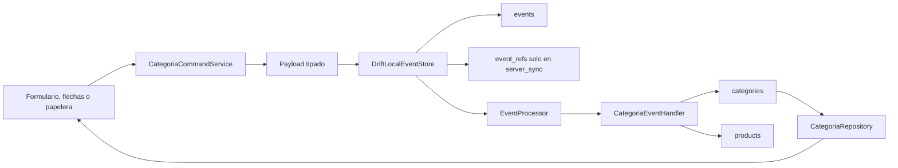

# Modulo Categorias

Esta nota documenta el comportamiento actualmente implementado para
categorias en la app Flutter y en el servidor NestJS. Describe el codigo
existente; cualquier capacidad indicada como pendiente no forma parte del
contrato actual.

## Fuentes de verdad revisadas

| Componente | Fuente |
|---|---|
| App movil, dominio y SQLite | `/Users/benjamin/Projects/POS/pos_flutter` |
| API, PostgreSQL y conflictos | `/Users/benjamin/Library/CloudStorage/GoogleDrive-benjamin94833@gmail.com/My Drive/Projects/POS/pos-nest` |
| Decisiones offline-first | Este vault de analisis |

Linea base usada en esta revision:

- Flutter: rama `main`, commit `dbf2379`, arbol de trabajo limpio antes de
  modificar este vault.
- NestJS: rama `main`, commit `4c63b95` mas los cambios actuales sin commit del
  modulo de sincronizacion. La implementacion de categorias revisada todavia no
  queda representada solo por el commit indicado.

## Estado funcional

| Capacidad | Flutter | NestJS | Estado |
|---|---:|---:|---|
| Listar y observar categorias | Si | Proyeccion oficial | Implementado |
| Crear categoria | Si | Valida y aplica `categoria_creada` | Implementado |
| Editar nombre y color | Si | Merge o conflicto por campo | Implementado |
| Reordenar categorias | Si | Intercambio transaccional de dos posiciones | Implementado |
| Operar en `standalone` | Si | No participa | Implementado |
| Sincronizar en `server_sync` | Si | Push, pull, preflight y conflictos | Implementado |
| Eliminar categoria vacia | Si | Si | Primera entrega implementada |
| Resolver articulos y eliminar | Si | Si | Segunda entrega implementada |
| Eliminar todos los articulos y la categoria | No | No | Pendiente de Ventas |
| Desactivar o reactivar categoria | No | No | Fuera del alcance actual |
| Categorias padre o subcategorias | No | No | Fuera del alcance actual |

## Proposito y alcance

Una categoria es un agrupador plano para organizar articulos del catalogo. En
el alcance actual tiene nombre, color y posicion visual. La relacion concreta
con productos se usa para contar el conjunto vinculado y, antes del hard
delete, moverlo a otra categoria o dejarlo sin categoria.

El modulo incluye:

- Consulta reactiva y ordenada de categorias en la app.
- Alta local optimista.
- Edicion de `name` y `color_key`.
- Movimiento hacia arriba o abajo mediante intercambio con la categoria
  adyacente.
- Hard delete de categorias vacias o con productos resueltos y compactacion de
  su orden.
- Resolucion atomica de productos mediante `move` o `uncategorize`.
- Registro y aplicacion atomica de eventos locales.
- Sincronizacion, preflight y deteccion de conflictos en `server_sync`.
- Restauracion de la proyeccion optimista cuando un evento entra en conflicto.

No incluye:

- `Eliminar todos` y cualquier borrado de productos dependiente de Ventas.
- Desactivacion o reactivacion.
- Jerarquia de categorias.
- Un endpoint CRUD exclusivo para categorias; el servidor recibe cambios por
  el protocolo generico de sincronizacion.

## Modelo de dominio

El modelo que consume la UI es:

| Campo de dominio | Persistencia | Regla actual |
|---|---|---|
| `id` | `category_id` o `id` local | UUID v4 generado en el dispositivo |
| `nombre` | `name` | Obligatorio y normalizado con `trim` |
| `color` | `color_key` | Clave de una paleta controlada |
| `orden` | `sort_order` | Entero consecutivo desde cero |

La proyeccion de sincronizacion agrega `active`, `version`,
`created_event_id`, `last_event_id` y `last_server_sequence`.

### Invariantes

- La estructura es plana; no existe `parent_category_id`.
- El nombre no puede quedar vacio despues de aplicar `trim`.
- Los nombres no son unicos. Dos categorias con IDs distintos pueden tener el
  mismo nombre.
- Todas las claves de color deben pertenecer a la paleta controlada.
- El orden esperado es `0..n-1`, sin huecos ni duplicados.
- Un movimiento siempre intercambia dos categorias consecutivas.
- `active` se hereda de la proyeccion comun, pero no se usa para filtrar ni
  representa un ciclo de vida funcional.
- Una edicion sin cambios reales no genera evento.
- Un movimiento fuera de los limites de la lista no genera evento.

### Paleta de color

Valores admitidos:

```text
neutral
amber
blue
blue_grey
brown
cyan
deep_orange
deep_purple
green
grey
indigo
light_blue
light_green
lime
orange
pink
purple
red
teal
yellow
```

`neutral` es el valor inicial cuando el usuario no elige un color. La app puede
guardarlo, pero no lo muestra entre las 19 muestras seleccionables del dialogo.
La base persiste la clave estable y la UI decide el color visual asociado.

## Casos de uso de la app

### Listar categorias

La pestana `CATEGORIA` observa `CategoriaRepository.watchCategorias()`. Drift
ordena por:

1. `sort_order`.
2. `name`.
3. `id` como desempate estable.

Mientras el stream todavia no ha emitido se muestra un indicador de carga y,
ante un error, el mensaje `No se pudieron cargar las categorías.`. La consulta
no filtra por `active`.

### Crear categoria

1. El usuario abre el boton `Agregar` y selecciona `Añadir categoría`.
2. El formulario inicia con nombre vacio y color `neutral`.
3. La UI exige un nombre con contenido.
4. `CategoriaCommandService` vuelve a normalizar y validar el nombre.
5. Se generan UUID v4 para categoria y evento.
6. La app propone `sort_order = cantidad actual de categorias`.
7. El evento y la proyeccion se guardan en una transaccion SQLite.

En el servidor, `sort_order` recibido se valida pero no se considera
autoritativo. Bajo un bloqueo global de orden, el servidor asigna
`max(sort_order) + 1` y guarda ese valor en el evento canonico. Cuando el evento
regresa por pull, la app completa la metadata y adopta el orden oficial.

### Editar categoria

Al tocar una tarjeta se abre el formulario con nombre y color actuales. Solo
son mutables `name` y `color_key`.

La edicion:

- Requiere que la categoria exista.
- Requiere un `base_event_id`, tomado de `last_event_id` o, en su ausencia, de
  `created_event_id`.
- Incluye `base_version` y el `last_server_sequence` conocido.
- Declara unicamente los campos que realmente cambiaron.
- Retorna sin guardar si nombre y color conservan el mismo valor.

### Mover categoria

Las flechas de cada tarjeta permiten subir o bajar una posicion. La flecha de
subir esta deshabilitada para la primera categoria y la de bajar para la
ultima.

Antes de crear el evento, el command service verifica que la lista local sea
consecutiva. El evento contiene el estado base y el cambio de las dos
categorias involucradas. La aplicacion local actualiza ambas proyecciones
dentro de la misma transaccion que guarda el evento.

### Eliminacion

La papelera abre un flujo independiente de la edicion. La app obtiene todos los
productos vinculados por `category_id`, activos e inactivos, sin contar
variantes. Si el conjunto esta vacio confirma el hard delete directamente. Si
hay productos ofrece exclusivamente moverlos por ID a otra categoria activa o
dejarlos sin categoria, seguido de una confirmacion final.

El comando vuelve a consultar el conjunto exacto y crea un unico
`categoria_eliminada`. La actualizacion de productos, el hard delete, la
compactacion de `sort_order`, el evento y las referencias se aplican en una
sola transaccion.

En `server_sync`, el servidor vuelve a validar la instantanea, el orden, el
destino, el conjunto exacto y las bases de productos bajo bloqueos
transaccionales. Push, pull, preflight, eco y restauracion de conflictos
reconocen todas las referencias del evento. `Eliminar todos` sigue bloqueado
por la especificacion de Ventas y no aparece en la interfaz.
El contrato completo vive en [[03 - Dominio/Modulos/Eliminacion de categorias|Eliminacion de categorias]].

## Flujo local implementado



`events`, las referencias que correspondan, `categories` y `products` se
modifican dentro de una unica transaccion SQLite. Si falla el handler, no debe
quedar un evento local separado de sus proyecciones.

## Comandos

| Comando | Entrada | Resultado |
|---|---|---|
| `CrearCategoriaCommand` | `nombre`, `color` | Genera `categoria_creada` |
| `EditarCategoriaCommand` | `categoriaId`, `nombre`, `color` | Genera `categoria_actualizada` si hay cambios |
| `MoverCategoriaCommand` | `categoriaId`, `arriba` o `abajo` | Genera `categoria_movida` si existe una posicion adyacente |
| `EliminarCategoriaCommand` | `categoriaId`, resolucion, IDs confirmados y destino opcional | Genera un unico `categoria_eliminada` |

Errores del command service que impiden guardar:

- Nombre vacio.
- Categoria inexistente al editar, mover o eliminar.
- Falta de evento base para editar, mover o eliminar.
- Orden local no consecutivo antes de mover o eliminar.
- Conjunto confirmado distinto del conjunto actual de productos.
- Destino ausente, igual al origen, inactivo o con base invalida para `move`.
- Destino presente para `none` o `uncategorize`.

La pantalla captura cualquier error de alta o edicion y muestra
`No se pudo guardar la categoría.`. Para movimientos muestra
`No se pudo mover la categoría.` y para eliminacion
`No se pudo eliminar la categoría. Inténtalo nuevamente.`.

## Eventos y contratos

Los cuatro eventos usan `aggregate_type = category`.

| Evento | Agregado principal | Campos mutables | Referencias |
|---|---|---|---|
| `categoria_creada` | Nueva categoria | Estado inicial completo | Categoria creada `affects` |
| `categoria_actualizada` | Categoria editada | `name`, `color_key` | Categoria editada `affects` |
| `categoria_movida` | Categoria movida | `sort_order` de dos categorias | Ambas categorias `affects` |
| `categoria_eliminada` | Categoria eliminada | Productos, hard delete y compactacion | Origen, productos y posteriores `affects`; destino `uses` |

### `categoria_creada`

Envelope local relevante:

- `base_version = 1`.
- `base_server_sequence = null`.
- `aggregate_id` es el UUID nuevo.

Payload canonico:

```json
{
  "name": "Bebidas",
  "color_key": "cyan",
  "sort_order": 0
}
```

Validaciones:

- `name` es texto no vacio y se normaliza con `trim`.
- `color_key` pertenece a la paleta.
- `sort_order` es entero mayor o igual que cero.
- El servidor permite nombres duplicados y coloca la categoria al final con un
  orden canonico calculado dentro de la transaccion.

### `categoria_actualizada`

Envelope local relevante:

- `base_version` es la version actual de la proyeccion.
- `base_server_sequence` es la ultima secuencia oficial conocida y puede ser
  nula si la base todavia es local.

Payload con cambio de nombre y color:

```json
{
  "base_event_id": "event_previous",
  "changed_fields": ["name", "color_key"],
  "changes": {
    "name": {
      "from": "Bebidas",
      "to": "Bebidas frías"
    },
    "color_key": {
      "from": "cyan",
      "to": "blue"
    }
  }
}
```

Validaciones:

- `base_event_id` es obligatorio.
- `changed_fields` no puede estar vacio, repetir campos ni incluir campos
  distintos de `name` y `color_key`.
- Cada campo declarado debe tener `from` y `to` validos y diferentes.
- El servidor exige al menos `base_version` o `base_server_sequence` en el
  envelope.

### `categoria_movida`

La categoria en `aggregate_id` es la que el usuario decidio mover. La otra se
transporta en `displaced_category`.

```json
{
  "base_event_id": "event_category_2",
  "changed_fields": ["sort_order"],
  "changes": {
    "sort_order": {
      "from": 1,
      "to": 0
    }
  },
  "displaced_category": {
    "category_id": "category_1",
    "base_event_id": "event_category_1",
    "base_version": 2,
    "base_server_sequence": 10,
    "sort_order": {
      "from": 0,
      "to": 1
    }
  }
}
```

Validaciones:

- `changed_fields` debe ser exactamente `["sort_order"]`.
- Los dos IDs deben ser diferentes.
- Las posiciones deben ser enteros no negativos, distintas, consecutivas y
  formar un intercambio exacto.
- El envelope exige `base_version >= 1` para la categoria movida.
- La categoria desplazada exige `base_event_id`, `base_version >= 1` y una
  `base_server_sequence` nula o no negativa.

## Referencias de eventos

```text
categoria_creada
  category <category_id> affects

categoria_actualizada
  category <category_id> affects

categoria_movida
  category <moved_category_id> affects
  category <displaced_category_id> affects

categoria_eliminada
  category <deleted_category_id> affects
  category <each_shifted_category_id> affects
  product <each_linked_product_id> affects
  category <destination_category_id> uses  # solo move
```

Los command services declaran estas `LocalEventRef` en ambos modos y el store
rechaza comandos sin referencias. Su persistencia depende del modo:

| Modo | Evento local | `event_refs` locales | Procesos remotos |
|---|---|---|---|
| `standalone` | `application_status = applied`, `delivery_status = not_required` | No se crean filas | No se ejecutan push, pull, preflight, health checks ni WebSocket |
| `server_sync` | `application_status = applied`, `delivery_status = pending` | `source = local_pending`, `server_sequence = null` | Participan en preflight, push, pull y conflictos |

Cuando el servidor reconoce un evento, la app cambia sus referencias a
`source = server` y completa `server_sequence`. El servidor tambien persiste
referencias `source = server` para eventos aceptados y para eventos marcados
como conflicto.

Una importacion futura de historial `standalone` debe reconstruir estas
referencias. No debe convertir silenciosamente los eventos `not_required` en
pendientes.

## Persistencia

### SQLite en Flutter

Tabla `categories`:

| Columna | Nulable | Uso |
|---|---:|---|
| `id` | No | UUID y llave primaria |
| `name` | No | Nombre normalizado |
| `color_key` | No | Paleta; valor predeterminado `neutral` |
| `sort_order` | No | Posicion local |
| `active` | No | Heredado; valor predeterminado `true`, sin uso funcional |
| `version` | No | Concurrencia optimista; inicia en 1 |
| `created_event_id` | Si | Evento creador |
| `last_event_id` | Si | Ultimo evento aplicado |
| `last_server_sequence` | Si | Ultima secuencia oficial conocida |

No hay una restriccion SQLite que haga unico `sort_order`; el invariante se
mantiene actualmente desde los command services y handlers.

### PostgreSQL en NestJS

La entidad `CategoryEntity` usa:

| Columna | Definicion actual |
|---|---|
| `category_id` | UUID, llave primaria |
| `name` | `varchar(160)`, no unico |
| `color_key` | `varchar(40)`, predeterminado `neutral` |
| `sort_order` | `integer`, indice no unico |
| `active` | `boolean`, predeterminado `true` |
| `version` | `integer`, predeterminado `1` |
| `created_event_id` | UUID nulable |
| `last_event_id` | UUID nulable |
| `last_server_sequence` | `bigint` nulable |
| `created_at_server` | `timestamptz` administrado por TypeORM |
| `updated_at_server` | `timestamptz` administrado por TypeORM |

El servidor usa un `pg_advisory_xact_lock` con la clave
`pos.category_order` para serializar altas, movimientos y eliminaciones. Ademas
bloquea con `pessimistic_write` categorias y productos involucrados antes de
cambiar las proyecciones.

## Aplicacion e idempotencia en Flutter

### Creacion

- Inserta la proyeccion con `active = true` y version inicial.
- Si vuelve el mismo evento por pull, no duplica la fila y completa
  `last_server_sequence`.
- Si una proyeccion pendiente local ocupa el mismo ID que una creacion oficial
  distinta, el handler puede retirar la proyeccion pendiente para aplicar la
  oficial; la revalidacion posterior marca el evento local como conflicto.

### Actualizacion

- En aplicacion local exige que `base_version` y los valores `from` coincidan
  con la proyeccion actual.
- Incrementa la version una vez y actualiza solo los campos declarados.
- El eco del mismo evento no vuelve a incrementar la version; solo completa la
  metadata oficial.
- Un evento remoto con secuencia igual o anterior a la proyeccion se ignora.

### Movimiento

- Comprueba las bases y posiciones de ambas categorias al aplicar localmente.
- Actualiza orden, version, `last_event_id` y secuencia de ambas proyecciones.
- El eco del mismo evento solo completa metadata y no intercambia de nuevo.
- Un evento remoto anterior a cualquiera de las dos proyecciones se ignora.

### Eliminacion

- `none` conserva el contrato de categoria vacia; `move` y `uncategorize`
  transportan el conjunto exacto de productos y sus bases. `delete` se rechaza.
- Cada producto cambia solo `category_id` y metadata de sincronizacion, e
  incrementa su version una vez.
- Reaplicar el mismo evento no vuelve a modificar productos ni orden.
- El eco solo completa secuencias oficiales de productos y categorias
  afectadas; nunca recrea la categoria eliminada.

## Sincronizacion y autoridad del servidor

En `server_sync`, el flujo relevante es:

```mermaid
flowchart LR
    LOCAL["Eventos pendientes"] --> PREFLIGHT["POST /sync/preflight"]
    PREFLIGHT --> APPLY["Aplicar eventos oficiales que impactan referencias"]
    APPLY --> REVALIDATE["Revalidar pendientes"]
    REVALIDATE --> PUSH["POST /sync/push"]
    PUSH --> SERVER["Validar y aplicar en PostgreSQL"]
    SERVER --> NOTICE["WebSocket: eventos disponibles"]
    NOTICE --> PULL["GET /sync/pull"]
    PULL --> ECHO["Reconocer eco y completar metadata"]
```



La implementacion considera que:

- `categoria_actualizada` siempre requiere preflight por ser una actualizacion.
- `categoria_movida` siempre requiere preflight y sus dos referencias permiten
  detectar movimientos oficiales que afecten cualquiera de las categorias.
- `categoria_eliminada` siempre requiere preflight; las referencias de
  producto y destino tambien participan en la busqueda de eventos impactantes.
- Una `categoria_creada` que solo declara `affects` no requiere preflight por
  si sola; la colision improbable de UUID se valida al hacer push.
- Los eventos dependientes de otros eventos locales pendientes esperan a que su
  base sea reconocida. Si la dependencia entra en conflicto, tambien se marcan
  como conflicto.
- Pull solo entrega eventos con estado oficial `synced`, ordenados por
  `server_sequence`. Los eventos `conflict` se consultan por el flujo de
  conflictos y no se aplican como verdad oficial.
- Cada push aceptado emite un aviso WebSocket con la secuencia mas reciente y
  los tipos de evento; el socket no transporta el estado de la categoria.

## Reglas de merge y conflictos

### Edicion por campo

El servidor compara los campos declarados con los eventos oficiales aceptados
despues de `base_server_sequence` y con los valores `from` del payload:

- Si otro evento cambio una columna distinta, la edicion se fusiona.
- Si otro evento cambio la misma columna, el evento entra en conflicto.
- Una base futura o con formato invalido se rechaza.
- Si la categoria no existe, se registra conflicto.

Ejemplo: un cambio local de `name` puede fusionarse si el servidor solo cambio
`color_key`; dos cambios concurrentes de `name` producen conflicto.

### Reordenamiento

El servidor valida la base y el orden actual de las dos categorias bajo
bloqueo. Si las posiciones oficiales ya no coinciden, no intenta reconstruir
un orden diferente: registra conflicto y conserva el orden oficial.

### Tipos registrados

| Tipo | Situacion |
|---|---|
| `aggregate_id_conflict` | Otra categoria oficial ya usa el UUID de una creacion |
| `missing_aggregate` | Falta la categoria editada o alguna involucrada en el movimiento |
| `concurrent_field_update` | Un cambio oficial y el local modifican el mismo campo |
| `stale_category_move_base` | La base declarada del movimiento no es valida para el estado oficial |
| `concurrent_category_move` | Cambio el orden oficial de alguna categoria involucrada |
| `category_linked_products_changed` | El conjunto oficial de productos ya no coincide con el confirmado |
| `concurrent_product_category_update` | Cambio la categoria o base de un producto confirmado |
| `concurrent_category_delete` | Cambio el origen, destino, instantanea u orden de una eliminacion |

Los payloads invalidos, colores fuera de paleta, campos desconocidos y bases
con formato imposible producen `rejected`, no una proyeccion oficial.

## Restauracion de proyecciones en conflicto

La app aplica los comandos de forma optimista. Cuando preflight o push detecta
un conflicto:

- `categoria_creada`: elimina la proyeccion solo si fue creada por el evento
  local conflictivo.
- `categoria_actualizada`: revierte los campos locales que todavia conservan el
  valor `to`, salvo los campos para los que ya existe un valor oficial mas
  reciente.
- `categoria_movida`: intenta devolver las dos posiciones y su metadata a las
  bases del evento; preserva cualquier categoria que ya recibio un orden
  oficial mas reciente.
- `categoria_eliminada`: restaura categoria, posiciones y metadata/categoria de
  productos solo cuando siguen perteneciendo al evento conflictivo; preserva
  cualquier estado oficial posterior.
- Los eventos pendientes que dependan del evento conflictivo se marcan tambien
  como conflicto y sus proyecciones se limpian en orden inverso.

Esta restauracion evita que la UI continue mostrando como valida una mutacion
que el servidor no acepto.

## API usada por el modulo

No existe un `CategoriesController` CRUD. Categorias usa los endpoints comunes:

| Endpoint | Participacion de categorias |
|---|---|
| `GET /sync/health` | Informa secuencia oficial antes de decidir sincronizacion |
| `POST /sync/preflight` | Busca eventos oficiales por referencias `category` y `product` |
| `POST /sync/push` | Recibe los cuatro eventos de categoria |
| `GET /sync/pull` | Descarga eventos aceptados por secuencia |
| `POST /sync/conflicts/report` | Reporta conflictos detectados primero en el dispositivo |
| `GET /sync/conflicts` | Permite consultar, entre otros, `ref_type = category` |

Estos endpoints solo deben utilizarse en `server_sync`.

## Criterios de aceptacion cubiertos

- Crear una categoria normaliza el nombre, conserva el color y la coloca al
  final.
- Se puede crear sin elegir color usando `neutral`.
- Se rechaza un nombre vacio antes de persistir.
- Se permiten nombres duplicados con IDs distintos.
- Editar nombre y color genera un payload con cambios reales y bases.
- Guardar sin cambios no crea un evento.
- Mover intercambia exactamente dos posiciones consecutivas.
- Los limites superior e inferior no generan movimientos.
- Alta, edicion y movimiento actualizan evento y proyeccion atomicamente en
  ambos modos.
- Eliminar una categoria vacia conserva el historial y compacta el orden.
- Una categoria con productos permite mover el conjunto exacto o dejarlo sin
  categoria, conservando `active`, nombre, variantes, precio e inventario.
- La UI excluye el origen del selector, impide confirmar sin destino y no
  muestra `Eliminar todos`.
- Una eliminacion concurrente restaura o limpia proyecciones optimistas sin
  mover, desvincular ni eliminar productos automaticamente.
- `standalone` no genera `event_refs` y usa `delivery_status = not_required`.
- `server_sync` genera referencias pendientes y reconoce el eco del servidor
  sin reaplicar la mutacion.
- El servidor fusiona cambios en columnas diferentes y registra conflicto para
  cambios concurrentes de la misma columna o del orden.

## Verificacion ejecutada

El 2026-08-13 se ejecutaron las suites completas despues de implementar la
segunda entrega de eliminacion:

```text
Flutter: 206 pruebas aprobadas; dart analyze sin hallazgos
NestJS:  54 pruebas aprobadas en 4 suites; npm run build correcto
PostgreSQL real: 3 pruebas de integracion aprobadas
```

La cobertura incluye `none`, `move` y `uncategorize`, rechazo de `delete`,
consulta de productos activos e inactivos sin contar variantes, selector y
confirmaciones, conjunto exacto, metadata, refs en ambos modos, compactacion,
rollback local y PostgreSQL, idempotencia, eco, preflight/pull, restauracion y
preservacion de estado oficial, FK `RESTRICT` y bloqueo concurrente real.

## Pendientes y limites detectados

| Pendiente | Impacto actual | Accion recomendada |
|---|---|---|
| Flutter no limita la longitud de `name` y el handler NestJS tampoco la valida explicitamente | PostgreSQL define `varchar(160)` y un nombre largo puede fallar como error de base | Agregar una regla compartida y devolver rechazo controlado antes de persistir |
| `sort_order` no tiene restriccion unica ni de consecutividad en SQLite o PostgreSQL | El invariante depende enteramente de handlers y bloqueos | Mantener pruebas de integridad y decidir si conviene una restriccion o reparador de orden |
| Flutter usa `schemaVersion = 3` sin migraciones de actualizacion y reinicia la base en debug salvo restauracion preservada | Los cambios de esquema todavia dependen del flujo de desarrollo | Crear migraciones antes de conservar datos entre versiones de desarrollo o publicar |
| NestJS usa `synchronize: true` y no hay migracion versionada para `categories` | El esquema no es reproducible de forma controlada para produccion | Desactivar `synchronize` en produccion y agregar la migracion de categorias |
| La integracion PostgreSQL es opt-in mediante `RUN_POSTGRES_INTEGRATION=1` | La suite normal no requiere una base local | Ejecutarla en CI cuando exista un servicio PostgreSQL aislado |

## Archivos principales de implementacion

Flutter:

```text
lib/domain/categorias/
lib/application/commands/categoria_command_service.dart
lib/application/sync/payloads/categoria_*_payload.dart
lib/application/sync/handlers/categoria_event_handler.dart
lib/application/sync/categoria*_conflict_projection_restorer.dart
lib/application/sync/projections/producto_projection_store.dart
lib/data/local/drift/tables/categories.dart
lib/data/local/drift/daos/categoria_dao.dart
lib/data/local/drift/daos/producto_dao.dart
lib/data/repositories/categoria_repository_impl.dart
lib/data/repositories/producto_repository_impl.dart
lib/presentation/pages/gestion_inventario/categorias/
```

NestJS:

```text
src/entities/category.entity.ts
src/sync/categoria-event.handler.ts
src/sync/categoria-event.handler.spec.ts
src/sync/categoria-event.handler.postgres.spec.ts
src/sync/payloads/categoria-eliminada.payload.ts
src/sync/sync.service.ts
src/sync/sync.controller.ts
```

## Enlaces

- [[03 - Dominio/Modulos/Eliminacion de categorias|Eliminacion de categorias]]
- [[03 - Dominio/Modulos/Modulos|Modulos]]
- [[05 - Datos/Catalogo e inventario|Catalogo e inventario]]
- [[04 - Sincronizacion/Patron para nuevas funcionalidades offline first|Patron para nuevas funcionalidades offline first]]
- [[04 - Sincronizacion/Implementacion de conflictos centralizados|Implementacion de conflictos centralizados]]
- [[01 - Contexto/Modos de operacion|Modos de operacion]]
