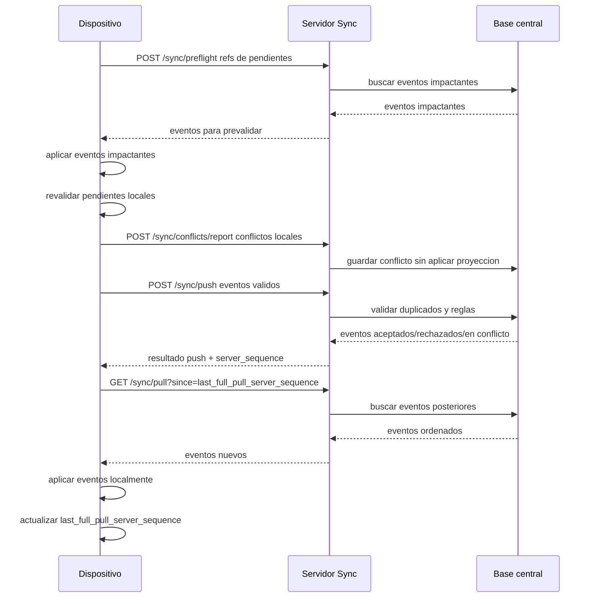

# Flujo push pull

Este flujo aplica solo al modo `server_sync`. En modo `standalone` no se ejecuta `preflight`, `push`, `pull` ni WebSocket; el evento queda aplicado localmente y puede respaldarse.

## Decision

El flujo estandar de reconexion es:

```text
preflight -> revalidar pendientes -> push -> pull completo final
```

El `pull completo` no desaparece. Se ejecuta al final para dejar el dispositivo actualizado y avanzar el cursor global.

WebSocket no reemplaza este flujo. Solo avisa a otros dispositivos que existen eventos aceptados y que deben ejecutar `/sync/pull`.

## Por que no pull completo primero

No se usa `pull completo -> push` como flujo normal porque el pull completo puede traer muchos eventos irrelevantes para los pendientes locales. Eso aumenta latencia, consumo de datos y cambios visuales antes de intentar preservar el trabajo hecho offline.

Ademas, un pull completo primero no evita la validacion del servidor. Aunque el dispositivo aplique todos los eventos remotos, el servidor debe validar otra vez en `/sync/push` porque pueden ocurrir eventos nuevos mientras el dispositivo revalida o sube sus pendientes.

El pull completo antes del push queda como excepcion para casos de alto riesgo o desfase grande.

## Flujo de reconexion



## Preflight

El dispositivo envia referencias derivadas de sus eventos pendientes. El servidor devuelve solo eventos recientes que pueden impactar esos pendientes.

El preflight no debe avanzar `last_full_pull_server_sequence`. Puede guardar `last_preflight_server_sequence` solo como diagnostico o metrica.

## Revalidacion local

Despues del preflight, el dispositivo reclasifica sus pendientes:

- `ready_to_push`
- `needs_user_review`
- `conflict`
- `pending_external_confirmation`
- `rejected_locally`

Solo los eventos `ready_to_push` se suben automaticamente.

Para actualizaciones concurrentes, la reclasificacion debe comparar columnas modificadas. Si dos eventos cambian columnas distintas del mismo registro, ambos pueden aplicarse; si cambian la misma columna del mismo registro, el pendiente debe ir a `conflict` o `needs_user_review`.

Los eventos reclasificados como `conflict` se reportan por `/sync/conflicts/report` si todavia no tienen `server_sequence`. No se mezclan en el arreglo normal de eventos de `/sync/push`.

## Push

El dispositivo envia eventos pendientes de servidor.

En la implementacion actual eso puede representarse como `sync_status = pending`. Si se separa estado local de estado de entrega, equivaldria a `delivery_status = pending`.

El servidor responde por evento:

- `accepted`
- `duplicate`
- `rejected`
- `conflict`

Cuando el servidor responde `conflict`, debe incluir `conflict_id`, `default_winner_event_id` y `reason` si el evento se guardo como participante de un caso administrativo.

Despues de aceptar y persistir eventos, el servidor puede emitir `sync:events_available` por WebSocket a los demas dispositivos de la misma instalacion operativa.

El aviso debe incluir como minimo el ultimo `server_sequence` disponible. No debe incluirse como sustituto del pull completo ni avanzar cursores locales.

## Pull completo final

El dispositivo pide:

```http
GET /sync/pull?since=last_full_pull_server_sequence&limit=500
```

El servidor responde eventos con `server_sequence > last_full_pull_server_sequence`.

Este pull final es el unico que debe avanzar el cursor global de sincronizacion del dispositivo.

## Orden recomendado

1. Preflight de pendientes.
2. Aplicar eventos impactantes.
3. Revalidar pendientes locales.
4. Reportar conflictos locales que no tengan `server_sequence`.
5. Push de eventos validos.
6. Aplicar resultado del push.
7. Pull completo final.
8. Actualizar checkpoints.

## Relacion con tiempo real

Cuando un dispositivo recibe `sync:events_available`, debe ejecutar `/sync/pull` desde su `last_full_pull_server_sequence`.

Si el dispositivo tiene eventos pendientes propios, conserva el flujo normal de reconexion:

```text
preflight -> revalidar pendientes -> push -> pull completo final
```

Si no tiene pendientes, puede hacer pull directo para actualizarse.

Ver [[04 - Sincronizacion/Tiempo real con WebSocket|Tiempo real con WebSocket]].

## Excepciones

Se puede hacer pull completo antes del push cuando:

- No hay eventos pendientes.
- El dispositivo estuvo demasiado tiempo offline.
- El servidor responde que el preflight excede el limite de eventos.
- Hay pendientes de configuracion global, impuestos, permisos o caja que requieren contexto completo.
- El cursor local esta demasiado atrasado.

## Dispositivo nuevo

Este flujo aplica cuando el dispositivo ya tiene una base local inicializada. Si el dispositivo esta vacio, primero debe ejecutar [[04 - Sincronizacion/Inicializacion de nuevos dispositivos|Inicializacion de nuevos dispositivos]] para recibir un snapshot y guardar `last_full_pull_server_sequence`.

## Prevalidacion

Ver [[04 - Sincronizacion/Prevalidacion de pendientes|Prevalidacion de pendientes]].

## Decision relacionada

[[02 - Decisiones/ADR-0008 Flujo de sincronizacion con preflight antes de push|ADR-0008 Flujo de sincronizacion con preflight antes de push]]
