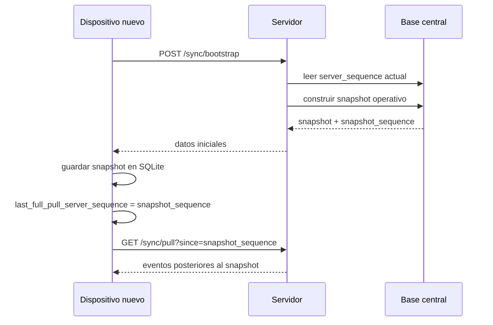

# Inicializacion de nuevos dispositivos

Esta nota aplica al modo `server_sync`. En modo `standalone`, un dispositivo nuevo se inicializa por instalacion local o restauracion de respaldo, no por `/sync/bootstrap`.

## Problema

Si un negocio ya tiene meses o anos operando, la tabla `events` puede contener cientos de miles o millones de registros. Un dispositivo nuevo no deberia tardar demasiado reconstruyendo todo desde el primer evento.

## Estrategia

Usar:

```text
snapshot actual + eventos nuevos
```

No usar:

```text
todos los eventos desde el inicio
```

## Flujo propuesto



## Datos del snapshot

El snapshot debe contener solo el estado necesario para operar:

- Catalogo actual.
- Categorias actuales.
- Catalogo de unidades con dimension, factor atomico y precision.
- Usuarios y permisos necesarios.
- Dispositivos registrados.
- Roles y configuracion de permisos.
- Ventas abiertas.
- Comandas abiertas, pendientes o en preparacion.
- Inventario actual.
- Cajas abiertas o sesiones de caja activas.
- Configuracion del negocio.

## Datos que no necesita cargar completos

- Todas las ventas cerradas historicas.
- Todos los eventos historicos desde el inicio.
- Movimientos de inventario antiguos si ya existe balance actual.
- Comandas cerradas antiguas.

## Cursor inicial

El servidor debe devolver:

```json
{
  "snapshot_sequence": 150000
}
```

El dispositivo guarda:

```text
last_full_pull_server_sequence = 150000
```

Luego solo descarga:

```http
GET /sync/pull?since=150000
```

## Regla de consistencia

El `snapshot_sequence` debe representar el punto exacto del historial hasta donde el snapshot esta actualizado. Si mientras se construye el snapshot ocurren nuevos eventos, esos eventos deben descargarse despues con `pull`.

## Decision relacionada

[[02 - Decisiones/ADR-0005 Bootstrap con snapshot para dispositivos nuevos|ADR-0005 Bootstrap con snapshot para dispositivos nuevos]]
