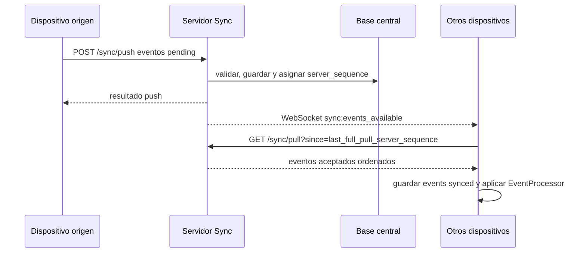

# Tiempo real con WebSocket

Esta nota aplica al modo `server_sync`. En modo `standalone`, WebSocket no se activa porque no existe servidor de sincronizacion.

## Objetivo

Usar WebSocket para reducir latencia entre dispositivos sin convertirlo en fuente de verdad.

El WebSocket solo avisa que existen eventos nuevos aceptados por el servidor. Los eventos completos se descargan con `/sync/pull`.

## Regla principal

```text
WebSocket = aviso
/sync/pull = descarga de eventos
events = verdad historica
tablas de lectura = estado actual proyectado
```

Si un dispositivo pierde un aviso WebSocket, no pierde datos. Al reconectar o ejecutar el siguiente pull, descarga los eventos pendientes desde su ultimo `last_full_pull_server_sequence`.

## Flujo al aceptar eventos



## Evento de socket recomendado

```text
sync:events_available
```

Payload minimo:

```json
{
  "latest_server_sequence": 121,
  "event_types": ["espacio_creado"],
  "source_device_id": "device_tablet_01"
}
```

## Reglas

- El servidor debe emitir el aviso solo despues de persistir el evento aceptado y asignar `server_sequence`.
- El aviso puede enviarse a los demas dispositivos del mismo negocio, sucursal o scope operativo.
- El cliente que recibe el aviso debe ejecutar `/sync/pull` desde su cursor completo local.
- El aviso no debe avanzar `last_full_pull_server_sequence`.
- Si llegan varios avisos seguidos, el cliente puede compactarlos en un solo pull.
- Si el dispositivo origen tambien recibe el aviso, el flujo sigue siendo idempotente.
- La UI no debe depender directamente del socket; debe observar las tablas locales actualizadas por los handlers.

## Relacion con push/pull

El flujo de reconexion sigue siendo:

```text
preflight -> revalidar pendientes -> push -> pull completo final
```

WebSocket no reemplaza ese flujo. Solo permite que otros dispositivos se enteren rapido de que deben hacer pull.

## Decision relacionada

[[02 - Decisiones/ADR-0010 WebSocket como aviso de eventos disponibles|ADR-0010 WebSocket como aviso de eventos disponibles]]
