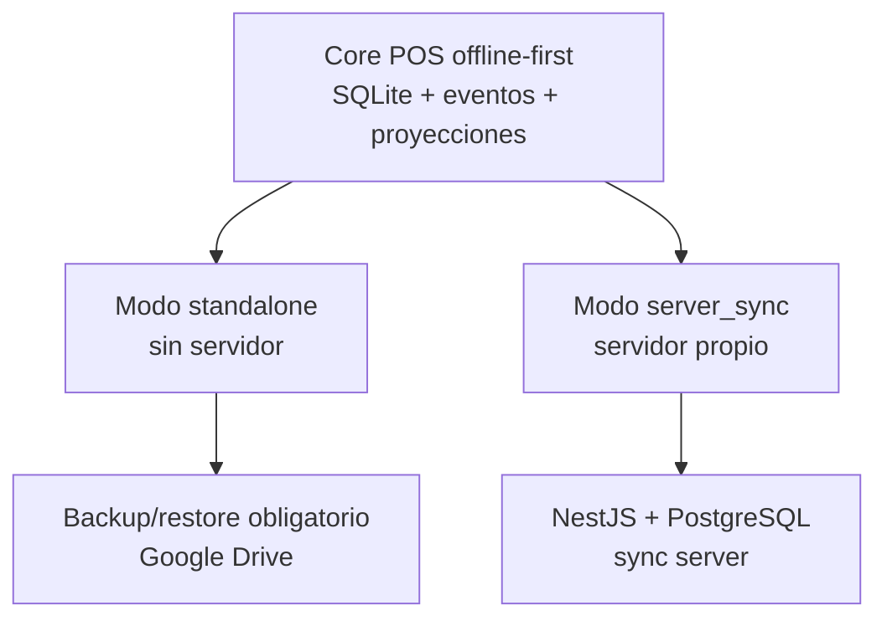
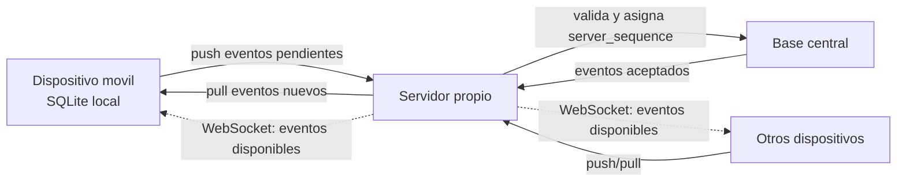

# Vision general

La sincronizacion propuesta para el modo `server_sync` es incremental, offline-first y basada en eventos.

El modo `standalone` usa el mismo core local de eventos y proyecciones, pero no ejecuta push/pull contra servidor. En ese modo los eventos son trazabilidad local y base para respaldo/restauracion.

## Modos



## Flujo `server_sync`



## Principios

- El dispositivo siempre escribe primero en SQLite.
- Cada accion importante genera un evento.
- El core local no depende del servidor.
- En modo `server_sync`, el servidor es autoridad para aceptar o rechazar eventos.
- En modo `server_sync`, el servidor asigna `server_sequence`.
- En modo `server_sync`, los dispositivos descargan eventos nuevos desde su ultimo cursor.
- En modo `server_sync`, WebSocket solo avisa que hay eventos disponibles; no reemplaza `/sync/pull`.
- En modo `standalone`, respaldo/restauracion no equivale a sincronizacion transaccional.
- Las tablas de lectura se actualizan aplicando eventos.
- Un dispositivo nuevo se inicializa con snapshot actual y despues continua con eventos nuevos.
- La operacion offline debe cubrir todos los modulos disponibles online, salvo operaciones imposibles por requerir confirmacion externa inmediata.
- En modo `server_sync`, al reconectar el flujo estandar es `preflight -> revalidar -> push -> pull completo final`.

## Dispositivos nuevos en `server_sync`

Un dispositivo vacio no debe reconstruir todo el historial desde el primer evento. Debe ejecutar un bootstrap:

```text
snapshot actual + snapshot_sequence
```

Despues sincroniza solo:

```text
eventos con server_sequence > snapshot_sequence
```

## Enlaces clave

- [[04 - Sincronizacion/Flujo push pull|Flujo push pull]]
- [[01 - Contexto/Modos de operacion|Modos de operacion]]
- [[04 - Sincronizacion/Tiempo real con WebSocket|Tiempo real con WebSocket]]
- [[04 - Sincronizacion/Inicializacion de nuevos dispositivos|Inicializacion de nuevos dispositivos]]
- [[04 - Sincronizacion/Paridad operativa offline|Paridad operativa offline]]
- [[04 - Sincronizacion/Prevalidacion de pendientes|Prevalidacion de pendientes]]
- [[04 - Sincronizacion/Protocolo de eventos|Protocolo de eventos]]
- [[04 - Sincronizacion/Idempotencia y duplicados|Idempotencia y duplicados]]
- [[04 - Sincronizacion/Resolucion de conflictos|Resolucion de conflictos]]
- [[05 - Datos/Eventos|Eventos]]
- [[02 - Decisiones/ADR-0008 Flujo de sincronizacion con preflight antes de push|ADR-0008 Flujo de sincronizacion con preflight antes de push]]
- [[02 - Decisiones/ADR-0010 WebSocket como aviso de eventos disponibles|ADR-0010 WebSocket como aviso de eventos disponibles]]
