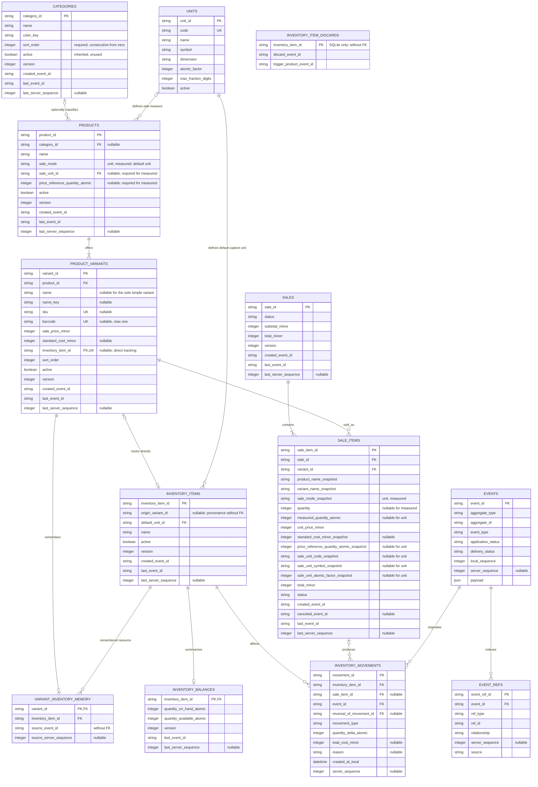

# Catalogo e inventario

> Actualización implementada 2026-09-16: el cobro directo completo en efectivo confirma
> venta, pago y consumo histórico en una transacción. Admite negativos y recetas,
> conserva precios capturados y acepta desactivaciones remotas posteriores. Ver
> [[04 - Sincronizacion/Confirmacion de ventas en efectivo|contrato vigente y límites]].
> Las propuestas adicionales del diagrama (SKU, cancelaciones, etc.) no describen
> necesariamente el código actual.

Esta nota es la referencia ER canónica del catálogo, sus variantes y su
relación con inventario. Si otro diagrama difiere, prevalecen esta nota y
ADR-0014, con la excepción de recuperación/descarte especificada por ADR-0017.
Procedencia y memoria ya existen en los esquemas declarados SQLite/PG; el
receptor está verificado. Recuperación/descarte Flutter core están verificados y la UI
pendiente. El diagrama añade esos elementos físicos sin dar por completo el flujo.

## Estado del analisis

El diagrama mezcla una parte concluida con otras todavia propuestas. No debe
interpretarse todo el modelo como esquema final.

| Alcance | Estado | Observacion |
|---|---|---|
| Categorias | Concluido funcionalmente | Estructura plana implementada en Flutter |
| Productos | Contrato de Articulos confirmado | Categoria opcional, nombre no unico, configuracion comun de venta y ciclo funcional |
| Variantes | Contrato de Articulos confirmado | Precio de venta, costo estandar opcional, SKU/codigo unicos y orden comun |
| Unidades y cantidades | Decidido | Escala por dimension, factores enteros, conversion exacta y catalogo metrico inicial confirmados en ADR-0012 |
| Inventario | Implementado para seguimiento directo | Vínculo directo opcional por variante; saldos y movimientos siguen perteneciendo al recurso |
| Recuperación y descarte de seguimiento | Esquemas/receptor/core Flutter verificados; UI pendiente | [[08 - Roadmap/Seguimiento de existencias/Plan de implementacion\|Cinco fases]]: memoria durable, procedencia y descarte vacío solo standalone |
| Integracion con ventas | Implementada para efectivo completo | El consumo nace al confirmar el cobro de caja directa; comandas fuera de alcance |

## Decisiones confirmadas para articulos

Cada variante puede enlazar opcionalmente un recurso físico mediante
`inventory_item_id`. La ausencia del vínculo significa “sin seguimiento”; no
se persiste un booleano adicional. Los recursos, saldos y movimientos conservan
su identidad como agregado de Inventario aunque la variante los use.

- Un producto ofrece una o mas variantes.
- La categoria del producto es opcional. La ausencia de categoria no crea una
  categoria artificial en la base.
- Los nombres de producto no son unicos.
- El modo sencillo crea una unica variante sin nombre visible. Si se agrega
  una segunda variante, todas las variantes activas deben tener nombres que
  permitan distinguirlas dentro del producto.
- Producto y variantes se desactivan y reactivan; no se borran fisicamente.
- Un producto activo debe tener al menos una variante activa.
- Solo las variantes se ordenan manualmente. `sort_order` es consecutivo desde
  cero dentro de cada `product_id`, incluyendo activas e inactivas; no existe
  orden manual de productos.
- El precio de venta pertenece a la variante y debe ser mayor que cero.
- El costo estandar pertenece a la variante y admite `null` o un entero mayor o
  igual que cero. Es una referencia comercial, no una entrada de inventario.
- `product_variants.inventory_item_id` es nullable, único y referencia un
  recurso activo. Un mismo recurso no puede ser el vínculo directo de dos
  variantes.
- `sale_mode`, `sale_unit_id` y `price_reference_quantity_atomic` pertenecen al
  producto y aplican a todas sus variantes.
- SKU y codigo de barras son opcionales y pertenecen a la variante. Cuando
  existen, deben normalizarse y validarse como unicos en el catalogo actual.
- Imagenes, favoritos, descripcion, MRP, impuestos, vencimiento, etiquetas,
  espacios, modificadores y edicion masiva quedan fuera del primer alcance de
  Articulos. Tambien quedan fuera la contabilidad de costos, utilidad neta y
  reportes completos de rentabilidad.
- Las ventas unitarias usan cantidad entera. Las ventas medidas guardan
  `measured_quantity_atomic` como entero normalizado al atomo de la dimension;
  la UI captura texto decimal en la unidad configurada sin persistir `REAL` ni
  transportar la fraccion como `double`.

### Configuracion comun de venta

Todo producto declara una configuracion de venta comun para sus variantes:

| `sale_mode` | `sale_unit_id` | `price_reference_quantity_atomic` |
|---|---|---|
| `unit` | `null` | `null` |
| `measured` | Unidad activa obligatoria | Entero positivo obligatorio |

`sale_mode` usa `unit` por defecto. En modo medido, el precio de cada variante
se interpreta por la cantidad de referencia del producto. Por ejemplo,
`sale_unit_id = kilogram`, cuyo factor es `1000` gramos, y
`price_reference_quantity_atomic = 1000` expresan que cada
`sale_price_minor` es el precio por un kilogramo. Cuando existe,
`standard_cost_minor` corresponde a esos mismos `1000` gramos. La UI puede
capturar `0.25 kg`; el evento y `sale_items` guardan `250` atomos de masa.

La configuracion se modifica como un solo campo logico. No puede cambiar
mientras exista una linea de venta abierta o provisional relacionada con
cualquiera de sus variantes. Las lineas confirmadas historicas no la bloquean
porque `sale_items` conserva snapshots del modo, unidad y cantidad de
referencia utilizados.

El total cobrado se calcula siempre con `sale_price_minor`. El costo estandar
no modifica venta, impuestos, descuentos o pagos. Al agregar una linea se
captura `standard_cost_minor_snapshot`, incluido `null`, para que una edicion
posterior de la variante no cambie el costo ni el margen de referencia
historicos.

### Unidades y conversion exacta

El contrato transversal vive en
[[03 - Dominio/Modulos/Unidades y cantidades|Unidades y cantidades]] y
[[02 - Decisiones/ADR-0012 Cantidades atomicas y unidades por dimension|ADR-0012]].
No existe una escala global equivalente a los centavos: cada dimension define
su atomo y cada unidad registrada declara cuantos atomos representa.

Catalogo inicial:

| Unidad | Dimension | Factor atomico | Decimales de captura |
|---|---|---:|---:|
| pieza | conteo | 1 pieza | 0 |
| gramo | masa | 1 gramo | 0 |
| kilogramo | masa | 1000 gramos | 3 |
| mililitro | volumen | 1 mililitro | 0 |
| litro | volumen | 1000 mililitros | 3 |

`units.atomic_factor` es entero y reemplaza cualquier
`conversion_to_base` decimal. La UI analiza la cantidad como texto decimal y
la convierte exactamente antes de construir el comando. Una unidad solo puede
convertirse con otras de su dimension; masa y volumen no son intercambiables
sin una densidad explicita, fuera del alcance inicial.

Un `inventory_item` guarda `default_unit_id` para captura y presentacion. Sus
saldos y movimientos se almacenan siempre en atomos de
la dimension. Una unidad desactivada deja de ofrecerse en configuraciones
nuevas, pero sigue interpretando referencias e historicos existentes. Codigo,
dimension, factor y precision son inmutables una vez referenciados.

### Existencias y consumo

Las existencias pertenecen a `inventory_items`; `product_variants` solo guarda
la referencia opcional al recurso. Activar seguimiento en el alta avanzada
crea, en un lote atómico, el recurso y su único balance. Una existencia inicial
positiva agrega además un movimiento `initial_balance`; cero o ausencia dejan
el balance en cero sin crear un movimiento de cantidad cero. Los eventos
históricos de `recurso_inventario_creado` que usaron `manual_adjustment` se
siguen interpretando con su tipo original y nunca se reescriben.

`inventory_movements` es el historial inmutable y auditable.
`inventory_balances` es una proyección materializada que el mismo handler
actualiza dentro de la transacción del movimiento. Por ello, mostrar la
existencia no suma todo el historial: consulta una fila de balance en O(1). La
suma de movimientos se reserva para reconstrucción, auditoría o reparación.

Los movimientos operativos distinguen estas intenciones:

| Tipo | Delta | `reason` | Uso |
|---|---:|---|---|
| `initial_balance` | Positivo | Opcional | Existencia inicial creada junto con el recurso |
| `stock_receipt` | Positivo | Opcional | Compra, devolución, transferencia u otra reposición común |
| `manual_adjustment` | Positivo o negativo, nunca cero | Obligatorio | Corrección justificada, por ejemplo conteo, merma o error de captura |
| `reversal` | Distinto de cero | Opcional | Reservado; exige `reversal_of_movement_id` |

Todo motivo presente se normaliza con NFKC y `trim`, mide entre 1 y 500
caracteres y se persiste como `null` cuando está ausente, nunca como cadena
vacía. Los tipos distintos de `reversal` exigen
`reversal_of_movement_id = null`; una reversión no puede autorreferenciarse y
la FK autorreferenciada conserva `ON DELETE RESTRICT`.

`quantity_delta_atomic` es el único dato de cantidad en el movimiento. No se
guardan snapshots de cantidad anterior ni posterior: el saldo vigente se consulta en
`inventory_balances`. `total_cost_minor` continúa nullable y en este alcance se
escribe `null`; la valuación real de entradas queda para una decisión futura.

La misma pantalla móvil crea y edita recursos. En edición el nombre puede
cambiar, la unidad es inmutable porque el historial ya la utiliza y el saldo
solo se muestra. Un guardado con nombre y cantidad produce dos eventos
independientes y causalmente encadenados: `recurso_inventario_actualizado` y
`movimiento_inventario_registrado`. El movimiento, el nuevo saldo y las
versiones de recurso/balance se aplican en una transacción.

Para venta `unit`, el recurso directo usa una unidad `count` con factor atómico
`1`. Para venta `measured`, la unidad del recurso debe compartir la dimensión
de la unidad de venta. Todas las cantidades persisten como enteros atómicos.

El `inventory_item` conserva identidad, saldo, historial y ciclo de vida
independientes. Desactivar producto o variante no lo borra ni reinicia.
La decisión ADR-0017 requiere conservar memoria
al desvincular para recuperar el mismo recurso; solo admite descarte de
autogenerados vacíos standalone, sin movimientos ni dependencias. En server_sync
se conservan siempre recurso y balance. Entradas, conteos, mermas y ajustes se
registran contra el recurso.

El esquema actual añade `inventory_items.origin_variant_id` y
`variant_inventory_memory`, proyección auxiliar sin stock ni consumo. SQLite
también contiene `inventory_item_discards`, aún sin handler/emisor ejecutable.
Campos/cascadas y discrepancias entre esquema y aplicación están en
[[08 - Roadmap/Seguimiento de existencias/Mapeo fisico de esquemas|Mapeo físico]].
La auditoría [[08 - Roadmap/Seguimiento de existencias/Evidencia/2026-10-04-prerrequisitos-fase5/Resultados|Auditoría de entrada a fase 5, 2026-10-04]] confirma que el plan no puede cerrarse: memoria/legado/
descarte/undo Flutter fallan y la interfaz no se implementó.

El código actual ya admite recetas y consumo histórico en la confirmación de
ventas conforme a
[[04 - Sincronizacion/Confirmacion de ventas en efectivo|contrato de confirmación]].
Una venta tardía conserva el recurso capturado aunque el vínculo actual sea nulo;
por ello la limpieza remota no forma parte de esta entrega.
`inventory_movements.total_cost_minor`, cuando exista, seguirá representando
el costo real del movimiento y no se inferirá del costo estándar.

## Decision actual para categorias

La especificacion funcional y tecnica derivada del codigo implementado vive en
[[03 - Dominio/Modulos/Categorias|Modulo Categorias]]. Esta seccion conserva el
modelo de datos dentro del contexto general de catalogo e inventario.

La tabla `categories` queda concluida, para el alcance actual, con los
siguientes campos:

El catalogo usa una estructura plana: no existen categorias padre ni
subcategorias.

| Campo | Regla |
|---|---|
| `category_id` | Identificador global generado en el dispositivo |
| `name` | Nombre obligatorio, normalizado con `trim` |
| `color_key` | Identificador obligatorio de una paleta controlada |
| `sort_order` | Posicion entera, unica y consecutiva desde cero |
| `active` | Campo comun heredado; no se usa para ocultar ni cambiar el ciclo de vida de categorias |
| `version` | Version para concurrencia optimista |
| `created_event_id` | Evento que creo la proyeccion |
| `last_event_id` | Ultimo evento aplicado a la proyeccion |
| `last_server_sequence` | Ultima secuencia oficial aplicada; nula en `standalone` |

En este alcance, `categories` hereda `active` por la estructura comun de las
proyecciones, pero el campo no participa en consultas ni habilita
desactivacion, eliminacion o reactivacion. Ese ciclo de vida debe analizarse
antes de agregarlo al flujo funcional. Los nombres no son unicos: categorias
distintas pueden compartir el mismo `name`.

### Color de categoria

`color_key` guarda una clave estable y no un valor dependiente de Flutter, CSS
o de un tema visual concreto.

Valores permitidos:

```text
neutral
amber
blue
blue_grey
brown
cyan
deep_orange
deep_purple
green
grey
indigo
light_blue
light_green
lime
orange
pink
purple
red
teal
yellow
```

Reglas:

- `color_key` es obligatorio y usa `neutral` cuando el usuario no selecciona
  color. `neutral` no aparece como muestra seleccionable en el formulario.
- Varias categorias pueden compartir el mismo color.
- La app Flutter convierte la clave en colores apropiados para tema claro y
  oscuro.
- La paleta valida vive en el dominio o configuracion de la app; no se guarda
  un entero propio de `Color`.
- Si en el futuro se requieren colores libres, se analizara `color_hex` o una
  tabla de paleta; no se agregan ambas alternativas por anticipado.

## Diagrama ER actual

En este diagrama, `CATEGORIES` conserva su especificacion implementada. Los
campos principales de productos y variantes reflejan las decisiones
confirmadas durante el analisis de Articulos; balances y la integracion completa
con Ventas continuan en revision. Lotes, vencimiento y politicas configurables
no forman parte del esquema actual.



### Integridad confirmada para productos y variantes

- `products.category_id` es nulable. Cuando tiene valor, debe referenciar una
  categoria existente.
- `products.name` es obligatorio despues de `trim`, pero no es unico.
- `products.sale_mode` solo admite `unit` o `measured` y usa `unit` por defecto.
  `unit` exige unidad y cantidad de referencia nulas; `measured` exige
  `sale_unit_id` activo y `price_reference_quantity_atomic > 0`.
- La unidad de venta medida y su referencia pertenecen a la misma dimension;
  la referencia ya esta convertida a atomos y la entrada decimal nunca llega
  al payload.
- `sale_mode`, `sale_unit_id` y `price_reference_quantity_atomic` cambian como
  un solo campo logico y no pueden modificarse mientras alguna variante tenga
  una linea de venta abierta o provisional.
- `products.active` y `product_variants.active` representan el ciclo funcional
  confirmado; no se agregan campos de borrado fisico.
- Todo producto debe conservar al menos una variante. Si el producto esta
  activo, debe existir al menos una variante activa.
- La variante unica creada en modo sencillo puede tener `name = null`. Antes de
  activar una segunda variante, todas las variantes activas deben recibir
  nombres distinguibles dentro del producto.
- `sale_price_minor > 0`.
- `standard_cost_minor IS NULL OR standard_cost_minor >= 0`. `null` significa
  costo desconocido y cero significa costo conocido igual a cero.
- En `measured`, precio de venta y costo estandar usan la misma
  `price_reference_quantity_atomic` del producto.
- Todas las variantes heredan la configuracion de venta del producto. Una
  variante no puede sobrescribir modo, unidad ni cantidad de referencia.
- `sort_order` es unico dentro de `product_id` y debe formar `0..n-1` sin
  huecos contando variantes activas e inactivas. Un movimiento intercambia dos
  variantes adyacentes.
- SKU y codigo de barras son nulables. Sus valores normalizados no pueden
  repetirse dentro del catalogo actual.
- El unico dato de negocio que el usuario debe capturar obligatoriamente para
  toda variante es `sale_price_minor`; `standard_cost_minor` es opcional.
  Orden, estado, version y trazabilidad siguen siendo columnas
  no nulas o administradas por el sistema.

## Reglas de sincronizacion para categorias

Eventos del alcance actual:

```text
categoria_creada
categoria_actualizada
categoria_movida
```

Una actualizacion debe incluir `base_version` o `base_server_sequence` y declarar
las columnas modificadas. `color_key` se trata como cualquier otra columna
mutable para merge o conflicto.

Un movimiento intercambia exactamente dos posiciones consecutivas en una sola
transaccion. El evento conserva las bases y los cambios `from`/`to` de la
categoria movida y de la desplazada. Si cualquiera de las posiciones oficiales
ya no coincide, el movimiento entra en conflicto.

Referencias conceptuales:

```text
categoria_creada
  ref category <category_id> affects

categoria_actualizada
  ref category <category_id> affects

categoria_movida
  ref category <moved_category_id> affects
  ref category <displaced_category_id> affects
```

Los command services declaran y validan estas referencias en ambos modos. La
app solo las persiste en `event_refs` cuando opera en `server_sync`; en
`standalone` el evento usa `delivery_status = not_required` y no genera filas
en `event_refs`.

## Pendientes antes de cerrar el resto del diagrama

- Analizar mediante una decision posterior cualquier escala menor que gramo o
  mililitro y cualquier unidad no metrica; no reinterpretar enteros existentes.
- Diseñar conversiones contextuales de compra o empaque, como caja de 24
  piezas o costal de 25 kg, dentro del articulo de inventario y no como unidad
  fisica global.
- Comandas: definir en su propio alcance cuándo se confirma una línea; caja directa
  ya consume al confirmar efectivo.
- Alertas, reposición, políticas configurables, lotes y vencimiento quedan pendientes.
  El efectivo completo permite stock negativo y conserva los consumos históricos de
  variantes o recursos desactivados después de las condiciones conocidas.

## Enlaces

- [[03 - Dominio/Modulos/Articulos|Modulo Articulos]]
- [[03 - Dominio/Modulos/Categorias|Modulo Categorias]]
- [[05 - Datos/Modelo de tablas|Modelo de tablas]]
- [[02 - Decisiones/ADR-0004 Inventario por movimientos|ADR-0004 Inventario por movimientos]]
- [[02 - Decisiones/ADR-0013 Costo estandar opcional por variante|ADR-0013 Costo estandar opcional por variante]]
- [[05 - Datos/Eventos|Eventos]]
- [[05 - Datos/Tablas de lectura|Tablas de lectura]]
- [[04 - Sincronizacion/Patron para nuevas funcionalidades offline first|Patron para nuevas funcionalidades offline first]]

## Estado actualizado del seguimiento — corrección de fase 3, 2026-10-04

La auditoría inicial fallida se conserva como historial. El core Flutter ahora
mantiene memoria por eventos, recupera el mismo recurso con historial, descarta
solo standalone elegible con rollback/replay comprobados y restaura memoria exacta.
Server_sync conserva recurso/balance; transporte HTTP/PG/SQLite y pull a cliente
vacío están verificados en su alcance. UI de fase 4 y cierre de fase 5 pendientes;
no se acredita uso físico ni despliegue. Evidencia y comandos: [[08 - Roadmap/Seguimiento de existencias/Evidencia/2026-10-04-correccion-fase3/Resultados|Corrección y verificación de fase 3, 2026-10-04]].
