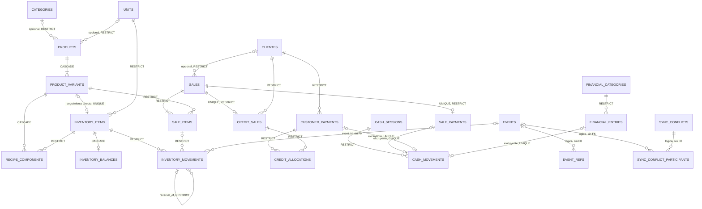
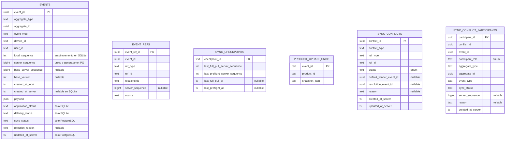
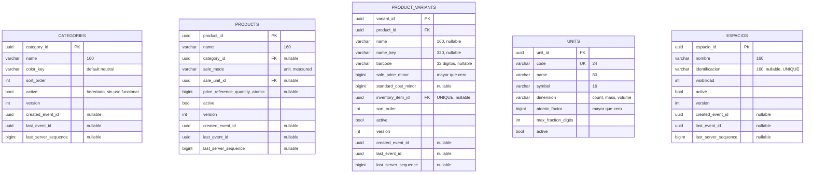
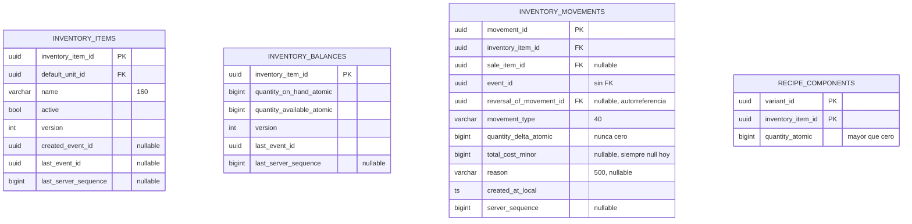
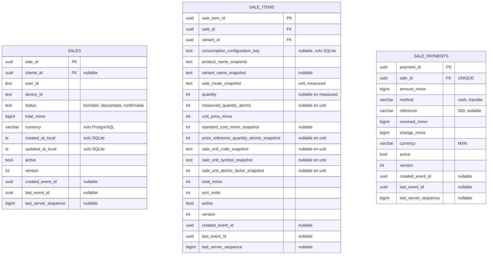
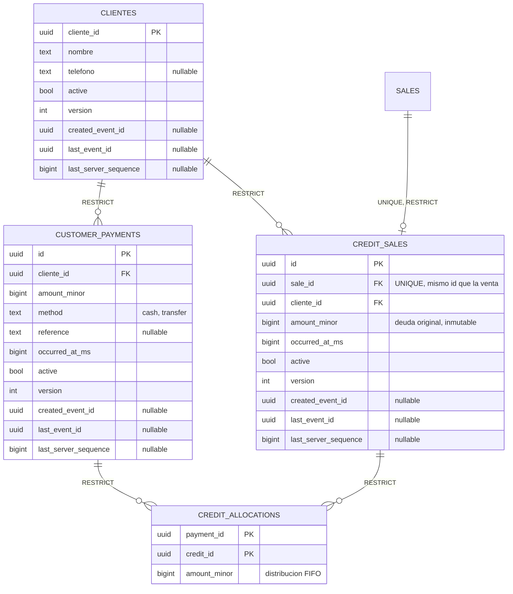
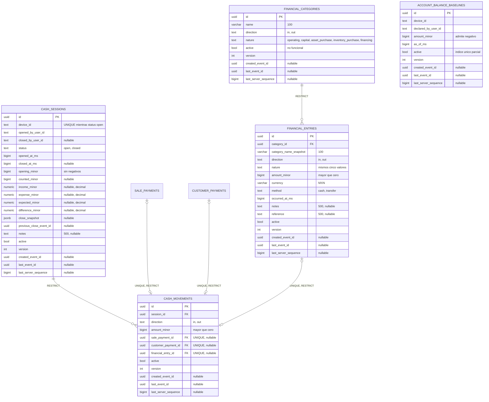

# Diagrama ER actual

Este diagrama describe el esquema que existe hoy en el codigo, no el modelo
propuesto. Se reconstruyo leyendo las definiciones reales:

```text
SQLite local:
  pos_flutter/lib/data/local/drift/tables/*.dart
  pos_flutter/lib/data/local/drift/app_database.dart   (schemaVersion = 8)

PostgreSQL central:
  pos-nest/src/entities/*.ts
  pos-nest/src/migrations/*.ts
```

Si este diagrama contradice a [[05 - Datos/Modelo de tablas|Modelo de tablas]] o a
[[05 - Datos/Catalogo e inventario|Catalogo e inventario]], prevalece este
documento y hay que actualizar aquellos.

## Inventario de tablas

| Ambito | Tablas | Cantidad |
|---|---|---:|
| Nucleo compartido | clientes, categories, products, product_variants, recipe_components, espacios, events, event_refs, units, inventory_items, inventory_balances, inventory_movements, sales, sale_items, sale_payments, credit_sales, customer_payments, credit_allocations, financial_categories, financial_entries, cash_sessions, cash_movements, account_balance_baselines | 23 |
| Solo SQLite local | sync_checkpoints, product_update_undo | 2 |
| Solo PostgreSQL | sync_conflicts, sync_conflict_participants | 2 |
| Total | | 27 |

## Diagrama general

Relaciones derivadas de las llaves foraneas reales. Las lineas marcadas como
logica no tienen FK en la base.



`ESPACIOS`, `UNITS`, `ACCOUNT_BALANCE_BASELINES`, `SYNC_CHECKPOINTS` y
`PRODUCT_UPDATE_UNDO` son agregados independientes: no tienen FK de salida hacia
otra tabla de negocio. Los identificadores de usuario, dispositivo y rol viajan
como texto dentro de `events`, `sales` y `cash_sessions`; no existen tablas
`users`, `roles` ni `devices`.

`events.aggregate_id` es una referencia polimorfica y por eso no se dibuja como
relacion: apunta al agregado afectado segun `aggregate_type`, y ninguna FK puede
expresarlo. Lo mismo aplica a `event_refs.ref_id`, `sync_conflicts.ref_id` y
`cash_sessions.device_id`.

## Nucleo de eventos



`EVENT_REFS`, `PRODUCT_UPDATE_UNDO` y `SYNC_CONFLICT_PARTICIPANTS` no declaran FK
hacia `events`: son referencias de auditoria y preflight, no integridad.

## Catalogo



`UNITS` es dato de referencia compartido, no proyeccion de evento: por eso no
hereda `active`, `version` ni trazabilidad. No existe columna `sku`; el
identificador de negocio de la variante es `barcode`.

## Inventario



`INVENTORY_BALANCES`, `INVENTORY_MOVEMENTS` y `RECIPE_COMPONENTS` no heredan los
campos comunes: el saldo usa la PK del recurso, y el movimiento y la receta son
hijos sin ciclo de vida propio.

Tipos de movimiento reales:

```text
initial_balance     delta positivo
stock_receipt       delta positivo
manual_adjustment   delta con signo, exige reason
reversal            exige reversal_of_movement_id
sale_consumption    delta negativo, exige sale_item_id
```

## Ventas



En PostgreSQL, `sale_items` no repite las once columnas de snapshot: las
contiene en una sola columna `snapshot jsonb`, cuyo tipo es la linea de venta
confirmada (`ConfirmedSaleLine`). SQLite si las materializa para consultarlas
sin parsear JSON.

## Credito de clientes



`CREDIT_ALLOCATIONS` es una proyeccion reconstruible: no tiene `active`, `version`
ni trazabilidad, y su identidad es el par abono, credito.

## Caja y finanzas



`CASH_MOVEMENTS` exige exactamente un origen: la restriccion cuenta los tres
origenes no nulos y exige el resultado `= 1`. Los totales de sesion
(`income_minor`, `expense_minor`, `expected_minor`, `difference_minor`) son
`numeric` y no `bigint` para evitar overflow acumulado.

`ACCOUNT_BALANCE_BASELINES` es el unico agregado que admite `amount_minor`
negativo: una cuenta puede estar sobregirada y recortarla a cero corromperia el
estimado en silencio.

## Diferencias entre SQLite local y PostgreSQL central

| Tabla | SQLite local | PostgreSQL central |
|---|---|---|
| `events` | `application_status`, `delivery_status`, `local_sequence` autoincremental, `server_sequence` nullable | `sync_status` enum, `updated_at_server`, `server_sequence` unico generado |
| `events.event_refs` | se persiste solo en `server_sync` | siempre se persiste |
| `sync_checkpoints` | existe | no existe |
| `product_update_undo` | existe | no existe |
| `sync_conflicts` | no existe | existe |
| `sync_conflict_participants` | no existe | existe |
| `sale_items` | once columnas de snapshot | una columna `snapshot jsonb` |
| `sale_items` | `consumption_configuration_key` | no existe |
| `sales` | `created_at_local`, `updated_at_local` | `currency` |
| `sales.status` default | `borrador` | `confirmada` |
| `inventory_movements.event_id` | `text` | `uuid` |
| Proyecciones | sin `created_at_server` ni `updated_at_server` | ambas presentes |
| Tipos de fecha | `datetime` | `timestamptz(3)` |
| Cantidades | `integer` | `bigint` como texto |

Las diferencias son intencionales: SQLite optimiza lecturas rapidas y permite
purgar eventos sin romper las proyecciones, PostgreSQL conserva la integridad
y el historial.

## Divergencias contra el documento Modelo de tablas

Estas diferencias ya existen en el codigo y deben corregirse en el documento
conceptual o explicarse como decision.

| Documento dice | El codigo tiene |
|---|---|
| Tabla `payments` | `sale_payments`, con una unica fila por venta |
| `sale_payments.amount` decimal | `amount_minor` entero, mas `received_minor` y `change_minor` |
| `sales.subtotal_minor`, `discount_total_minor`, `tax_total_minor`, `table_name`, `opened_at`, `closed_at`, `canceled_at` | no existen; solo `total_minor` y fechas locales |
| `sale_items.status`, `notes`, `canceled_event_id` | no existen; la baja logica es `active` |
| `product_variants.sku` | no existe; el identificador es `barcode` |
| `product_variants.is_default` | eliminado por migracion |
| Tablas `kitchen_tickets` y `kitchen_ticket_items` | no existen en ningun motor |
| Tablas `users`, `roles`, `devices`, `settings` | no existen |
| `ESPACIOS` hospeda ventas | no hay columna `espacio_id` en `sales`; el vinculo es logico |
| `sync_checkpoints.device_id`, `last_pushed_local_sequence`, `last_push_at`, `updated_at` | no existen; solo los dos cursores de pull y preflight |
| `SYNC_CONFLICTS` con `aggregate_type`, `aggregate_id`, `field_name`, `resolved_at` | solo `conflict_type`, `ref_type`, `ref_id`, `status` y los dos eventos |
| `SYNC_CONFLICT_PARTICIPANTS` con `device_id`, `user_id`, `payload_snapshot`, `joined_at` | solo rol, agregado, tipo, `sync_status`, `server_sequence` y `reason` |
| `SYNC_CONFLICTS` y participantes con FK hacia `events` | son `uuid` sin FK |
| Recetas y credito de clientes | no figuraban; ya estan implementados |
| `inventory_movements` sin `sale_consumption` | el tipo `sale_consumption` existe y tiene indice unico |

## Enlaces

- [[05 - Datos/Modelo de tablas|Modelo de tablas]]
- [[05 - Datos/Catalogo e inventario|Catalogo e inventario]]
- [[05 - Datos/Tablas de lectura|Tablas de lectura]]
- [[05 - Datos/Eventos|Eventos]]
- [[05 - Datos/Trazabilidad entre proyecciones y eventos|Trazabilidad entre proyecciones y eventos]]
