# Modelo de tablas

Modelo inicial para SQLite local y base central. No todas las columnas finales estan cerradas.

El modelo debe soportar dos modos:

- `standalone`: SQLite local como fuente operativa principal, con eventos para auditoria y respaldos.
- `server_sync`: SQLite local mas base central PostgreSQL con eventos aceptados
  y `server_sequence`.

Las tablas de negocio y eventos son parte del core compartido. Las tablas
estrictamente relacionadas con sincronizacion remota pueden no usarse en
`standalone`.

## Estado del catalogo

El esquema de `categories` esta concluido para el alcance actual. Incluye
`color_key` y hereda `active` como campo comun, aunque no lo usa para filtrar ni
exponer un ciclo de vida funcional.

Productos y variantes siguen el contrato de
[[03 - Dominio/Modulos/Articulos|Modulo Articulos]]. Una variante puede
referenciar un recurso directo mediante `inventory_item_id`; el recurso, saldo
y movimientos siguen perteneciendo al agregado Inventario. El diagrama
normativo con el detalle de ambos agregados vive en
[[05 - Datos/Catalogo e inventario|Catálogo e inventario]].

Las escalas y conversiones de cantidades siguen
[[02 - Decisiones/ADR-0012 Cantidades atomicas y unidades por dimension|ADR-0012]]:
los decimales existen solo durante la captura y toda cantidad canonica se
persiste como entero atomico.

Por ahora cada base operativa representa un unico catalogo. SKU y codigo se
validan como unicos dentro de esa base.

```mermaid
erDiagram
    DEVICES ||--o{ EVENTS : generates
    USERS ||--o{ EVENTS : performs
    DEVICES ||--o{ SYNC_CHECKPOINTS : has
    EVENTS ||--o{ EVENT_REFS : indexes
    EVENTS ||--o{ SYNC_CONFLICT_PARTICIPANTS : participates
    EVENTS ||--o{ SYNC_CONFLICTS : may_win
    SYNC_CONFLICTS ||--o{ SYNC_CONFLICT_PARTICIPANTS : groups

    CATEGORIES o|--o{ PRODUCTS : "optionally groups"
    PRODUCTS ||--|{ PRODUCT_VARIANTS : offers
    PRODUCT_VARIANTS o|--o| INVENTORY_ITEMS : "tracks directly"
    UNITS ||--o{ INVENTORY_ITEMS : "defines default capture unit"
    UNITS o|--o{ PRODUCTS : "defines sale measure"
    INVENTORY_ITEMS ||--o| INVENTORY_BALANCES : summarizes
    PRODUCT_VARIANTS ||--o{ SALE_ITEMS : sold_as
    INVENTORY_ITEMS ||--o{ INVENTORY_MOVEMENTS : affects
    SALE_ITEMS o|--o{ INVENTORY_MOVEMENTS : produces
    EVENTS ||--o{ INVENTORY_MOVEMENTS : originates
    ROLES ||--o{ USERS : grants

    SALES ||--|{ SALE_ITEMS : contains
    SALES ||--o{ PAYMENTS : receives
    SALES ||--o{ KITCHEN_TICKETS : sends
    CASH_SESSIONS ||--o{ CASH_MOVEMENTS : contains
    ESPACIOS ||--o{ SALES : hosts

    KITCHEN_TICKETS ||--o{ KITCHEN_TICKET_ITEMS : contains
    SALE_ITEMS ||--o{ KITCHEN_TICKET_ITEMS : references

    DEVICES {
        string device_id PK
        string name
        string device_type
        datetime registered_at
        datetime last_seen_at
        string status
    }

    ESPACIOS {
        string id PK
        string nombre
        string identificacion
        integer visibilidad
        boolean active
        integer version
        string created_event_id FK
        string last_event_id FK
        integer last_server_sequence
    }

    USERS {
        string user_id PK
        string name
        string role_id FK
        string pin_hash
        boolean active
        integer version
        string created_event_id FK
        string last_event_id FK
        integer last_server_sequence
    }

    ROLES {
        string role_id PK
        string name
        json permissions
        boolean active
        integer version
        string created_event_id FK
        string last_event_id FK
        integer last_server_sequence
    }

    EVENTS {
        string event_id PK
        string aggregate_type
        string aggregate_id
        string event_type
        string device_id FK
        string user_id FK
        integer local_sequence
        integer server_sequence
        integer base_server_sequence
        integer base_version
        datetime created_at_local
        datetime created_at_server
        json payload
        string application_status "local: applied, failed"
        string delivery_status "local: not_required, pending, delivered, rejected, conflict"
        string sync_status "server: pending, synced, rejected, conflict"
        string rejection_reason "nullable"
    }

    EVENT_REFS {
        string event_ref_id PK
        string event_id FK
        string ref_type
        string ref_id
        string relationship
        integer server_sequence
        string source
    }

    SYNC_CHECKPOINTS {
        string checkpoint_id PK
        string device_id FK
        integer last_full_pull_server_sequence
        integer last_preflight_server_sequence
        integer last_pushed_local_sequence
        datetime last_full_pull_at
        datetime last_preflight_at
        datetime last_push_at
        datetime updated_at
    }

    SYNC_CONFLICTS {
        string conflict_id PK
        string conflict_type
        string ref_type
        string ref_id
        string aggregate_type
        string aggregate_id
        string field_name
        string default_winner_event_id FK
        string resolution_event_id FK
        string reason
        string status
        datetime created_at
        datetime updated_at
        datetime resolved_at
    }

    SYNC_CONFLICT_PARTICIPANTS {
        string conflict_participant_id PK
        string conflict_id FK
        string event_id FK
        string aggregate_type
        string aggregate_id
        string role
        string device_id
        string user_id
        integer server_sequence
        datetime created_at_local
        datetime created_at_server
        json payload_snapshot
        datetime joined_at
    }

    CATEGORIES {
        string category_id PK
        string name
        string color_key
        integer sort_order "required, consecutive from zero"
        boolean active "inherited, unused"
        integer version
        string created_event_id FK
        string last_event_id FK
        integer last_server_sequence
    }

    PRODUCTS {
        string product_id PK
        string category_id FK "nullable"
        string name
        string sale_mode "unit, measured; default unit"
        string sale_unit_id FK "nullable; required for measured"
        integer price_reference_quantity_atomic "nullable; required for measured"
        boolean active
        integer version
        string created_event_id FK
        string last_event_id FK
        integer last_server_sequence
        datetime updated_at_server
    }

    PRODUCT_VARIANTS {
        string variant_id PK
        string product_id FK
        string name "nullable for sole simple variant"
        string name_key "nullable"
        string sku UK "nullable"
        string barcode UK "nullable"
        integer sale_price_minor
        integer standard_cost_minor "nullable"
        string inventory_item_id FK, UK "nullable; direct tracking"
        boolean is_default
        integer sort_order
        boolean active
        integer version
        string created_event_id FK
        string last_event_id FK
        integer last_server_sequence
    }

    UNITS {
        string unit_id PK
        string code UK
        string name
        string symbol
        string dimension
        integer atomic_factor
        integer max_fraction_digits
        boolean active
    }

    INVENTORY_ITEMS {
        string inventory_item_id PK
        string default_unit_id FK
        string name
        boolean active
        integer version
        string created_event_id FK
        string last_event_id FK
        integer last_server_sequence
    }

    INVENTORY_BALANCES {
        string inventory_item_id PK, FK
        integer quantity_on_hand_atomic
        integer quantity_available_atomic
        string last_event_id FK
        integer last_server_sequence
    }

    SALES {
        string sale_id PK
        string user_id FK
        string device_id FK
        string table_name
        string customer_name
        string status
        integer subtotal_minor
        integer discount_total_minor
        integer tax_total_minor
        integer total_minor
        integer version
        string created_event_id FK
        string last_event_id FK
        integer last_server_sequence
        datetime opened_at
        datetime closed_at
        datetime canceled_at
    }

    SALE_ITEMS {
        string sale_item_id PK
        string sale_id FK
        string variant_id FK
        string product_name_snapshot
        string variant_name_snapshot
        string sale_mode_snapshot "unit, measured"
        integer quantity "nullable for measured"
        integer measured_quantity_atomic "nullable for unit"
        integer unit_price_minor
        integer standard_cost_minor_snapshot "nullable"
        integer price_reference_quantity_atomic_snapshot "nullable for unit"
        string sale_unit_code_snapshot "nullable for unit"
        string sale_unit_symbol_snapshot "nullable for unit"
        integer sale_unit_atomic_factor_snapshot "nullable for unit"
        integer total_minor
        string status
        string notes
        integer version
        string created_event_id FK
        string canceled_event_id FK
        string last_event_id FK
        integer last_server_sequence
    }

    PAYMENTS {
        string payment_id PK
        string sale_id FK
        string method
        decimal amount
        string currency
        string reference
        string status
        integer version
        string created_event_id FK
        string canceled_event_id FK
        string last_event_id FK
        integer last_server_sequence
        datetime paid_at
    }

    KITCHEN_TICKETS {
        string kitchen_ticket_id PK
        string sale_id FK
        string area
        string status
        integer version
        string created_event_id FK
        string last_event_id FK
        integer last_server_sequence
        datetime sent_at
        datetime completed_at
    }

    KITCHEN_TICKET_ITEMS {
        string kitchen_ticket_item_id PK
        string kitchen_ticket_id FK
        string sale_item_id FK
        string status
        string notes
        integer version
        string created_event_id FK
        string last_event_id FK
        integer last_server_sequence
    }

    INVENTORY_MOVEMENTS {
        string movement_id PK
        string inventory_item_id FK
        string sale_item_id FK "nullable"
        string event_id FK
        string reversal_of_movement_id FK "nullable"
        string movement_type
        integer quantity_delta_atomic
        integer total_cost_minor "nullable"
        string reason "nullable"
        datetime created_at_local
        integer server_sequence "nullable"
    }

    CASH_SESSIONS {
        string cash_session_id PK
        string device_id FK
        string opened_by_user_id FK
        string status
        decimal opening_amount
        decimal expected_amount
        decimal counted_amount
        integer version
        string created_event_id FK
        string last_event_id FK
        integer last_server_sequence
        datetime opened_at
        datetime closed_at
    }

    CASH_MOVEMENTS {
        string cash_movement_id PK
        string cash_session_id FK
        string movement_type
        decimal amount
        string reason
        string event_id FK
        integer server_sequence
        datetime created_at
    }

    SETTINGS {
        string settings_id PK
        string scope
        json values
        integer version
        string created_event_id FK
        string last_event_id FK
        integer last_server_sequence
    }
```



## Notas por modo

En modo `standalone`:

- `server_sequence` puede permanecer `null`.
- `created_at_server` puede permanecer `null`.
- `last_server_sequence` puede permanecer `null` o `0`.
- Los eventos usan `application_status = applied` y
  `delivery_status = not_required` cuando la aplicacion local concluye.
- `sync_checkpoints` puede no usarse.
- `event_refs` permanece vacia durante la operacion normal; las referencias se declaran y validan en memoria, pero no se persisten.
- La retencion de eventos debe cuidar auditoria y respaldos, no solo sincronizacion.

En modo `server_sync`:

- `server_sequence` es el cursor oficial.
- `sync_checkpoints` controla pull/preflight.
- `event_refs` permite prevalidacion y conflictos.
- SQLite usa `application_status` y `delivery_status`; PostgreSQL conserva
  `sync_status` como estado oficial del evento recibido.
- Los estados `rejected` y `conflict` requieren explicacion visible para el usuario.

## Configuracion local sugerida

Debe existir una forma persistente de conocer el modo instalado. Puede ser archivo de configuracion, tabla local o `dart-define` materializado al iniciar.

Campos conceptuales:

```text
mode
auth_provider
sync_provider
backup_provider
installation_id
```

No es obligatorio que estos campos vivan en la base de negocio, pero la app debe poder consultarlos antes de registrar dependencias.

## Notas

- `events` es la fuente historica local; en `server_sync` tambien es la fuente historica de sincronizacion.
- `units.atomic_factor` es entero. No se usa `conversion_to_base` decimal ni
  `double` para cantidades canonicas.
- El catalogo inicial usa gramo, mililitro y pieza como atomos de masa, volumen
  y conteo. Kilogramo y litro tienen factor `1000` y permiten hasta tres
  decimales de captura.
- `inventory_items.default_unit_id` elige presentacion y captura; balances y
  movimientos guardan atomos de su dimension.
- `product_variants.inventory_item_id` es nullable y único. `NULL` desactiva el
  seguimiento; un valor enlaza el balance del recurso sin duplicar stock en la
  tabla de variantes.
- `inventory_balances` se consulta para la existencia actual. La suma de
  `inventory_movements` se usa solo para auditoría o reconstrucción.
- Codigo, dimension, factor y precision de una unidad referenciada son
  inmutables. `active = false` bloquea nuevas configuraciones, no historicos.
- En PostgreSQL, `events.sync_status` puede ser `pending`, `synced`, `rejected`
  o `conflict`.
- En SQLite, `events.application_status` separa el resultado de aplicacion local
  y `events.delivery_status` separa la entrega remota. En `standalone`, este
  ultimo usa `not_required`.
- `events.rejection_reason` guarda el motivo de rechazo o conflicto cuando aplique.
- Las demas tablas son estado actual o proyecciones.
- `server_sequence` no debe depender de la hora del dispositivo.
- `updated_at` no debe usarse como cursor principal de sincronizacion.
- Las tablas de lectura deben guardar el evento que las creo o modifico por ultima vez.
- En dispositivos moviles, las columnas `*_event_id` pueden conservarse sin FK estricta hacia `events` para permitir purga local de eventos sincronizados.
- Las entidades mutables deben guardar `version` para detectar ediciones concurrentes.
- `event_refs` permite prevalidar pendientes y agrupar conflictos sin buscar dentro del JSON de cada evento.
- Los eventos `conflict` tambien deben conservar sus `event_refs` en servidor para saber con que clave, campo, regla o agregado chocaron.
- `sync_conflicts` representa el caso administrativo de conflicto; no reemplaza a `events`.
- `sync_conflict_participants` permite que un evento o registro participe en mas de un conflicto. Debe existir una restriccion unica por `(conflict_id, event_id)`, pero no por `event_id` ni por `aggregate_id`.
- `last_preflight_server_sequence` no reemplaza a `last_full_pull_server_sequence`; solo sirve como diagnostico o control del preflight.
- `last_full_pull_server_sequence` es el cursor global usado por `/sync/pull`.

## Especificaciones modulares relacionadas

- [[03 - Dominio/Modulos/Articulos|Modulo Articulos]]
- [[03 - Dominio/Modulos/Unidades y cantidades|Unidades y cantidades]]
- [[03 - Dominio/Modulos/Categorias|Modulo Categorias]]
